## Before you start

Sound Lab is on `main`. Each module below walks through making one simple thing, with screenshots taken from the editor.

1. Get the latest: `git pull` on `main` in your `godot-audio-kit` folder.
2. Build the native core, so instruments, loops, songs and voices play live: `cd native` then `scons` (about a minute the first time). The SFX page works without it; the Synth, Loops, Sequencer and Pseudo-Speech pages fall back to slower baked playback.
3. Open the project in Godot 4.5 or later. The screenshots are from 4.5, except tutorials 6 and 7, which are from 4.7 on a Mac. The Audio Kit plugin is already enabled (**Project → Project Settings → Plugins** if not).
4. Click **Sound Lab** in the bar at the top of the editor, beside 2D, 3D and Script. It has five pages, as tabs: **SFX**, **Synth**, **Loops**, **Sequencer** and **Pseudo-Speech**.

Everything Sound Lab makes is an ordinary file in your project, under `res://audio/` unless you choose another folder. Every edit can be undone with **Ctrl+Z** (Cmd+Z on a Mac).

## 1. SFX: make a jump sound

The SFX page makes game sound effects in one click: pick a kind of sound, keep pressing until you like one, nudge it, then save it into your project. In this tutorial you make a jump sound for a player character and play it from a scene, in about five minutes.

### The page at a glance

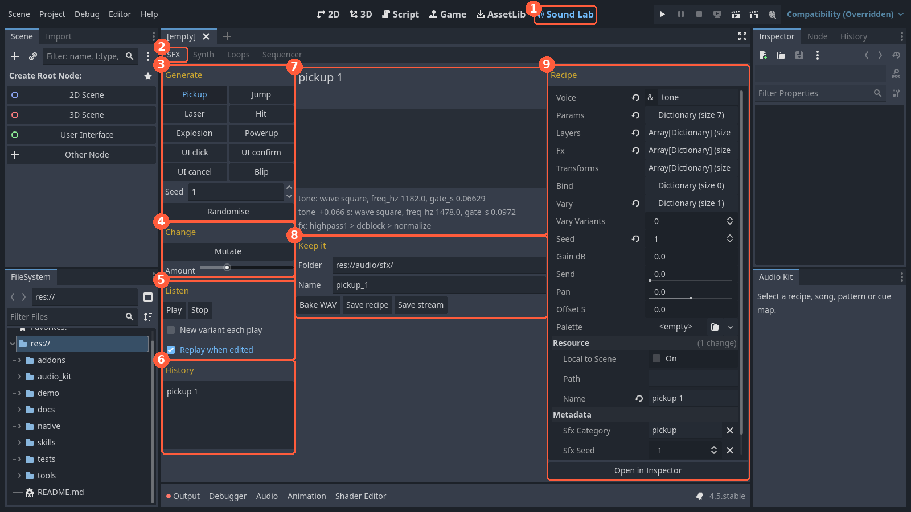

1. **Sound Lab** opens the lab.
2. **SFX** is the first of the five pages.
3. **Generate**: one button per kind of sound, plus **Seed** and **Randomise**.
4. **Change**: **Mutate** makes a close variation of the current sound; **Amount** sets how close.
5. **Listen**: **Play** and **Stop**. **Replay when edited** plays the sound again after every change.
6. **History**: every sound you've made this session. Click one to go back to it.
7. The current sound: its name, length and loudness, its waveform, and a one-line summary of how it's built.
8. **Keep it**: a folder, a name, and three ways to save.
9. **Recipe**: every setting of the current sound, editable. Sounds in the Audio Kit are recipes: small text files of settings, turned into audio when they play.

### Step 1: generate a jump

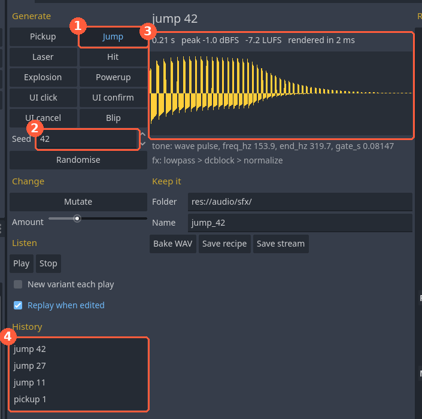

1. Press **Jump** (1). You hear a short rising blip, and its waveform appears (3).
2. Press **Jump** again. Each press picks a new random **Seed** (2) and gives a different jump. Press it a few times until one feels right for your character.
3. Every sound you make is listed under **History** (4), so you can click back to an earlier one at any time.

The seed is the sound's ID: **Jump** with seed 42 is always the same sound, on any computer. Type a seed into the box to get a sound back, or note one down to share it.

The other buttons work the same way: **Pickup** (coins, items), **Laser**, **Hit**, **Explosion**, **Powerup**, **UI click**, **UI confirm**, **UI cancel** and **Blip**. **Randomise** makes something unpredictable from any kind.

### Step 2: fine-tune it with Mutate

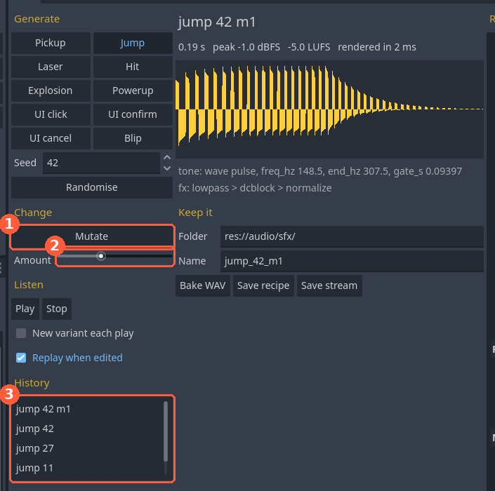

1. Press **Mutate** (1). You get a near neighbour of your sound: a little higher or lower, shorter or longer. Its name gets "m1" added ("jump 42 m1").
2. Press it again to keep wandering, or click the original in **History** (3) to go back.
3. Drag **Amount** (2) left for subtle changes, right for bigger ones.

### Step 3 (optional): edit the settings

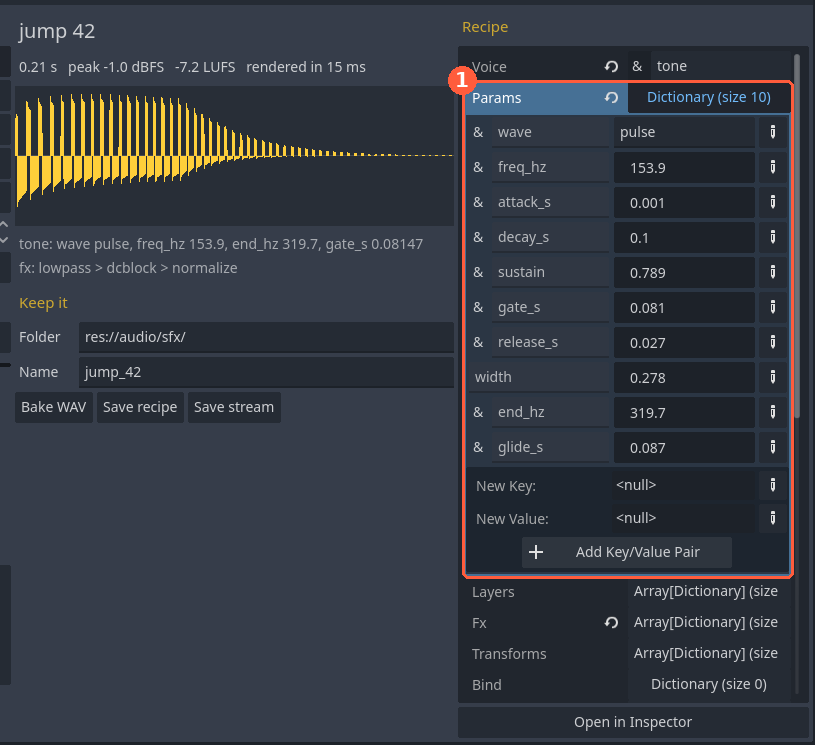

For exact control, click **Params** in the **Recipe** panel to open the sound's settings (1). Click any value, type a new one and press Enter; the sound replays straight away. For a jump, the useful ones are:

- `freq_hz` and `end_hz`: the starting and ending pitch in Hz. A bigger gap between them makes a bigger swoop.
- `glide_s`: how long the swoop takes, in seconds.
- `gate_s`: how long the note is held.
- `wave`: the tone, such as `square`, `pulse`, `triangle` or `sine`. Square and pulse sound retro; sine sounds soft.

The grey summary under the waveform shows the same main values, so you can see what changed. **Ctrl+Z** undoes an edit.

### Step 4: save it into your project

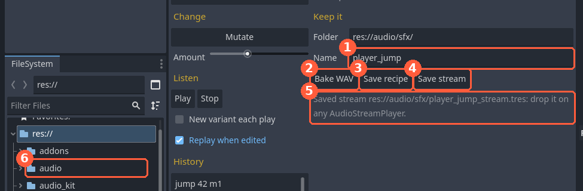

1. Type a name, such as `player_jump`, in **Name** (1). Files go in the **Folder** above it, `res://audio/sfx/` by default.
2. Pick how to save it:
    - **Bake WAV** (2) writes `player_jump.wav`: a normal audio file that plays anywhere, even without the Audio Kit.
    - **Save recipe** (3) writes `player_jump.tres`, the recipe itself, which you can reopen and edit later.
    - **Save stream** (4) writes `player_jump_stream.tres`, a sound that plays in any audio player and comes out slightly different each time, so a jump heard 50 times doesn't sound robotic.
3. The message under the buttons (5) confirms where the file went, and it appears under `audio` in the **FileSystem** panel (6).

For a jump, use **Save stream**: the small changes on each play help a sound you hear often.

### Step 5: play it in your game

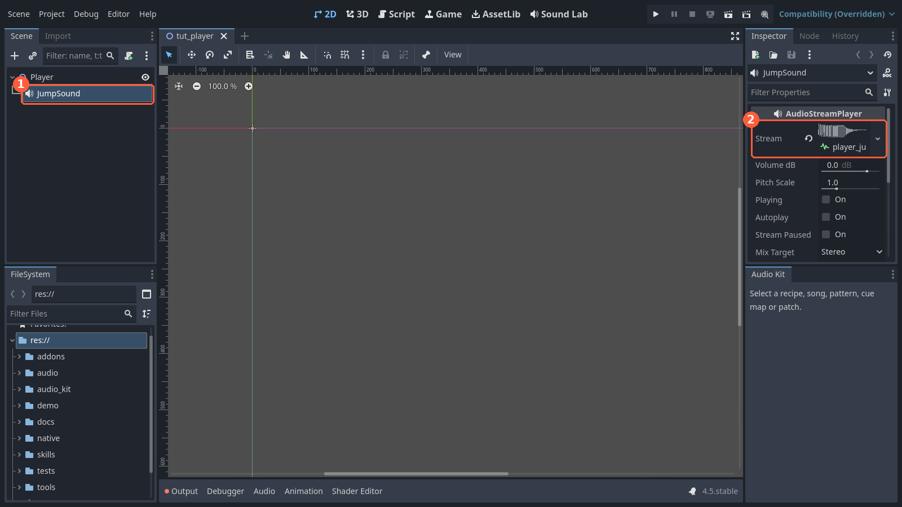

1. Open your player scene and add an **AudioStreamPlayer** child node. Name it `JumpSound` (1).
2. Drag `player_jump_stream.tres` (or the `.wav`) from **FileSystem** onto the **Stream** box in the Inspector (2).
3. Play it from your player script when the character jumps:

```gdscript
if Input.is_action_just_pressed("ui_accept") and is_on_floor():
    velocity.y = JUMP_VELOCITY
    $JumpSound.play()
```

For a sound that should come from the character's position on screen, use **AudioStreamPlayer2D** (or 3D) instead; it takes the same files.

### Tips

- **New variant each play** (under **Listen**) previews the small changes a saved stream makes, so you can hear the range before saving.
- To make the same sound from code: `AKSfxGen.generate(&"jump", 42)`.
- The **Audio Kit** panel under the Inspector plays any saved recipe or stream you select in **FileSystem**, so you can audition your sounds without opening the lab.

## 2. Synth: build a plucky bass

The Synth page builds instruments (patches) you play from a keyboard: the on-screen one, your computer keys, or a MIDI keyboard such as your MPK Mini. In this tutorial you build a punchy bass from a blank patch, set your keyboard's joystick to sweep its tone, and save it for your game, in about fifteen minutes.

Live playing needs the native core (see Before you start). Without it, the panels, saving and the **Render** preview still work.

### The page at a glance

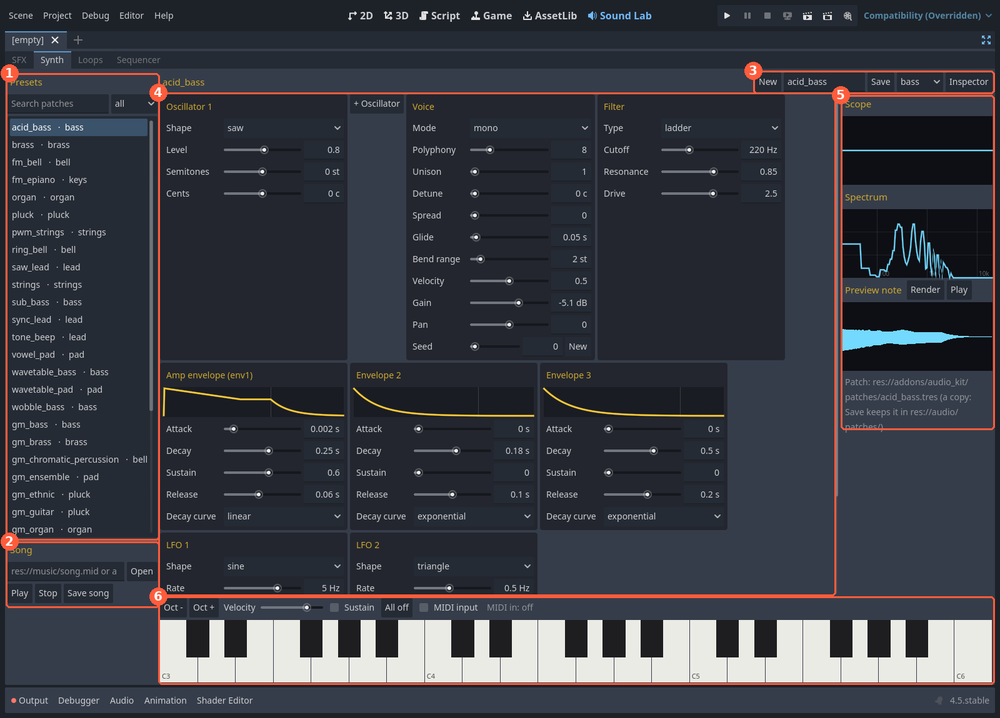

1. **Presets**: every instrument that comes with the kit, the General MIDI bank (the `gm_` ones) and your own saved patches, listed as "yours". Search by name or pick a category. Click one to load it.
2. **Song**: open a `.mid` file or a song and play it with your patches (covered in the MIDI section at the end).
3. The toolbar: **New** (a blank patch), the patch's name, **Save**, its category, and **Inspector**.
4. The panels: every part of the patch. They flow to fit the window, so scroll down for the rest.
5. **Scope** and **Spectrum** show what you're playing. **Preview note** draws one held note, so you can see the shape of the sound.
6. The keyboard and its controls.

A patch is built like a classic synthesizer: **oscillators** make the raw tone, the **filter** shapes how bright it is, **envelopes** shape how it changes over the length of a note, and **effects** add space and colour.

### Step 1: try a few presets

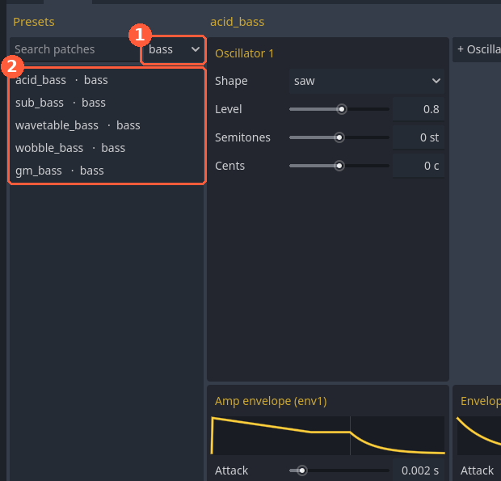

1. Set the category menu to **bass** (1). The list shrinks to the bass presets (2).
2. Click **acid_bass**, then play some low notes: click the on-screen keys, or use your computer keys (the bottom row `Z X C V B N M` plays the white keys from C, and `S D G H J` above it the black keys; the [ and ] keys move an octave).
3. Try **sub_bass** and **wobble_bass** too, to hear how different settings sound.

The presets that come with the kit open as copies, so you can't break them: **Save** always writes your own file.

### Step 2: start from a blank patch and set the oscillators

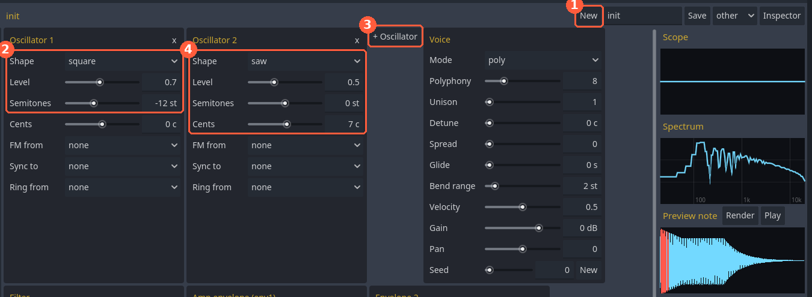

1. Click **New** (1). You get one plain saw wave.
2. In **Oscillator 1** (2), set **Shape** to **square** and **Semitones** to **-12**. That drops it an octave, for weight.
3. Click **+ Oscillator** (3) to add a second one.
4. In **Oscillator 2** (4), set **Shape** to **saw** and **Cents** to **7**. That's a tiny detune against the first, which makes the tone thicker.

To set a value, drag its slider, or click the number, type a value and press Enter. Play a note after each change to hear the difference.

### Step 3: shape the tone with the filter and modulation

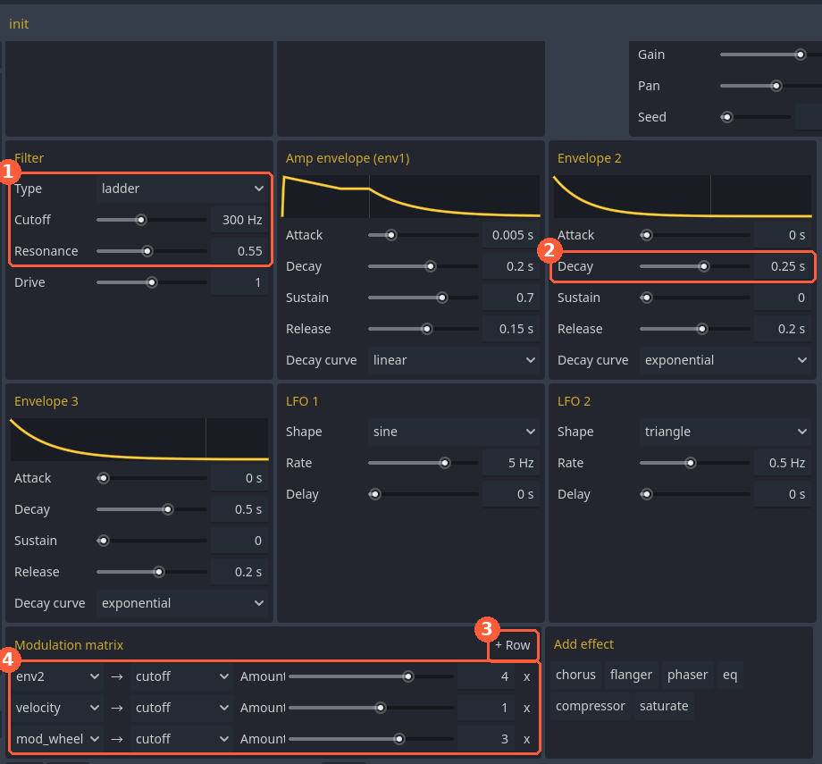

1. In **Filter** (1), set **Type** to **ladder**, **Cutoff** to **300 Hz** and **Resonance** to **0.55**. The bass goes dark and round.
2. In **Envelope 2** (2), set **Decay** to **0.25 s**. On its own this does nothing yet; the next step connects it to the filter.
3. In **Modulation matrix**, click **+ Row** (3) three times. Each row is "source → destination × amount". Set the rows (4) to:

| Source | Destination | Amount | What you hear |
| --- | --- | --- | --- |
| env2 | cutoff | 4 | Each note starts bright and quickly darkens: the "pluck" |
| velocity | cutoff | 1 | Harder key presses sound brighter |
| mod_wheel | cutoff | 3 | The mod wheel (your MPK's joystick, pushed up) opens the filter |

The envelopes draw their shape, so you can see what **Decay** changes.

### Step 4: finish the sound

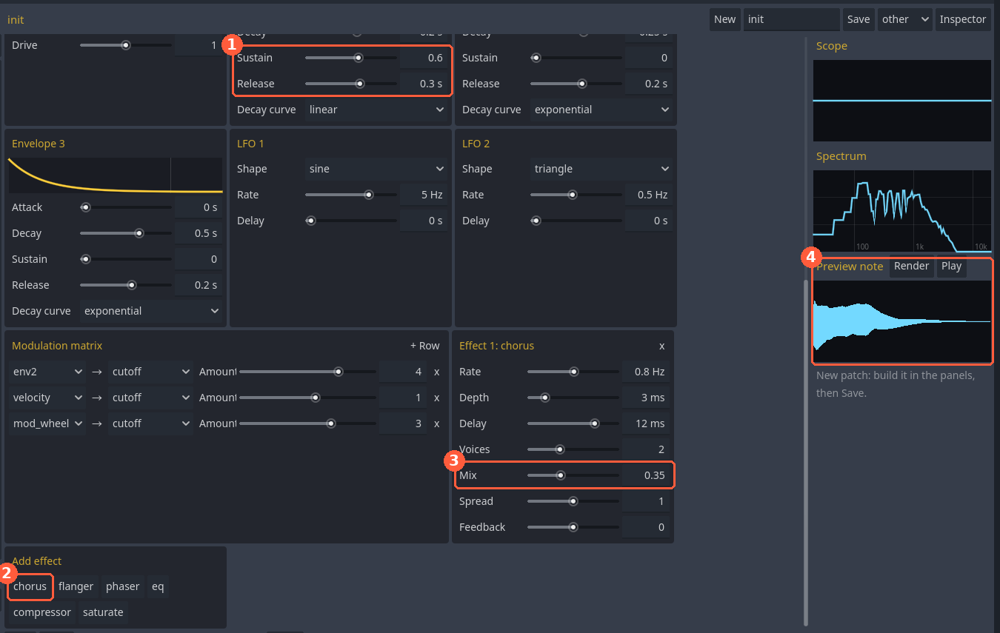

1. In **Amp envelope** (1), set **Sustain** to **0.6** and **Release** to **0.3 s**. Held notes stay present, and notes fade out gently when you let go.
2. Under **Add effect**, click **chorus** (2). An **Effect 1: chorus** panel appears; set its **Mix** to **0.35** (3) for a little width.
3. Check the **Preview note** (4): it redraws after each change, showing the bright start, the body and the fade.

Every change can be undone with **Ctrl+Z**.

### Step 5: play it

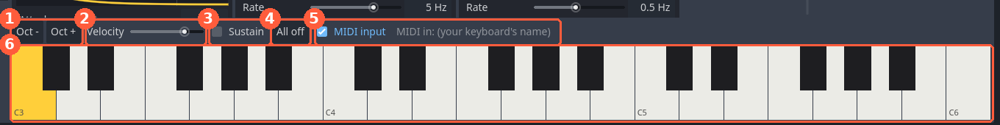

1. **Oct -** and **Oct +** (1) move the on-screen keyboard by an octave.
2. **Velocity** (2) sets how hard computer keys play. With the mouse, clicking lower on a key plays harder.
3. **Sustain** (3) holds notes after you let go, like a piano's pedal.
4. **All off** (4) stops every note, if one gets stuck.
5. Tick **MIDI input** (5) to play from a MIDI keyboard; its name appears beside it (see below).
6. Notes you play light up on the keyboard (6), however you play them.

### Step 6: play it from your MPK Mini

1. Plug in the MPK Mini before opening Godot (Godot only looks for MIDI devices when they're first opened).
2. Tick **MIDI input**. "MIDI in:" should show the keyboard's name. If it says "no devices", untick and tick it again after plugging in.
3. Play. The keys are velocity-sensitive, so playing harder brightens the sound (from the velocity row in Step 3).
4. Push the joystick **up** to open the filter (the mod_wheel row) and move it **left or right** to bend the pitch, two semitones each way.
5. A sustain pedal plugged into the MPK's sustain jack works like the **Sustain** box.

The pads send notes too, so on this page they play low notes of your patch. The full list of what a MIDI keyboard does is in the MIDI section at the end.

### Step 7: save it

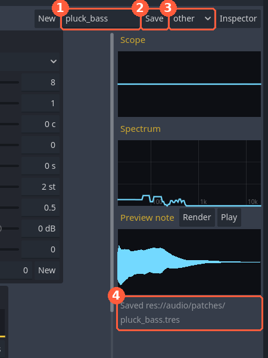

1. Type a name, such as `pluck_bass`, in the name box (1).
2. Set the category menu (3) to **bass**, so it's filed with the basses in **Presets**.
3. Click **Save** (2). The message (4) confirms it was saved to `res://audio/patches/pluck_bass.tres`, and it's listed in **Presets** as "yours".

From now on you're editing your saved file; click **Save** again after more changes.

### Step 8: use it in your game

A patch plays live through an **AudioStreamPlayer**, so you can trigger notes from game code (this needs the native core in the exported game):

```gdscript
var bass := AKSynthStream.new()
bass.patch = load("res://audio/patches/pluck_bass.tres")
$Music.stream = bass
$Music.play()
bass.note_on(36, 0.9)        # C2, fairly hard
bass.note_off(36, 0.5)       # let go half a second later
```

The patch also works as a track's instrument on the Loops page (next tutorial), which is usually the easier way to make music with it.

### Tips

- Use **Save** often while experimenting, with a new name for each version you like.
- To start from something close, load a preset and change it instead of starting from **New**.
- **Inspector** opens the patch in Godot's own inspector, where the Audio Kit panel can play it as single notes, chords or arpeggios.
- **Add effect** also has six effects for stranger sounds: **pitch** (a shifted copy blended in, such as an octave down), **ring** (a ring modulator, metallic), **growl** (a ragged flutter), **crush** (fewer bits, a lo-fi grit), **delay** (echoes) and **reverb** (a room). The character voices in tutorial 7 are built from them.

## 3. Loops: a drum beat and a bass line

The Loops page is where you write music: short loops of notes for one instrument, drawn on a grid that keeps playing while you edit. In this tutorial you write a one-bar drum beat, then a two-bar bass line for the `pluck_bass` patch from the Synth tutorial, and play them together, in about fifteen minutes.

Live looping needs the native core. Without it, **Play** renders the loop and plays that, re-rendering after each edit.

### The page at a glance

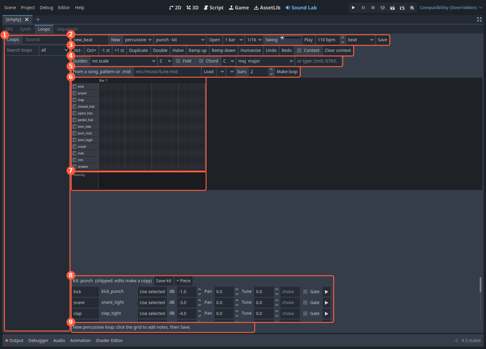

1. **Loops** lists your saved loops; the **Sounds** tab beside it lists drum and instrument samples.
2. The toolbar: name, **New**, the loop's type, its instrument, **Open** (the patch, on the Synth page), **Bars**, the grid size (1/16 = sixteen cells a bar), **Swing**, **Play**, tempo, category and **Save**.
3. Tools: move the view an octave, transpose, copy, double or halve the loop, shape velocities, undo and redo, and **Context** (play other loops along).
4. **Guides**: tint the rows of a scale or a chord, to help you stay in key.
5. Make a loop from part of a song or a `.mid` file.
6. The grid: one row per drum (or per note, for instruments), one column per cell, time running left to right.
7. The velocity strip: how hard each note plays.
8. The kit's drums: sound, level, pan, tuning and more for each.
9. Messages, such as where a file was saved.

There are three types of loop: **synth** (a patch from the Synth page), **sample** (a recorded or library sound played at different pitches) and **percussive** (a drum kit, one row per drum).

### Step 1: write a drum beat

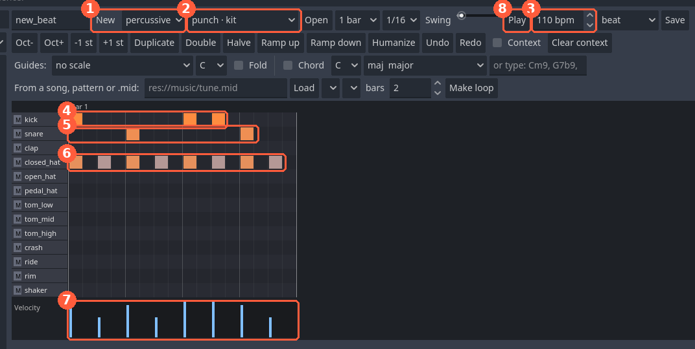

1. Click **New** and choose **percussive** (1). You get an empty one-bar loop on the **punch** kit (2). Any kit from the menu works; try them all later.
2. Set the tempo to **110** (3).
3. Click cells to add hits. Counting the cells 1 to 16 from the left (each group of four is one beat):
    - **kick** (4): cells 1, 9 and 11
    - **snare** (5): cells 5 and 13
    - **closed_hat** (6): every other cell: 1, 3, 5, 7, 9, 11, 13 and 15
4. Click **Play** (8). The beat loops; leave it playing while you work, and every change is heard on the next pass.
5. In the velocity strip (7), drag the bars of the hats on cells 3, 7, 11 and 15 down to about half height. Softer off-beat hats make the beat feel less mechanical.

Clicking a hit again deletes it, and **Ctrl+Z** undoes anything. Click a drum's name to hear it alone, or its **M** to mute that row while you listen.

### Step 2: save the beat

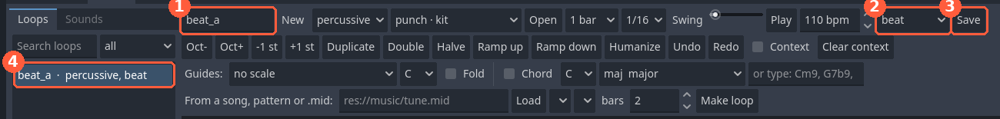

1. Type `beat_a` in the name box (1).
2. The category (2) is already **beat**; categories sort the loop list.
3. Click **Save** (3). The loop is saved to `res://audio/loops/beat_a.tres` and appears in the **Loops** list (4). Click any loop there to open it.

### Step 3: set up a bass loop

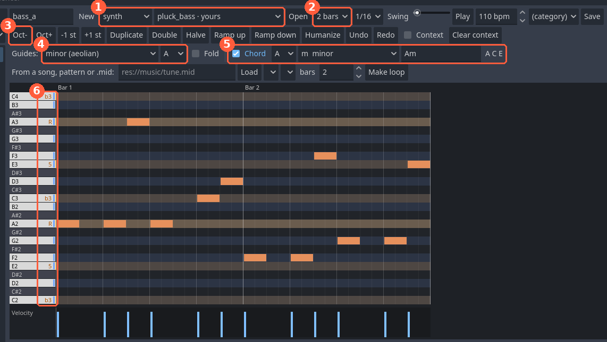

1. Click **New** and choose **synth**, then pick **pluck_bass · yours** from the instrument menu (1). Patches you save on the Synth page are listed as "yours".
2. Set **Bars** to **2** (2).
3. Click **Oct-** (3) once, so the rows run from C2 to C4. The grid is now a piano: each row is a note, black-key rows are darker.
4. Turn on the guides (4): **Scale** → **minor (aeolian)**, root **A**. The notes of A minor get a blue tint and a blue mark by the key.
5. Tick **Chord** (5) and pick **A** and **m minor**. The notes of the A minor chord (A, C, E) get a warm tint, and each one is labelled by its role in the chord (6): R for the root, b3 for the minor third, 5 for the fifth. The guides only change what you see.

### Step 4: draw the bass line

Each note below is two cells long (an eighth note): click the first cell and drag one cell to the right. Cells are counted 1 to 16 in each bar.

| Bar | Cell | Note |
| --- | --- | --- |
| 1 | 1 | A2 |
| 1 | 5 | A2 |
| 1 | 7 | A3 |
| 1 | 9 | A2 |
| 1 | 13 | C3 |
| 1 | 15 | D3 |
| 2 | 1 | F2 |
| 2 | 5 | F2 |
| 2 | 7 | F3 |
| 2 | 9 | G2 |
| 2 | 13 | G2 |
| 2 | 15 | E3 |

The first bar sits on the A minor chord. The second moves through F and G, so when you write it, set the chord guide to **F** major and then **G** major to see their notes. To fix a note, drag it to move it, or drag its right edge to change its length.

The pluck_bass patch plays an octave lower than the notes you write, because Oscillator 1 is set to -12 semitones. That's why A2 sounds deep.

### Step 5: play it with the beat, and save

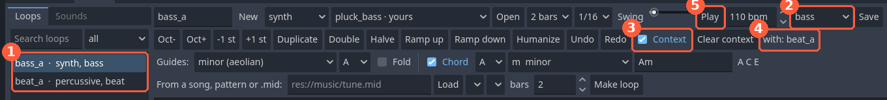

1. Tick **Context** (3), then click **beat_a** in the **Loops** list. "with: beat_a" appears (4).
2. Click **Play** (5). The bass plays over the beat, both looping. Keep editing; you hear changes on the next pass.
3. Name the loop `bass_a`, set the category (2) to **bass**, and click **Save**. Both loops are now in the list (1).

**Clear context** stops the other loops playing along. Context is only for listening: each loop is still saved on its own.

### Tips

- **Swing** (in the toolbar) delays every other 16th note for a shuffle feel; try it on the beat.
- Select notes by right-dragging a box around them, then use the arrow keys to move them, **Ctrl+D** to copy them after themselves, or **Ramp up** and **Humanize** to shape their velocities.
- **Double** makes the loop twice as long with the notes copied, a quick start for a variation in the second half.
- To reuse part of an existing song, type a `.mid` path in the import row (5 in the first picture), click **Load**, pick a part and the number of bars, then **Make loop**.
- In the next tutorial, the Sequencer arranges these loops into a full piece of music.

## 4. Sequencer: arrange your loops into a song

The Sequencer turns loops into a finished piece. It has two ways to arrange the same tracks: **scenes**, sets of loops a game switches between as the action changes, and a **timeline**, a fixed piece that plays start to finish. A **mixer** balances the tracks. In this tutorial you make an intro and a main section from `beat_a` and `bass_a` (the loops from the Loops tutorial), lay them out as a 24-second piece, mix it, export a WAV, and play the scenes from a game, in about fifteen minutes.

### The page at a glance

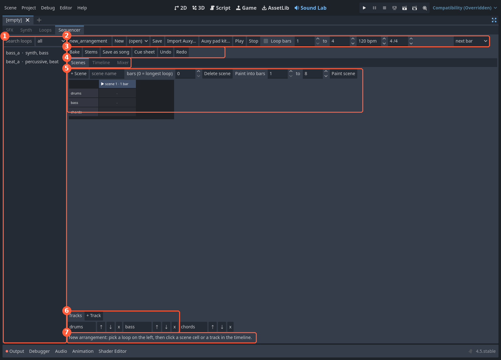

1. Your saved loops. Click one to pick it, then click where it should go.
2. The transport: the arrangement's name, **New**, open a saved one, **Save**, **Play** and **Stop**, **Loop bars**, tempo, time signature, and when scene switches land (**next bar**).
3. Export: **Bake** (a WAV), **Stems** (a WAV per track), **Save as song**, **Cue sheet**, and **Undo** and **Redo**.
4. The three views: **Scenes**, **Timeline** and **Mixer**.
5. The current view: here, the scenes grid, with a column per scene and a row per track.
6. **Tracks**: rename, reorder (↑ ↓) or delete (x) them, or **+ Track** to add one.
7. Messages.

### Step 1: set up the tracks and scenes

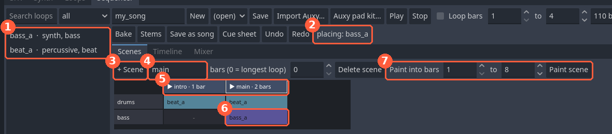

1. Click **New**, type `my_song` as the name, and set the tempo to **110 bpm**, the same as your loops.
2. A new arrangement has three tracks: drums, bass and chords. Click the **x** after **chords** in **Tracks** to delete it; you won't need it here.
3. Click **+ Scene** (3) to add a second scene. To name a scene, right-click its name in the grid to select it, type a name in the scene name box (4) and press Enter. Name them `intro` and `main` (5).
4. Fill the cells. Click **beat_a** in the loop list (1); "placing: beat_a" appears (2). Click the **drums** cell under **intro**, then the **drums** cell under **main**.
5. Click **bass_a** in the list, then the **bass** cell under **main** (6). Leave the bass cell under **intro** empty, so the intro is drums only.

A scene lasts as long as its longest loop ("intro · 1 bar", "main · 2 bars"), and shorter loops repeat to fill it. Right-click a cell to empty it.

### Step 2: switch between scenes

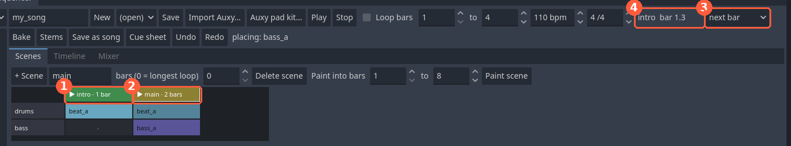

1. Click **intro** at the top of its column. It plays and turns green (1).
2. While it plays, click **main**. It turns yellow (2): it's waiting, and starts on the next bar line so the music never cuts mid-beat.
3. Switch back and forth. The menu at the right of the transport (3) sets when a switch lands: on the **next bar**, the **next beat**, or at the **end of the scene**. The position display (4) shows which section and bar is playing.

This is exactly what a game does: it plays a scene, then asks for another when something happens, such as a boss appearing (Step 6).

### Step 3: lay out a timeline

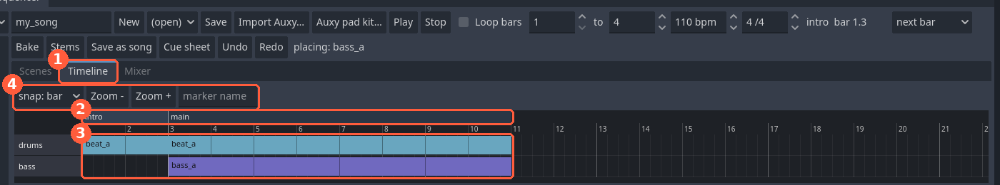

The quickest way to fill the timeline is to paint your scenes into it:

1. In the **Scenes** view, right-click **intro** to select it. Set **Paint into bars** to **1** to **2** (7 in the Step 1 picture) and click **Paint scene**.
2. Select **main** the same way, set the bars to **3** to **10**, and click **Paint scene**.
3. Click **Timeline** (1). The two scenes are now clips on the tracks (3): two bars of drums alone, then eight bars of drums and bass. Thin lines inside a clip show where its loop repeats.
4. Add section names. Click the strip above the bar numbers (2) at bar 1, select the marker, type `intro` in the **marker name** box (4) and press Enter. Add one called `main` at bar 3. A game can jump to these by name.
5. Click **Play**. The timeline plays from the start: about 24 seconds at 110 bpm.

You can also edit clips directly: drag a clip to move it, drag its right edge to repeat the loop more or fewer times, **Alt**-drag to copy it, and press **Delete** to remove the selected clip. Pick a loop and click an empty part of a track to place a new clip. **Zoom -** and **Zoom +** change the scale.

### Step 4: mix it

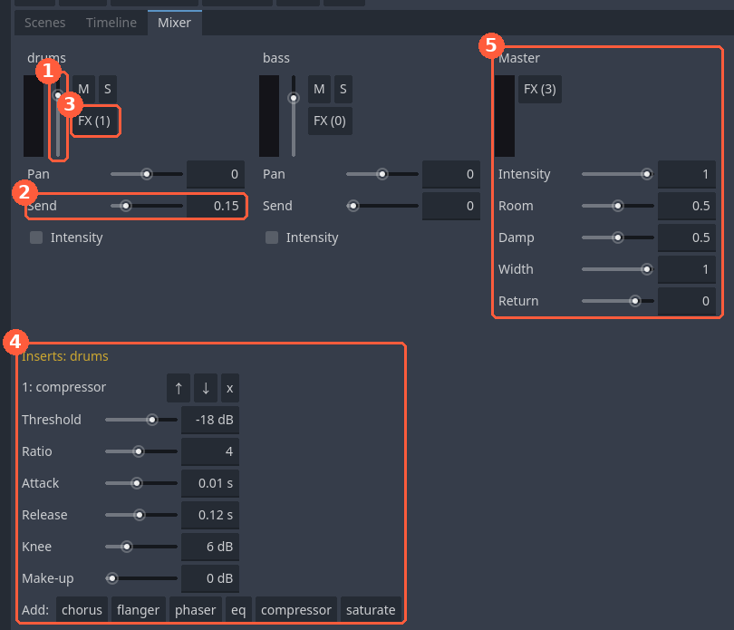

1. Click **Mixer**. Each track has a strip: a level meter, a fader (1), **M** (mute), **S** (solo), **FX**, **Pan** and **Send**.
2. Drag the **bass** fader down a little if the bass is louder than the drums.
3. Set the drums' **Send** to **0.15** (2). Send feeds the shared reverb, so the drums get a little room around them.
4. Click the drums' **FX** button (3), then **compressor** after **Add:** (4). A compressor evens out the loud and soft hits; the default settings are a good start.
5. The **Master** strip (5) controls the whole mix: the shared reverb's **Room**, **Damp**, **Width** and **Return**, and the master effects (**FX (3)**: a DC-blocking filter, a loudness leveller set to -16 LUFS and a limiter, so the final level is consistent).

Mix while the music plays: changes are heard within about a third of a second.

### Step 5: save and export

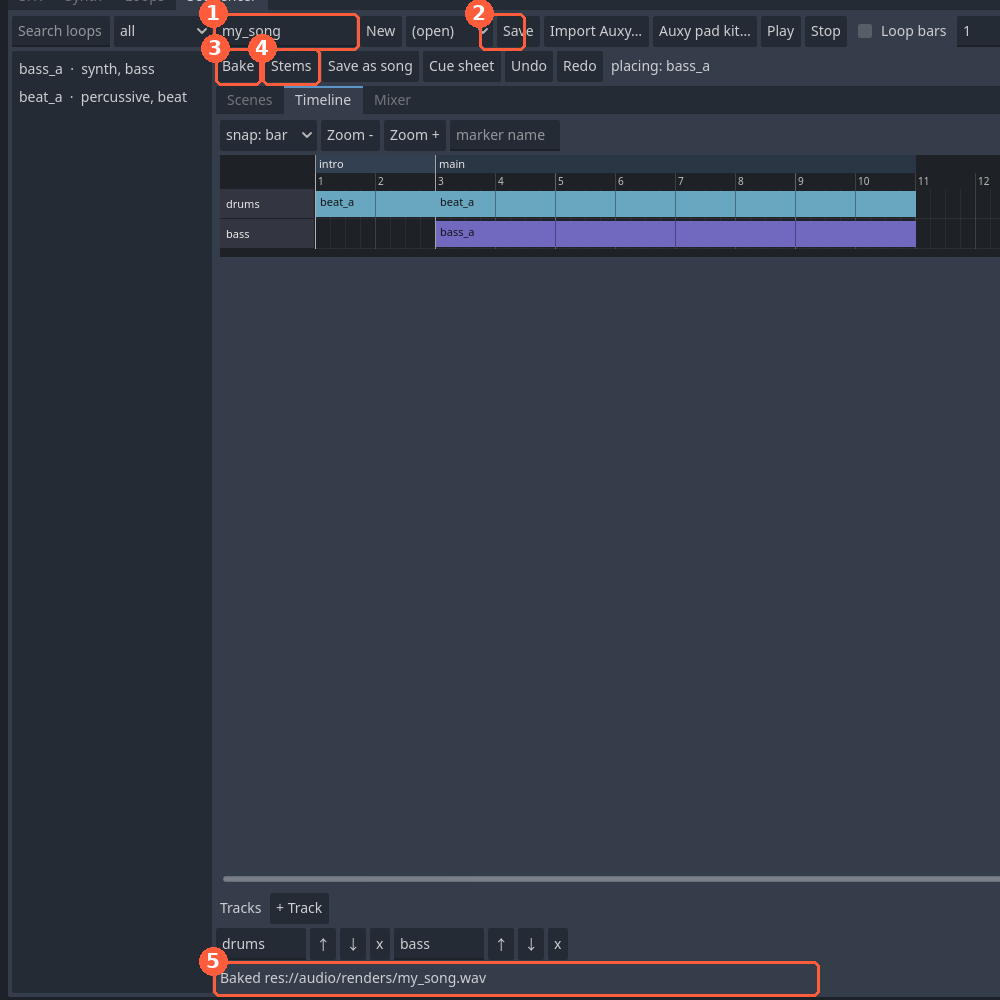

1. Check the name (1) and click **Save** (2). The arrangement is saved to `res://audio/arrangements/my_song.tres`; reopen it later from the menu beside **New**.
2. In the **Timeline** view, click **Bake** (3). The whole timeline is written as `res://audio/renders/my_song.wav` (5): a normal audio file you can play with an **AudioStreamPlayer**, even without the Audio Kit. In the **Scenes** view, **Bake** writes only the selected scene, handy for a loop of background music.
3. **Stems** (4) writes a WAV per track instead, for mixing in another program.

Double-click any clip or scene cell to open its loop in the Loops page, with the rest of the music playing around it, to fix a note in context.

### Step 6: play it in your game

For music that follows the game, play the scenes live with an **AKLivePlayer** node (this needs the native core in your game). Add one to your scene and drag `my_song.tres` onto its **Arrangement** property in the Inspector, then switch scenes from your script:

```gdscript
@onready var music: AKLivePlayer = $Music

func _ready() -> void:
    music.play_scene("intro")

func _on_level_started() -> void:
    music.play_scene("main", &"bar")    # switches on the next bar line
```

Set **Autoplay Scene** in the Inspector to start a scene without any code. For a fixed piece, such as a title screen, the baked WAV on an **AudioStreamPlayer** set to loop is simpler.

`demo/racing/race_demo.tscn` is a worked example: a small race whose countdown, laps and finish switch the music's scenes.

### Tips

- **Loop bars** in the transport plays just a range of bars round and round, for working on one part.
- Any loop can go on any track, since a loop carries its own instrument. Name tracks after their role (drums, bass, lead) to keep things clear.
- In the mixer, **Intensity** on a track fades it in as the game's music intensity rises (`AKLive.set_music_intensity`), for example drums that come in during a fight.

## 5. Recording: play along and record a take

Recording lets you play your MPK along with an arrangement and keep what you played as a **take**: an ordinary loop on the timeline that you can fix up on the Loops grid. In this tutorial you add a keys part to `my_song` (from the Sequencer tutorial), try a few passes round a section, and tidy the result, in about fifteen minutes.

Recording needs the native core and a MIDI keyboard (or the computer keyboard; see Step 6).

### The recording controls

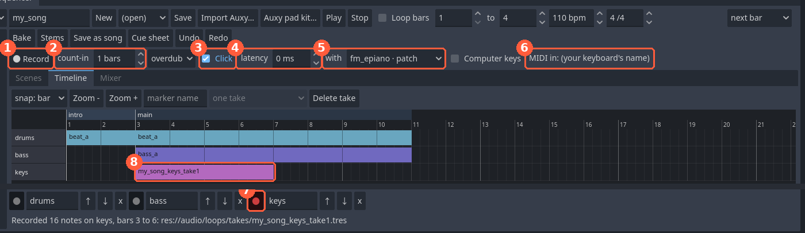

1. **● Record** starts recording; press it again (or **Stop**) to finish.
2. **count-in**: how many bars of clicks you get before the music starts (0 to 4).
3. **Click**: a metronome while you record.
4. **latency**: moves your notes earlier, in milliseconds, if takes come out consistently late.
5. **with**: what you play: the track's own instrument, or any drum kit or patch.
6. **MIDI in**: the keyboard Sound Lab is listening to.
7. The **●** beside a track arms it: that track is the one you play and record on (red when armed).
8. A take: a clip on the armed track, named `<song>_<track>_take<n>`.

### Step 1: set up a track to record on

1. Open `my_song` in the Sequencer (the menu beside **New**) and click **Timeline**.
2. Click **+ Track** and name the new track `keys` (type in its box and press Enter).
3. Click the **●** beside **keys** (7). It turns red: the track is armed, and your MPK now plays it. Play a few notes to hear it.
4. A new track has no loops yet, so it plays the pluck preset. Pick something else under **with** (5): try **fm_epiano · patch**.

Arming also turns on MIDI input. If **MIDI in** (6) says "no devices", plug the MPK in, then click the **●** twice (off and on) to look again.

### Step 2: record a take

1. Click bar **3** in the timeline's bar numbers to move the playhead to the start of **main**.
2. Leave **count-in** at **1 bar** and **Click** on.
3. Click **● Record** (1). You hear four clicks, then the song plays from bar 3 with the click going.
4. Play along: a simple riff over the bass is plenty. Play as long as you like.
5. Click **● Record** again, or **Stop**. The take appears on the keys track (8), from the bar of your first note to the end of the bar of your last.

Every note keeps its velocity, and the sustain pedal (if you have one plugged into the MPK) holds notes exactly as you heard them. **Ctrl+Z** removes the take if you didn't like it. To add more later in the song, move the playhead on and record again: earlier takes stay where they are.

### Step 3: loop a section and build it up

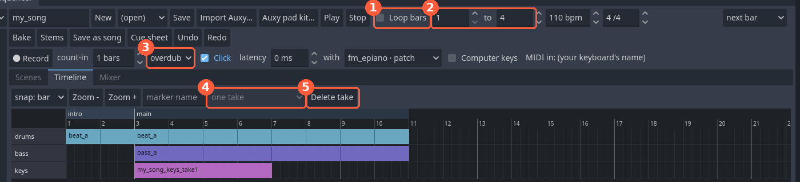

To work on one part, let recording go round it:

1. Tick **Loop bars** (1) and set the range to bars **3** to **4** (2).
2. Pick **overdub** or **replace** (3):
    - **overdub**: every pass is added to the take, and you hear what you played on the passes before. Play the chords one pass, a melody the next.
    - **replace**: each pass you play in replaces the passes before, so you can keep trying until one is right.
3. Click **● Record**, play as many passes as you like, then stop. The take covers exactly bars 3 to 4.

Record over exactly the same bars again and Sound Lab keeps both takes. Click the clip to select it, then use the **take** menu (4) to choose which one plays, or **Delete take** (5) to drop the one playing. The files themselves stay in `res://audio/loops/takes/`.

Untick **Loop bars** afterwards, or **Play** and **● Record** keep going round the range.

### Step 4: tidy the take on the Loops page

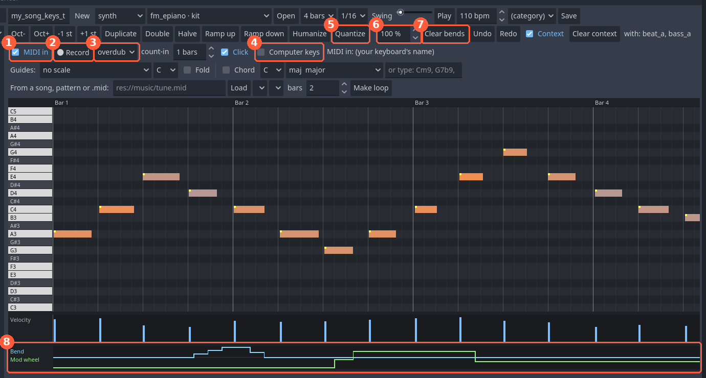

Double-click the take on the timeline: it opens on the Loops page with the rest of the song playing around it. Played notes sit slightly off the grid (a small yellow corner marks each one); that's the feel of your playing, not an error.

1. Select the notes to tidy (right-drag a box), or select none to tidy them all.
2. Set the strength (6): **100%** puts every note exactly on the grid; **50%** moves each one halfway, tightening the timing but keeping some feel.
3. Click **Quantize** (5). **Ctrl+Z** undoes it.
4. Fix any wrong notes by dragging them, as in the Loops tutorial, then **Save**.

On a synth take, the joystick's pitch bend and mod wheel are recorded too. They show in the strip under the velocities (8): **Bend** in blue, **Mod wheel** in green. They play back exactly as you moved them; **Clear bends** (7) removes them.

### Step 5: record straight into a loop

You can also record on the Loops page itself, to build a loop by playing:

1. Open or make a loop, and tick **MIDI in** (1). The keyboard plays the loop's instrument.
2. Pick **overdub** or **replace** (3) and click **● Record** (2). After the count-in, the loop goes round and round, and what you play is added to it (heard on the next pass).
3. Stop when you're happy. The whole recording is one undoable step.

For drums, open a percussive loop and play the pads: they hit the kit's drums by the General MIDI drum map (36 kick, 38 snare, 42 closed hat, 46 open hat, 49 crash), the same as in the Sequencer.

### Step 6: no MIDI keyboard to hand?

Tick **Computer keys** (4 on the Loops page, beside **with** in the Sequencer) and play on the computer keyboard, as on the Synth page: the bottom row `Z X C V B N M` plays the white keys from C3 and `S D G H J` the black keys, the row above plays the next octave, and `[` and `]` move an octave. Computer keys are ignored while you're typing in a box. In the Sequencer they play the armed track.

### Tips

- If every take comes out a little late, raise **latency** by 10 to 20 ms and try again. Godot reads MIDI once a frame, so notes can be up to about 8 ms out before you quantize.
- Turn the count-in up to 2 bars for a slower song, or to 0 to start straight away.
- Takes are ordinary loops, so you can reuse a good riff elsewhere: drag it to another bar, put it in a scene, or **Duplicate** it on the Loops page.

## 6. Pseudo-Speech: give a character a voice

The Pseudo-Speech page turns a line of dialogue into gibberish that follows the text: its rhythm, its stressed syllables and its melody, so a question rises and a shout lands. A word always sounds the same in a voice, so the gibberish reads like a language. In this tutorial you hear a line in a few voices, see why it sounds as it does, steer it with markup, and make a character speak it in a game with subtitles, in about ten minutes.

Every voice works without the native core, but slowly: a line can take 1 to 10 seconds to bake instead of a fraction of a second, and **Live** needs it.

### The page at a glance

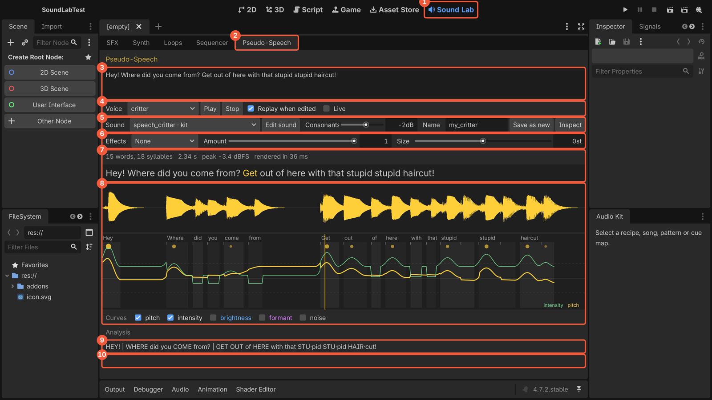

1. **Sound Lab** opens the lab.
2. **Pseudo-Speech** is the fifth page.
3. The line: type any dialogue here.
4. **Voice** picks who speaks; **Play** and **Stop**; **Replay when edited** plays the line again a moment after each change; **Live** plays it the way a game does (Step 4).
5. What the voice is made of: **Sound**, **Edit sound**, **Consonants**, **Name**, **Save** and **Inspect**. These are for making your own voice (next tutorial).
6. **Effects**, **Amount** and **Size**: a character for the voice, such as a demon or a robot (next tutorial).
7. The line's length and level, and the subtitle, which lights each word as it's spoken.
8. The waveform, and under it on the same time axis the curves: each word, its syllables and accents, and the pitch and loudness the voice follows. The checkboxes pick which curves are drawn.
9. **Analysis**: how the text was read.
10. Messages.

### Step 1: hear a line

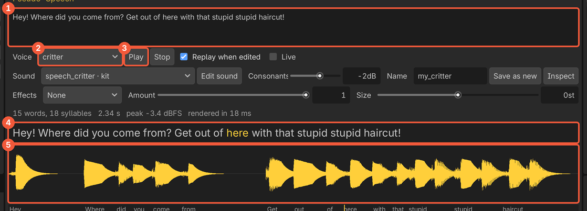

1. The page starts with a test line (1). Leave it for now, or type your own.
2. Set **Voice** (2) to **critter** and click **Play** (3). The subtitle (4) lights each word as you hear it, and the waveform (5) shows the line.
3. Try the other voices: **blip** (a retro text-box beep), **hollow** (a breathy whisper), **drone_priest** (a slow, low chant) and **scratch_king** (record scratches). Each takes the same words and makes them its own.
4. Change a word in the line. With **Replay when edited** ticked, it plays again a moment later.

Run the line through twice and it sounds exactly the same both times: the melody comes from the words, not from chance. Change one word and the others keep their own small melodies.

### Step 2: see why it sounds that way

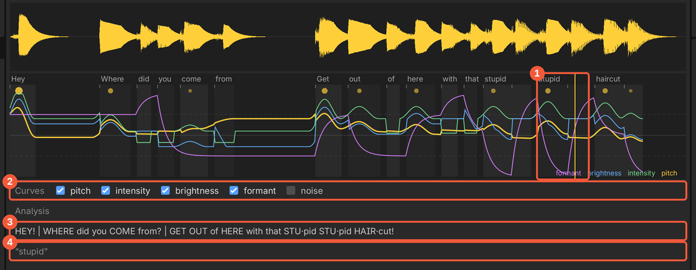

1. **Click a word** in the curves (1) to hear it alone, cut from the line so it keeps its place in the melody. The message line (4) shows which word you heard, and a yellow playhead follows it.
2. The bands are the words, each with its text. A small tick marks each syllable, and a dot marks an accented one: the bigger the dot, the stronger the accent. The second "stupid" gets a bigger dot than the first, because a word repeated in its clause lands harder each time.
3. Tick **brightness** and **formant** (2) to see more of what the voice follows. Pitch is yellow, around the voice's resting note, with its range dashed.
4. **Analysis** (3) shows how the text was read: syllables split with `·`, stressed ones in CAPITALS, each clause with its end mark (`!`, `?` or `.`), which sets its melody: a question rises at the end, an exclamation starts high and falls.

A word marked `(?)` in the analysis is one the kit's stress dictionary doesn't know (usually an invented name), so its stress was guessed. Tips below say how to fix it.

### Step 3: steer it with markup

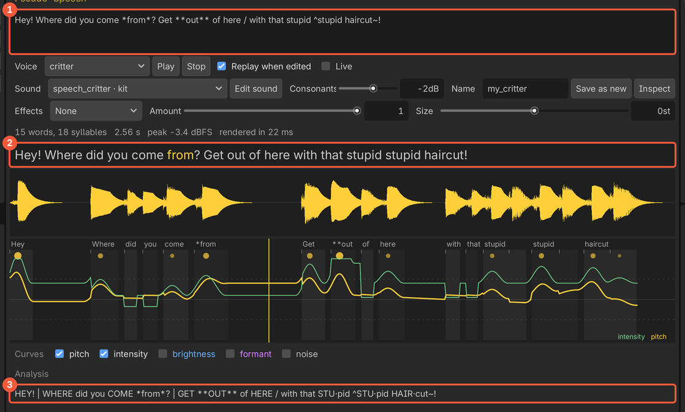

Marks in the text override what the words imply. Replace the line (1) with:

`Hey! Where did you come *from*? Get **out** of here / with that stupid ^stupid haircut~!`

The subtitle (2) shows the line without the marks, and the analysis (3) shows them in place. Each mark:

| Mark | Example | What you hear |
| --- | --- | --- |
| `*word*` | `come *from*` | An accent: higher, louder and brighter |
| `**word**` | `**out**` | The strongest accent, shouted and clipped |
| `/` | `here / with` | A short pause |
| `^word` | `^stupid` | A rise across the word; `_word` falls instead |
| `word~` | `haircut~` | The last syllable held longer; more tildes, longer |
| `{tag}` | `{whisper} come here` | Changes the voice until the next tag: `whisper`, `shout`, `excited`, `sad`, `fast`, `slow`, `high`, `low`; `{normal}` goes back |

A mark can cover several words (`**GET OUT**`). An unclosed mark or an unknown tag still plays; the message line says what's wrong.

### Step 4: play it live

Tick **Live** and click **Play**. The line now plays on the live synth, the way a game's speaker plays it: it starts at once, however long the line is, and the waveform and curves appear just after. Live and baked sound the same.

**Live** needs the native core and a voice made from a patch; **scratch_king** always bakes.

### Step 5: make a character speak in your game

An **AKSpeaker** node says lines in a voice and tells you when each word is heard, for subtitles and mouths. Add one to your character's scene and set its **Voice** to `critter.tres` (in `addons/audio_kit/speech/voices/`) in the Inspector, then:

```gdscript
@onready var speaker: AKSpeaker = $Speaker

func _ready() -> void:
    speaker.word_started.connect(func(index, word): $Subtitle.text = word)
    speaker.line_finished.connect(func(_line): $Subtitle.text = "")

func talk() -> void:
    speaker.say("Hey! Where did you come *from*?")

func _process(_delta: float) -> void:
    $Mouth.scale.y = 0.2 + speaker.mouth()   # open while a syllable sounds
```

The signals follow what you hear, not what was scheduled, so a subtitle or a mouth never runs ahead of the sound. A speaker plays live when the native core is in the game and bakes otherwise. To make it come from the character's place on screen, give its **Player** property an **AudioStreamPlayer2D** (or 3D).

`demo/speech/speech_demo.tscn` is a worked example: type a line, pick a voice, and a face mouths it under a subtitle.

### Tips

- For a word marked `(?)`, such as a character's name, add a line to the **Text** of `res://audio/speech/lexicon.tres`, an **AKSpeechLexicon** resource (make it with **New Resource** if your project has none): `zorblax 10` says ZOR·blax, one stress digit per syllable (1 stressed, 0 not).
- **drone_priest** without the native core takes about 10 seconds to bake the test line, so the page stops replaying it after each edit and says so; press **Play** when you're ready.
- In a cue map, a line is an ordinary recipe of the `speech` voice, with the text and the voice's path as its settings, so motion kit pieces can speak too.

## 7. Make your own voice: a goblin

Every character can have a voice of their own. On the Pseudo-Speech page you start from the kit voice closest to what you want and change what it's made of, how it speaks and its character, then save it as a new voice. In this tutorial you turn **critter** into a gruff, buzzy goblin and give it to a character in your game, in about ten minutes.

The page always edits a copy of the voice you pick, so you can't break the kit's voices: nothing is written until you click **Save**.

### Step 1: start from Critter and change its sound

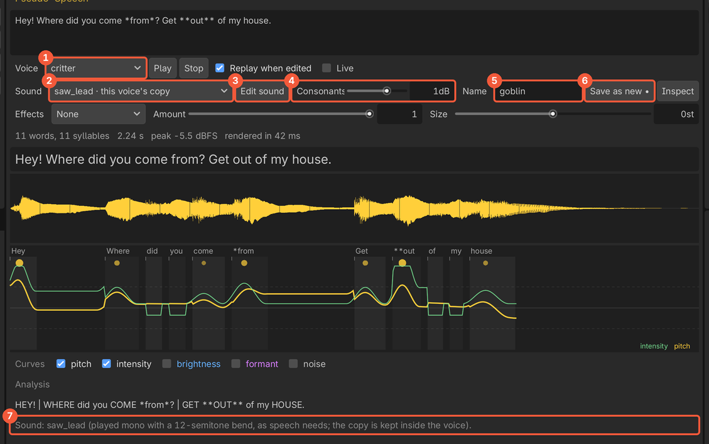

1. Type a short line to test with, such as `Hey! Where did you come *from*? Get **out** of my house.`
2. Set **Voice** to **critter** (1). It's quick and high, a good start for a small creature.
3. Set **Sound** (2) to **saw_lead · kit**. Sound is what the voice is made of, and changes it the most: Critter's own squeaky pulse becomes a buzzy saw. The list has the speech patches first, then every patch from the Synth page (the kit's, the General MIDI bank and yours), and at the end **scratch**, the record scratches Scratch King is made of.
4. The message (7) says the patch is played mono with a 12-semitone bend range, as speech needs. That copy is kept inside the voice, so the menu now says **saw_lead · this voice's copy**.
5. Drag **Consonants** (4) to **+1 dB**. That's the clicks of p, t and k and the hiss of s, f and h; a goblin spits its words a little more than Critter.
6. Type `goblin` in **Name** (5). The **Save as new** button (6) shows a dot while there are unsaved changes.

Any patch works as a sound, including your own from the Synth tutorial. **Edit sound** (3) opens it on the Synth page (Step 4).

### Step 2: give it a character

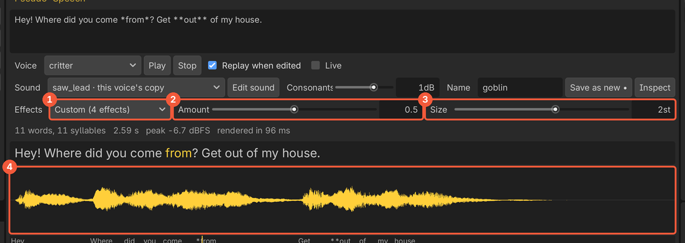

1. Set **Effects** (1) to **Beast**: a ragged growl, grit, a copy a fifth below and a small room.
2. Drag **Amount** (2) to **0.5**. Amount scales every effect at once: 0 is the dry voice, 1 the full character. Half a beast is plenty for a goblin.
3. Beast also sets **Size** (3) to +5, a big body. Drag it down to **+2 st**. Size changes how big the speaker sounds without changing the pitch: up is a bigger throat, down a smaller one. It's most of what makes a creature sound large or small.
4. Listen, and watch the waveform (4): the growl roughens it, and the line rings on a little after the last word.

The menu now says **Custom (4 effects)**, because the voice no longer matches Beast exactly. The effects are still Beast's, at your Amount and Size. Effects keep each voice at about the same loudness, so you can try them all freely:

| Character | Sounds like | Size |
| --- | --- | --- |
| Demon | An octave-down double, a growl, grit and a dark hall | +3 |
| Angel | A shimmering choir: chorus, a faint octave up, a bright hall | −1 |
| Alien | A swept ring modulator, a deep phaser, a short echo, lost bits | 0 |
| Beast | A ragged growl, grit and a fifth below | +5 |
| Sprite | A tiny body with a quick warble and a little echo | −5 |
| Ghost | Thin and far away: flanging, long echoes, a huge room | 0 |
| Robot | A low ring modulator, crushed samples, a tin can | 0 |
| Radio | A narrow, crunchy, squashed band, like a walkie-talkie | 0 |

### Step 3: change how it speaks

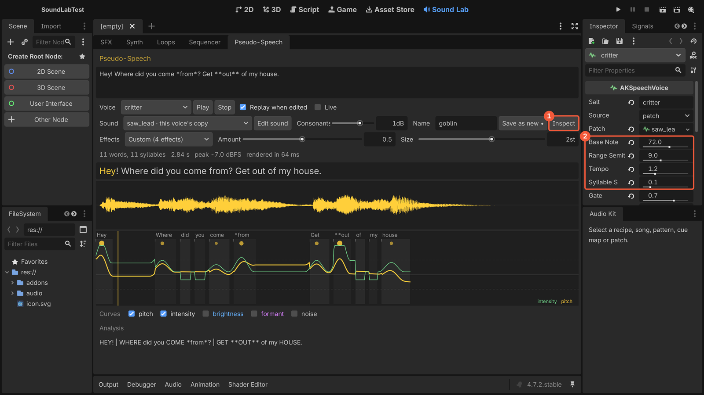

1. Click **Inspect** (1). Every setting of the voice opens in the Inspector, and changes there replay just like the page's own.
2. Set **Base Note** (2) to **72** (C5). Critter rests on 79 (G5); a goblin sits a little lower.
3. Set **Tempo** to **1.2**. Critter talks at 1.35; the goblin is a touch slower.

The other settings are worth a try too:

- **Range Semitones**: how far the melody moves. Wider sounds excitable, narrower sounds flat or sinister.
- **Syllable S** and **Gate**: how long a syllable lasts, and how much of it sounds. A low gate gives clipped, choppy speech.
- **Jitter**: looseness in the timing. 0 is a metronome.
- **Seed Pitch Semitones**: how much each word's own little melody moves it.
- **Effects**, further down: the effects one by one, with every setting, like the effects on a patch.

### Step 4 (optional): edit the sound on the Synth page

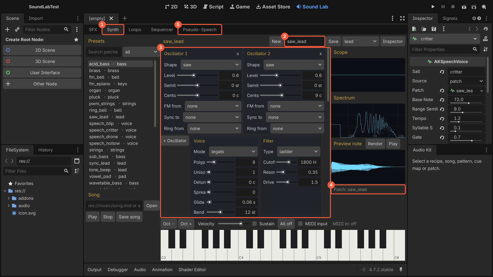

Click **Edit sound** on the Pseudo-Speech page. The lab switches to **Synth** (1) with the voice's copy of the patch open (2, 4), and every panel (3) works as in the Synth tutorial: a darker filter, a second detuned oscillator, a different wave.

Then click **Pseudo-Speech** (5) to go back and hear the voice with your changes. They're part of the voice and saved with it, so there's no need to save on the Synth page: that would write a separate patch file.

A speech patch hears the line through the usual inputs: a note per syllable, pitch bend for the melody, velocity for loudness, and the mod wheel for the vowel (dark u to bright i). A matrix row from **mod_wheel** to **cutoff** makes vowels sound different; Critter's own patch does this.

### Step 5: save it, and use it

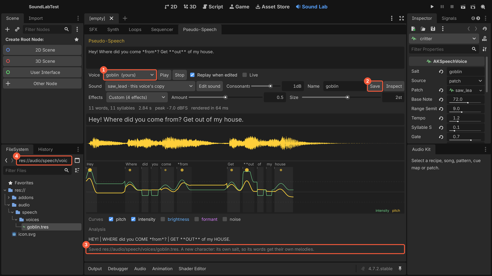

1. Click **Save as new**. The message (3) confirms it was saved to `res://audio/speech/voices/goblin.tres`, and it's in your project (4).
2. **Voice** (1) now shows **goblin (yours)**, and the button says **Save** (2): from now on it saves over your goblin.
3. A new voice gets its name as its *salt*, so its words get melodies of their own: "house" in Goblin is a different little tune from "house" in Critter.
4. To use it, set an **AKSpeaker**'s **Voice** to `goblin.tres`, as in the previous tutorial, or in code:

```gdscript
$Speaker.voice = load("res://audio/speech/voices/goblin.tres")
$Speaker.say("Get **out** of my house.")
```

A speaker that already holds the goblin picks up your changes the next time you save.

### Tips

- Saving a kit voice under a new name never changes the kit's own voice. To make a second goblin, pick **goblin (yours)**, change it, type a new name and save.
- In the Inspector, **States** gives a voice its own `{tag}` moods, or its own patch for one: a `shout` state with a rougher patch speaks every `**word**` through it.
- Voice files are ordinary resources: copy one into another project's `res://audio/speech/voices/` and it appears in **Voice** there.

## MIDI keyboards and MIDI files in Sound Lab

A MIDI keyboard plays live on three pages: the **Synth** page (tick **MIDI input** under its keyboard; Synth tutorial, Step 6), the **Sequencer** (arm a track with its **●**) and the **Loops** page (tick **MIDI in**); the last two also record what you play (Recording tutorial). The table below is for the Synth page; on the other two, the keys, pads, pitch bend, mod wheel and sustain pedal work the same way, and bend and mod wheel are recorded into synth takes.

### What each control does on the Synth page

The MPK Mini column assumes its factory settings.

| MIDI message | On an MPK Mini | What it does in Sound Lab |
| --- | --- | --- |
| Notes, with velocity | Keys | Play the patch; harder is louder, and brighter if the patch routes velocity to the filter |
| Notes from pads | Pads (notes 36–51) | Play low notes of the patch; they don't trigger drums on this page |
| Pitch bend | Joystick left and right | Bends held notes by the patch's **Bend range** (2 semitones unless you change it) |
| CC 1, mod wheel | Joystick up, or knob K1 | Whatever the patch's matrix routes from **mod_wheel** (nothing unless a row uses it) |
| CC 64, sustain | Sustain pedal jack | Holds notes after you let go |
| Channel pressure (aftertouch) | Not sent by the MPK Mini | The **aftertouch** matrix source, on keyboards that send it |
| CC 7, volume | Knob K7 | The volume of what you're playing |
| CC 120 or 123 | Not on the MPK Mini | Stops all notes, like **All off** |
| Program change | **PROG CHANGE** button | Switches to a General MIDI bank instrument; pick your patch in **Presets** again to get back |

The other knobs (K2 to K6 and K8) do nothing in Sound Lab yet. To make the joystick or K1 do something, add a matrix row with **mod_wheel** as its source (to **cutoff** for a filter sweep, **pitch** for vibrato depth with an LFO, or **amp** for a swell).

### MIDI files

- **Synth page → Song**: type a `.mid` path (or drop the file into your project first) and click **Open**, then **Play**. Each instrument in the file gets a starter General MIDI patch; pick another for any part from its menu, and **Save song** to keep it.
- **Loops page**: the import row turns one part of a `.mid` file (or all its drums) into a loop you can edit (Loops tutorial).
- Any `.mid` file you put in the project imports as a song you can play from game code.

### In your game

To play a patch from a MIDI keyboard while the game runs (for a music toy or a debug tool), add an `AKMidiRouter`:

```gdscript
var router := AKMidiRouter.new()
router.patch = load("res://audio/patches/pluck_bass.tres")
add_child(router)   # opens the MIDI inputs and plays the patch
```

It handles the same messages as the table above. Your `demo/midi/midi_demo.tscn` on `main` is another way to do this, with its own drum pads and instrument switching.

### If notes feel late

The delay between pressing a key and hearing it is set by Godot's audio buffer, about 15 to 30 ms by default. For playing in, lower **Project Settings → Audio → Driver → Output Latency** (turn on **Advanced Settings** to see it).
