## Before you start

Sound Lab is on `main`. Each module below walks through making one simple thing. Most have screenshots taken from the editor; tutorials 10 to 12 are newer and are text only for now.

| Tutorial | You make | Page |
| --- | --- | --- |
| [1. SFX](#1-sfx-make-a-jump-sound) | A jump sound | SFX |
| [2. Synth](#2-synth-build-a-plucky-bass) | A plucky bass, from a blank patch | Synth |
| [3. Loops](#3-loops-a-drum-beat-and-a-bass-line) | A drum beat and a bass line | Loops |
| [4. Sequencer](#4-sequencer-arrange-your-loops-into-a-song) | A song from your loops, as scenes and a timeline | Sequencer |
| [5. Recording](#5-recording-play-along-and-record-a-take) | A take played on a MIDI keyboard | Sequencer, Loops |
| [6. Pseudo-Speech](#6-pseudo-speech-give-a-character-a-voice) | A line of gibberish dialogue with subtitles | Pseudo-Speech |
| [7. Your own voice](#7-make-your-own-voice-a-goblin) | A goblin speech voice | Pseudo-Speech |
| [8. Flavor](#8-flavor-dial-in-a-funky-bass) | A funky bass from named knobs | Flavor |
| [9. Match a recording](#9-match-a-recording-turn-an-auxy-sound-into-a-patch) | A patch copied from an Auxy instrument | Synth |
| [10. The synth's toolbox](#10-the-synths-toolbox-an-evolving-pad) | An evolving pad, with LFOs, a modulation matrix, macros and effects | Synth |
| [11. The libraries](#11-the-libraries-find-a-patch-and-a-drum-kit) | A patch and a drum kit found in the libraries | Synth, Loops |
| [12. Your own samples](#12-your-own-samples-wav-files-into-instruments-and-kits) | An instrument and a drum kit from your own WAV files | Loops |

1. Get the latest: `git pull` on `main` in your `godot-audio-kit` folder.
2. Build the native core, so instruments, loops, songs and voices play live: `cd native` then `scons` (about a minute the first time). The SFX page works without it; the Synth, Loops, Sequencer and Pseudo-Speech pages fall back to slower baked playback, the Flavor page can still build and save sounds but not play them, and matching a recording (tutorial 9) needs it.
3. Open the project in Godot 4.5 or later. The screenshots are from 4.5, except tutorials 6, 7 and 9, which are from 4.7 on a Mac. Tutorial 8's show the Flavor page on its own, outside the editor window. The Audio Kit plugin is already enabled (**Project → Project Settings → Plugins** if not).
4. Click **Sound Lab** in the bar at the top of the editor, beside 2D, 3D and Script. It has six pages, as tabs: **SFX**, **Synth**, **Flavor**, **Loops**, **Sequencer** and **Pseudo-Speech**.

Everything Sound Lab makes is an ordinary file in your project, under `res://audio/` unless you choose another folder. Every edit can be undone with **Ctrl+Z** (Cmd+Z on a Mac).

## 1. SFX: make a jump sound

The SFX page makes game sound effects in one click: pick a kind of sound, keep pressing until you like one, nudge it, then save it into your project. In this tutorial you make a jump sound for a player character and play it from a scene, in about five minutes.

### The page at a glance

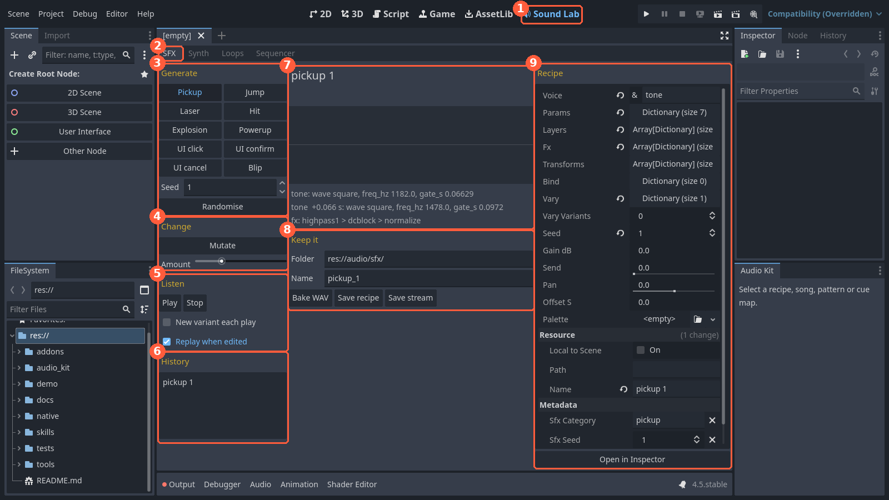

1. **Sound Lab** opens the lab.
2. **SFX** is the first of the five pages.
3. **Generate**: one button per kind of sound, plus **Seed** and **Randomise**.
4. **Change**: **Mutate** makes a close variation of the current sound; **Amount** sets how close.
5. **Listen**: **Play** and **Stop**. **Replay when edited** plays the sound again after every change.
6. **History**: every sound you've made this session. Click one to go back to it.
7. The current sound: its name, length and loudness, its waveform, and a one-line summary of how it's built.
8. **Keep it**: a folder, a name, and three ways to save.
9. **Recipe**: every setting of the current sound, editable. Sounds in the Audio Kit are recipes: small text files of settings, turned into audio when they play.

### Step 1: generate a jump

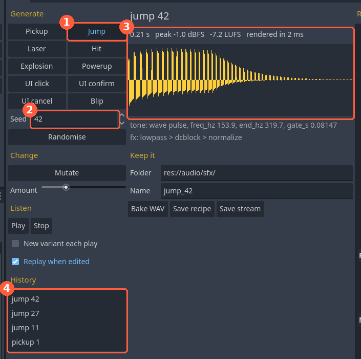

1. Press **Jump** (1). You hear a short rising blip, and its waveform appears (3).
2. Press **Jump** again. Each press picks a new random **Seed** (2) and gives a different jump. Press it a few times until one feels right for your character.
3. Every sound you make is listed under **History** (4), so you can click back to an earlier one at any time.

The seed is the sound's ID: **Jump** with seed 42 is always the same sound, on any computer. Type a seed into the box to get a sound back, or note one down to share it.

The other buttons work the same way: **Pickup** (coins, items), **Laser**, **Hit**, **Explosion**, **Powerup**, **UI click**, **UI confirm**, **UI cancel** and **Blip**. **Randomise** makes something unpredictable from any kind.

### Step 2: fine-tune it with Mutate

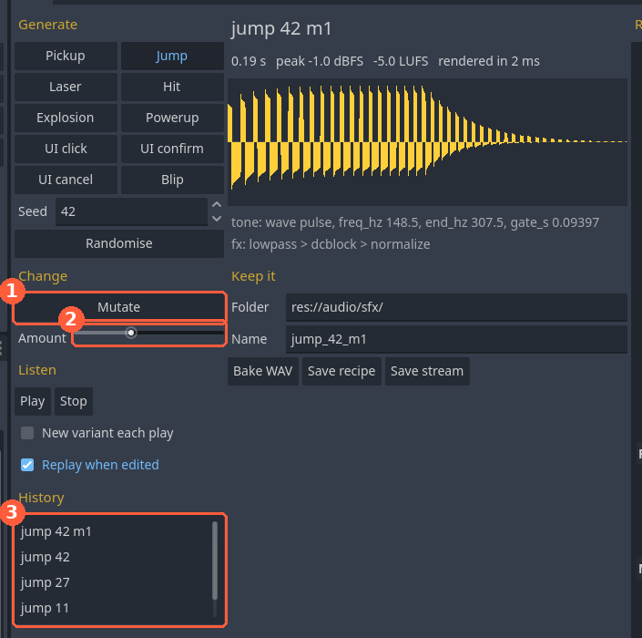

1. Press **Mutate** (1). You get a near neighbour of your sound: a little higher or lower, shorter or longer. Its name gets "m1" added ("jump 42 m1").
2. Press it again to keep wandering, or click the original in **History** (3) to go back.
3. Drag **Amount** (2) left for subtle changes, right for bigger ones.

### Step 3 (optional): edit the settings

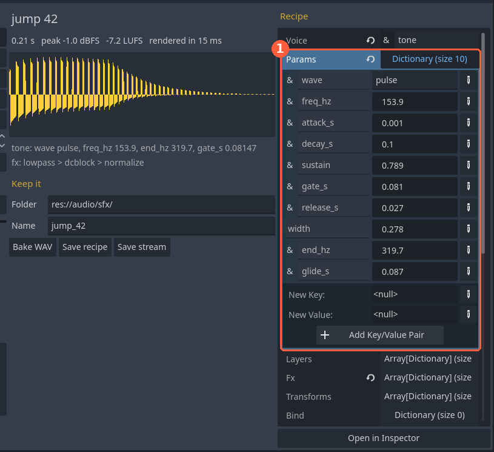

For exact control, click **Params** in the **Recipe** panel to open the sound's settings (1). Click any value, type a new one and press Enter; the sound replays straight away. For a jump, the useful ones are:

- `freq_hz` and `end_hz`: the starting and ending pitch in Hz. A bigger gap between them makes a bigger swoop.
- `glide_s`: how long the swoop takes, in seconds.
- `gate_s`: how long the note is held.
- `wave`: the tone, such as `square`, `pulse`, `triangle` or `sine`. Square and pulse sound retro; sine sounds soft.

The grey summary under the waveform shows the same main values, so you can see what changed. **Ctrl+Z** undoes an edit.

### Step 4: save it into your project

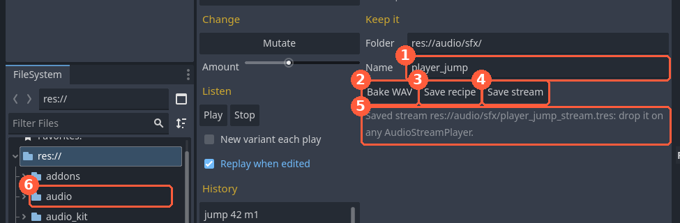

1. Type a name, such as `player_jump`, in **Name** (1). Files go in the **Folder** above it, `res://audio/sfx/` by default.
2. Pick how to save it:
    - **Bake WAV** (2) writes `player_jump.wav`: a normal audio file that plays anywhere, even without the Audio Kit.
    - **Save recipe** (3) writes `player_jump.tres`, the recipe itself, which you can reopen and edit later.
    - **Save stream** (4) writes `player_jump_stream.tres`, a sound that plays in any audio player and comes out slightly different each time, so a jump heard 50 times doesn't sound robotic.
3. The message under the buttons (5) confirms where the file went, and it appears under `audio` in the **FileSystem** panel (6).

For a jump, use **Save stream**: the small changes on each play help a sound you hear often.

### Step 5: play it in your game

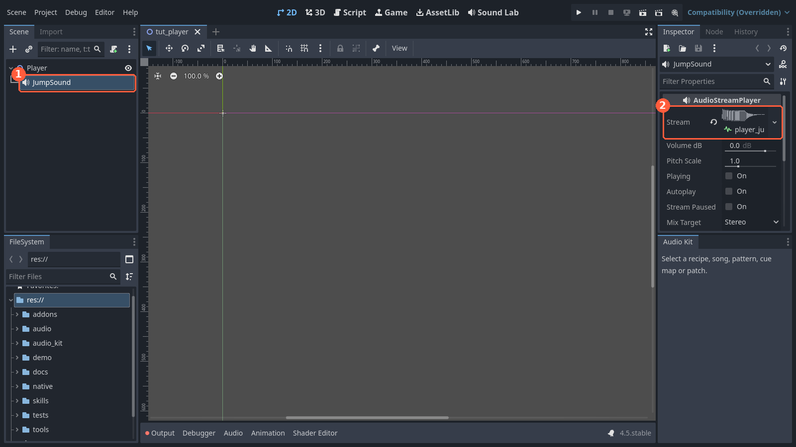

1. Open your player scene and add an **AudioStreamPlayer** child node. Name it `JumpSound` (1).
2. Drag `player_jump_stream.tres` (or the `.wav`) from **FileSystem** onto the **Stream** box in the Inspector (2).
3. Play it from your player script when the character jumps:

```gdscript
if Input.is_action_just_pressed("ui_accept") and is_on_floor():
    velocity.y = JUMP_VELOCITY
    $JumpSound.play()
```

For a sound that should come from the character's position on screen, use **AudioStreamPlayer2D** (or 3D) instead; it takes the same files.

### Tips

- **New variant each play** (under **Listen**) previews the small changes a saved stream makes, so you can hear the range before saving.
- To make the same sound from code: `AKSfxGen.generate(&"jump", 42)`.
- The **Audio Kit** panel under the Inspector plays any saved recipe or stream you select in **FileSystem**, so you can audition your sounds without opening the lab.

## 2. Synth: build a plucky bass

The Synth page builds instruments (patches) you play from a keyboard: the on-screen one, your computer keys, or a MIDI keyboard such as your MPK Mini. In this tutorial you build a punchy bass from a blank patch, set your keyboard's joystick to sweep its tone, and save it for your game, in about fifteen minutes.

Live playing needs the native core (see Before you start). Without it, the panels, saving and the **Render** preview still work.

### The page at a glance

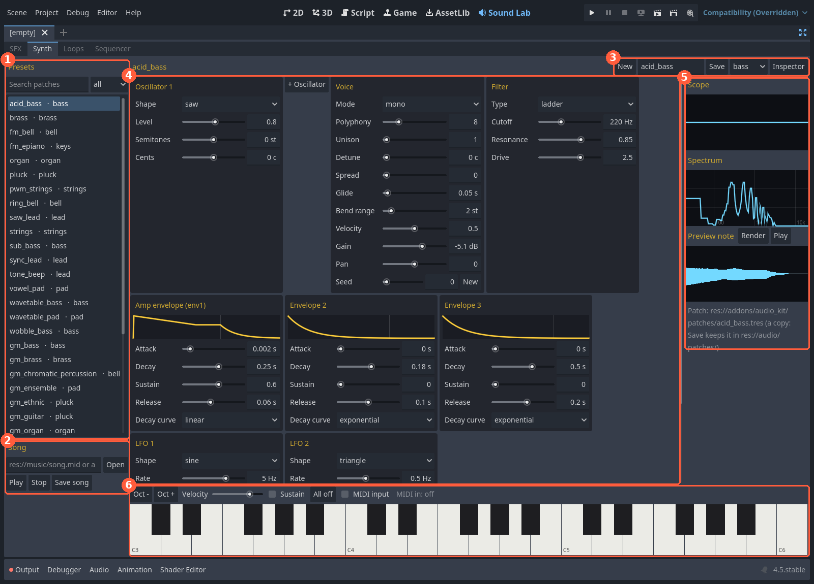

1. **Library**: every instrument that comes with the kit, the General MIDI bank (the `gm_` ones), your own saved patches and any library folders you've added (tutorial 11). Search by name, or open **Filters** to pick a category, source, creator and more. Click one to load it.
2. **Song**: open a `.mid` file or a song and play it with your patches (covered in the MIDI section at the end).
3. The toolbar: **New** (a blank patch), the patch's name, **Save**, its category, and **Inspector**.
4. The panels: every part of the patch. They flow to fit the window, so scroll down for the rest.
5. **Scope** and **Spectrum** show what you're playing. **Preview note** draws one held note, so you can see the shape of the sound.
6. The keyboard and its controls.

The screenshots were taken before some panels were added (Filter 2, Macros, a **Mode** menu on each envelope, **+ Envelope** and **+ LFO**, more effects) and before the preset list became the **Library** (its category menu is now under **Filters**), so the page you see has more in it; the controls this tutorial uses have the same names.

A patch is built like a classic synthesizer: **oscillators** make the raw tone, the **filter** shapes how bright it is, **envelopes** shape how it changes over the length of a note, and **effects** add space and colour.

### Step 1: try a few presets

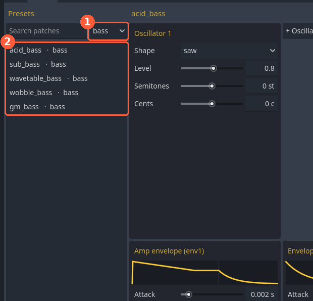

1. Click **Filters** and set **Category** to **bass** (1). The list shrinks to the bass presets (2).
2. Click **acid_bass**, then play some low notes: click the on-screen keys, or use your computer keys (the bottom row `Z X C V B N M` plays the white keys from C, and `S D G H J` above it the black keys; the [ and ] keys move an octave).
3. Try **sub_bass** and **wobble_bass** too, to hear how different settings sound.

The presets that come with the kit open as copies, so you can't break them: **Save** always writes your own file.

### Step 2: start from a blank patch and set the oscillators

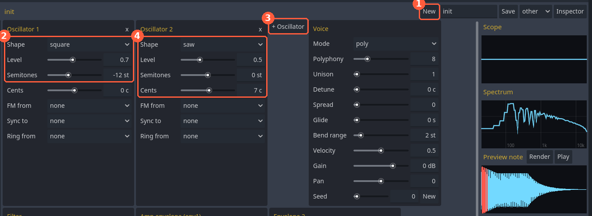

1. Click **New** (1). You get one plain saw wave.
2. In **Oscillator 1** (2), set **Shape** to **square** and **Semitones** to **-12**. That drops it an octave, for weight.
3. Click **+ Oscillator** (3) to add a second one.
4. In **Oscillator 2** (4), set **Shape** to **saw** and **Cents** to **7**. That's a tiny detune against the first, which makes the tone thicker.

Leave the other settings as they are. **Op**, in a panel's top corner, shows FM operator settings you won't need here; **x** removes the oscillator.

To set a value, drag its slider, or click the number, type a value and press Enter. Play a note after each change to hear the difference.

### Step 3: shape the tone with the filter and modulation

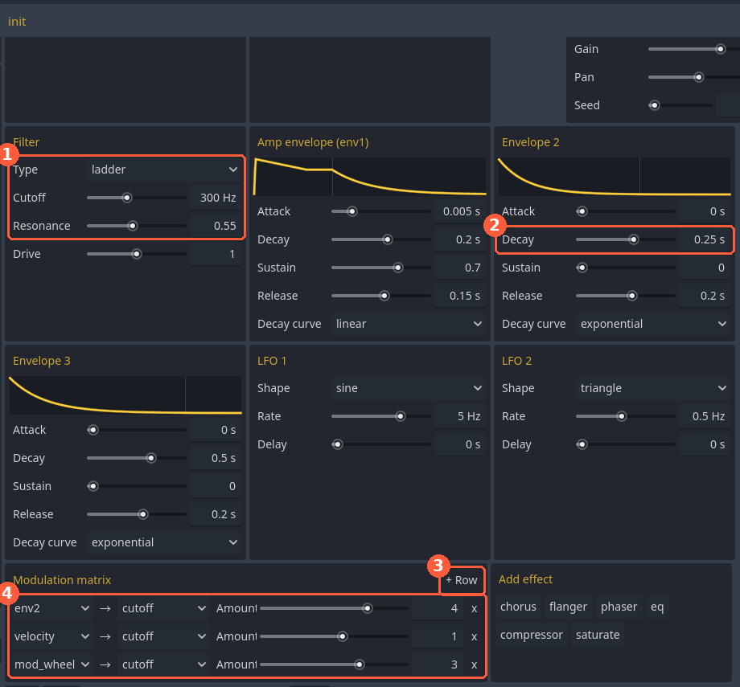

1. In **Filter** (1), set **Type** to **ladder**, **Cutoff** to **300 Hz** and **Resonance** to **0.55**. The bass goes dark and round. Leave **Drive**, **Poles** and **Feedback loop** as they are, and **Filter 2** (the next panel) off.
2. In **Envelope 2** (2), leave **Mode** on **adsr** and set **Decay** to **0.25 s**. On its own this does nothing yet; the next step connects it to the filter.
3. In **Modulation matrix**, click **+ Row** (3) three times. Each row is "source → destination × amount". Set the rows (4) to the table below; leave the **× 1** menu between the destination and the amount as it is (it multiplies a row by a second source):

| Source | Destination | Amount | What you hear |
| --- | --- | --- | --- |
| env2 | cutoff | 4 | Each note starts bright and quickly darkens: the "pluck" |
| velocity | cutoff | 1 | Harder key presses sound brighter |
| mod_wheel | cutoff | 3 | The mod wheel (your MPK's joystick, pushed up) opens the filter |

The envelopes draw their shape, so you can see what **Decay** changes.

### Step 4: finish the sound

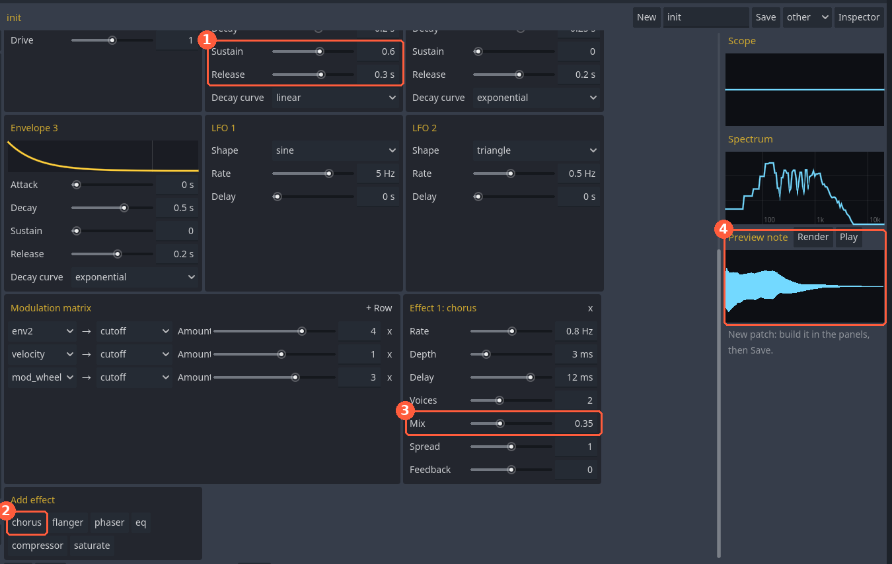

1. In **Amp envelope (env1)** (1), set **Sustain** to **0.6** and **Release** to **0.3 s**. Held notes stay present, and notes fade out gently when you let go.
2. Under **Add effect**, click **chorus** (2). An **Effect 1: chorus** panel appears; set its **Mix** to **0.35** (3) for a little width.
3. Check the **Preview note** (4): it redraws after each change, showing the bright start, the body and the fade.

Every change can be undone with **Ctrl+Z**.

### Step 5: play it

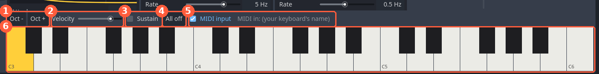

1. **Oct -** and **Oct +** (1) move the on-screen keyboard by an octave.
2. **Velocity** (2) sets how hard computer keys play. With the mouse, clicking lower on a key plays harder.
3. **Sustain** (3) holds notes after you let go, like a piano's pedal.
4. **All off** (4) stops every note, if one gets stuck.
5. Tick **MIDI input** (5) to play from a MIDI keyboard; its name appears beside it (see below).
6. Notes you play light up on the keyboard (6), however you play them.

### Step 6: play it from your MPK Mini

1. Plug in the MPK Mini before opening Godot (Godot only looks for MIDI devices when they're first opened).
2. Tick **MIDI input**. "MIDI in:" should show the keyboard's name. If it says "no devices", untick and tick it again after plugging in.
3. Play. The keys are velocity-sensitive, so playing harder brightens the sound (from the velocity row in Step 3).
4. Push the joystick **up** to open the filter (the mod_wheel row) and move it **left or right** to bend the pitch, two semitones each way.
5. A sustain pedal plugged into the MPK's sustain jack works like the **Sustain** box.

The pads send notes too, so on this page they play low notes of your patch. The full list of what a MIDI keyboard does is in the MIDI section at the end.

### Step 7: save it

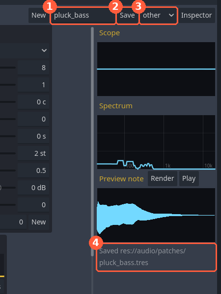

1. Type a name, such as `pluck_bass`, in the name box (1).
2. Set the category menu (3) to **bass**, so it's filed with the basses in the **Library**.
3. Click **Save** (2). The message (4) confirms it was saved to `res://audio/patches/pluck_bass.tres`, and it's listed in the **Library** among your patches (origin `created`).

From now on you're editing your saved file; click **Save** again after more changes.

### Step 8: use it in your game

A patch plays live through an **AudioStreamPlayer**, so you can trigger notes from game code (this needs the native core in the exported game):

```gdscript
var bass := AKSynthStream.new()
bass.patch = load("res://audio/patches/pluck_bass.tres")
$Music.stream = bass
$Music.play()
bass.note_on(36, 0.9)        # C2, fairly hard
bass.note_off(36, 0.5)       # let go half a second later
```

The patch also works as a track's instrument on the Loops page (next tutorial), which is usually the easier way to make music with it.

### Tips

- Use **Save** often while experimenting, with a new name for each version you like.
- To start from something close, load a preset and change it instead of starting from **New**.
- **Inspector** opens the patch in Godot's own inspector, where the Audio Kit panel can play it as single notes, chords or arpeggios.
- **Add effect** also has six effects for stranger sounds: **pitch** (a shifted copy blended in, such as an octave down), **ring** (a ring modulator, metallic), **growl** (a ragged flutter), **crush** (fewer bits, a lo-fi grit), **delay** (echoes) and **reverb** (a room). The character voices in tutorial 7 are built from them. Two more are tools: **filter** (a low- or high-pass on the whole sound) and **limiter** (holds the peaks under a ceiling).

### Going further

Tutorial 10 builds a pad with the panels this tutorial didn't use, and lists everything the synth can do. In short (all described in `docs/sound_lab.md`):

- **Filter 2**: pick a type to add a second filter, in series or in parallel with the first; each oscillator's **Filter** menu then picks which it goes through.
- **Mode** on an envelope: **stages** (any number of stages, each with its own curve), **dx7** or **cz**, for sounds an ADSR can't draw. **+ Envelope** adds up to five more, and **+ LFO** up to six more LFOs, for the matrix.
- **Op** on an oscillator: FM operator settings (ratio, its own envelopes, a list of modulators), for bells and electric pianos.
- **Macros**: four knobs that are matrix sources (macro1 .. macro4), so one slider can move several settings.
- Some settings have no panel yet (the arpeggiator, oscillator stacks, tempo sync); set them in the **Inspector**. `docs/synth.md` lists them all.

## 3. Loops: a drum beat and a bass line

The Loops page is where you write music: short loops of notes for one instrument, drawn on a grid that keeps playing while you edit. In this tutorial you write a one-bar drum beat, then a two-bar bass line for the `pluck_bass` patch from the Synth tutorial, and play them together, in about fifteen minutes.

Live looping needs the native core. Without it, **Play** renders the loop and plays that, re-rendering after each edit.

### The page at a glance

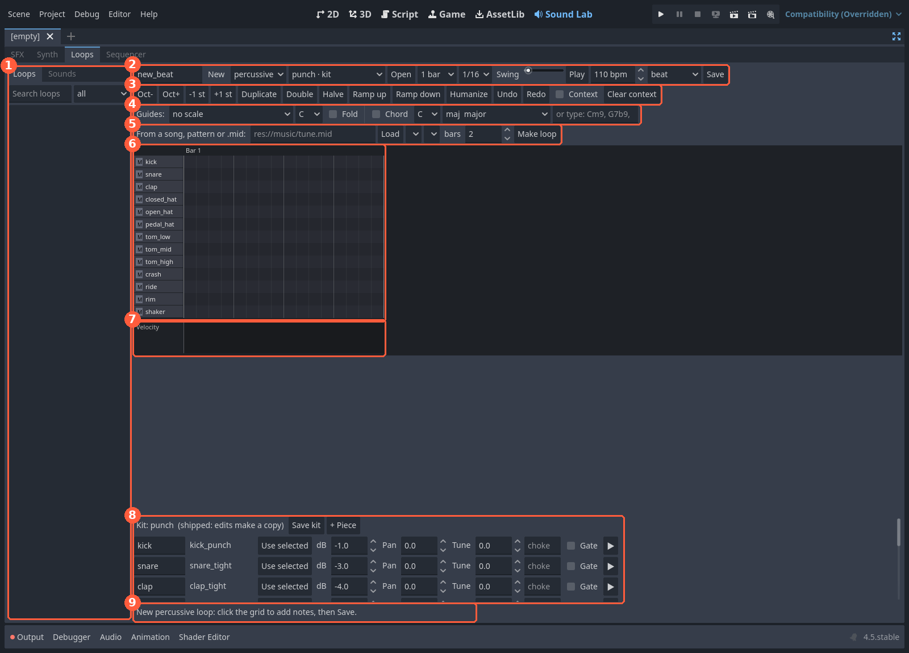

1. **Loops** lists your saved loops; the **Sounds** tab beside it lists the kit-made sounds and your own WAV, AIFF and OGG files (tutorial 12), and the **Drums** tab browses the drum library (tutorial 11).
2. The toolbar: name, **New**, the loop's type, its instrument, **Open** (the patch, on the Synth page), **Bars**, the grid size (1/16 = sixteen cells a bar), **Swing**, **Play**, tempo, category and **Save**.
3. Tools: move the view an octave, transpose, copy, double or halve the loop, shape velocities, undo and redo, and **Context** (play other loops along).
4. **Guides**: tint the rows of a scale or a chord, to help you stay in key.
5. Make a loop from part of a song or a `.mid` file.
6. The grid: one row per drum (or per note, for instruments), one column per cell, time running left to right.
7. The velocity strip: how hard each note plays.
8. The kit's drums: sound, level, pan, tuning and more for each.
9. Messages, such as where a file was saved.

There are three types of loop: **synth** (a patch from the Synth page), **sample** (a recorded or library sound played at different pitches) and **percussive** (a drum kit, one row per drum).

### Step 1: write a drum beat

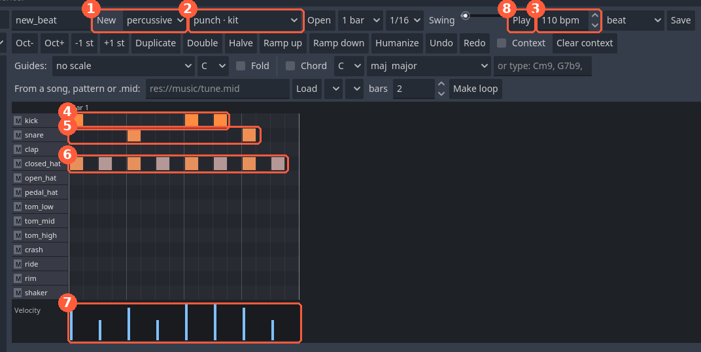

1. Click **New** and choose **percussive** (1). You get an empty one-bar loop on the **punch** kit (2). Any kit from the menu works; try them all later.
2. Set the tempo to **110** (3).
3. Click cells to add hits. Counting the cells 1 to 16 from the left (each group of four is one beat):
    - **kick** (4): cells 1, 9 and 11
    - **snare** (5): cells 5 and 13
    - **closed_hat** (6): every other cell: 1, 3, 5, 7, 9, 11, 13 and 15
4. Click **Play** (8). The beat loops; leave it playing while you work, and every change is heard on the next pass.
5. In the velocity strip (7), drag the bars of the hats on cells 3, 7, 11 and 15 down to about half height. Softer off-beat hats make the beat feel less mechanical.

Clicking a hit again deletes it, and **Ctrl+Z** undoes anything. Click a drum's name to hear it alone, or its **M** to mute that row while you listen.

### Step 2: save the beat

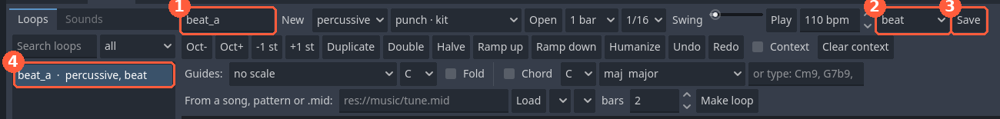

1. Type `beat_a` in the name box (1).
2. The category (2) is already **beat**; categories sort the loop list.
3. Click **Save** (3). The loop is saved to `res://audio/loops/beat_a.tres` and appears in the **Loops** list (4). Click any loop there to open it.

### Step 3: set up a bass loop

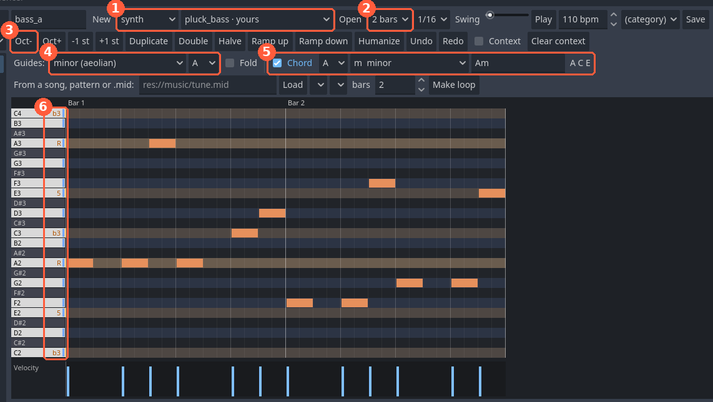

1. Click **New** and choose **synth**, then pick **pluck_bass · yours** from the instrument menu (1). Patches you save on the Synth page are listed as "yours".
2. Set **Bars** to **2** (2).
3. Click **Oct-** (3) once, so the rows run from C2 to C4. The grid is now a piano: each row is a note, black-key rows are darker.
4. Turn on the guides (4): **Scale** → **minor (aeolian)**, root **A**. The notes of A minor get a blue tint and a blue mark by the key.
5. Tick **Chord** (5) and pick **A** and **m minor**. The notes of the A minor chord (A, C, E) get a warm tint, and each one is labelled by its role in the chord (6): R for the root, b3 for the minor third, 5 for the fifth. The guides only change what you see.

### Step 4: draw the bass line

Each note below is two cells long (an eighth note): click the first cell and drag one cell to the right. Cells are counted 1 to 16 in each bar.

| Bar | Cell | Note |
| --- | --- | --- |
| 1 | 1 | A2 |
| 1 | 5 | A2 |
| 1 | 7 | A3 |
| 1 | 9 | A2 |
| 1 | 13 | C3 |
| 1 | 15 | D3 |
| 2 | 1 | F2 |
| 2 | 5 | F2 |
| 2 | 7 | F3 |
| 2 | 9 | G2 |
| 2 | 13 | G2 |
| 2 | 15 | E3 |

The first bar sits on the A minor chord. The second moves through F and G, so when you write it, set the chord guide to **F** major and then **G** major to see their notes. To fix a note, drag it to move it, or drag its right edge to change its length.

The pluck_bass patch plays an octave lower than the notes you write, because Oscillator 1 is set to -12 semitones. That's why A2 sounds deep.

### Step 5: play it with the beat, and save

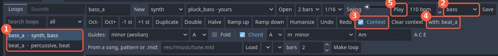

1. Tick **Context** (3), then click **beat_a** in the **Loops** list. "with: beat_a" appears (4).
2. Click **Play** (5). The bass plays over the beat, both looping. Keep editing; you hear changes on the next pass.
3. Name the loop `bass_a`, set the category (2) to **bass**, and click **Save**. Both loops are now in the list (1).

**Clear context** stops the other loops playing along. Context is only for listening: each loop is still saved on its own.

### Tips

- **Swing** (in the toolbar) delays every other 16th note for a shuffle feel; try it on the beat.
- Select notes by right-dragging a box around them, then use the arrow keys to move them, **Ctrl+D** to copy them after themselves, or **Ramp up** and **Humanize** to shape their velocities.
- **Double** makes the loop twice as long with the notes copied, a quick start for a variation in the second half.
- To reuse part of an existing song, type a `.mid` path in the import row (5 in the first picture), click **Load**, pick a part and the number of bars, then **Make loop**.
- In the next tutorial, the Sequencer arranges these loops into a full piece of music.

## 4. Sequencer: arrange your loops into a song

The Sequencer turns loops into a finished piece. It has two ways to arrange the same tracks: **scenes**, sets of loops a game switches between as the action changes, and a **timeline**, a fixed piece that plays start to finish. A **mixer** balances the tracks. In this tutorial you make an intro and a main section from `beat_a` and `bass_a` (the loops from the Loops tutorial), lay them out as a 24-second piece, mix it, export a WAV, and play the scenes from a game, in about fifteen minutes.

### The page at a glance

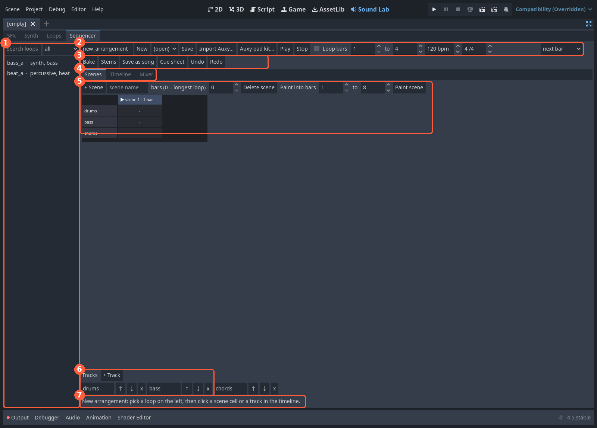

1. Your saved loops. Click one to pick it, then click where it should go.
2. The transport: the arrangement's name, **New**, open a saved one, **Save**, **Play** and **Stop**, **Loop bars**, tempo, time signature, and when scene switches land (**next bar**).
3. Export: **Bake** (a WAV), **Stems** (a WAV per track), **Save as song**, **Cue sheet**, and **Undo** and **Redo**.
4. The three views: **Scenes**, **Timeline** and **Mixer**.
5. The current view: here, the scenes grid, with a column per scene and a row per track.
6. **Tracks**: rename, reorder (↑ ↓) or delete (x) them, or **+ Track** to add one.
7. Messages.

### Step 1: set up the tracks and scenes

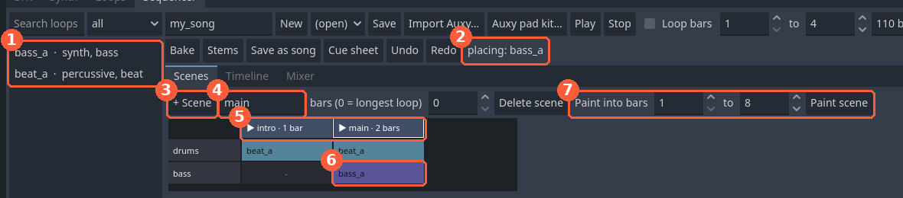

1. Click **New**, type `my_song` as the name, and set the tempo to **110 bpm**, the same as your loops.
2. A new arrangement has three tracks: drums, bass and chords. Click the **x** after **chords** in **Tracks** to delete it; you won't need it here.
3. Click **+ Scene** (3) to add a second scene. To name a scene, right-click its name in the grid to select it, type a name in the scene name box (4) and press Enter. Name them `intro` and `main` (5).
4. Fill the cells. Click **beat_a** in the loop list (1); "placing: beat_a" appears (2). Click the **drums** cell under **intro**, then the **drums** cell under **main**.
5. Click **bass_a** in the list, then the **bass** cell under **main** (6). Leave the bass cell under **intro** empty, so the intro is drums only.

A scene lasts as long as its longest loop ("intro · 1 bar", "main · 2 bars"), and shorter loops repeat to fill it. Right-click a cell to empty it.

### Step 2: switch between scenes

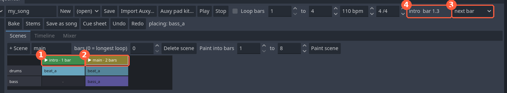

1. Click **intro** at the top of its column. It plays and turns green (1).
2. While it plays, click **main**. It turns yellow (2): it's waiting, and starts on the next bar line so the music never cuts mid-beat.
3. Switch back and forth. The menu at the right of the transport (3) sets when a switch lands: on the **next bar**, the **next beat**, or at the **end of the scene**. The position display (4) shows which section and bar is playing.

This is exactly what a game does: it plays a scene, then asks for another when something happens, such as a boss appearing (Step 6).

### Step 3: lay out a timeline

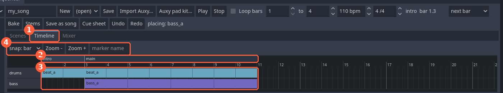

The quickest way to fill the timeline is to paint your scenes into it:

1. In the **Scenes** view, right-click **intro** to select it. Set **Paint into bars** to **1** to **2** (7 in the Step 1 picture) and click **Paint scene**.
2. Select **main** the same way, set the bars to **3** to **10**, and click **Paint scene**.
3. Click **Timeline** (1). The two scenes are now clips on the tracks (3): two bars of drums alone, then eight bars of drums and bass. Thin lines inside a clip show where its loop repeats.
4. Add section names. Click the strip above the bar numbers (2) at bar 1, select the marker, type `intro` in the **marker name** box (4) and press Enter. Add one called `main` at bar 3. A game can jump to these by name.
5. Click **Play**. The timeline plays from the start: about 24 seconds at 110 bpm.

You can also edit clips directly: drag a clip to move it, drag its right edge to repeat the loop more or fewer times, **Alt**-drag to copy it, and press **Delete** to remove the selected clip. Pick a loop and click an empty part of a track to place a new clip. **Zoom -** and **Zoom +** change the scale.

### Step 4: mix it

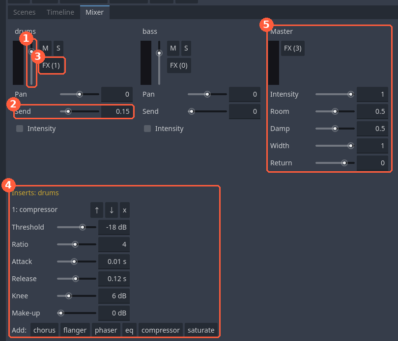

1. Click **Mixer**. Each track has a strip: a level meter, a fader (1), **M** (mute), **S** (solo), **FX**, **Pan** and **Send**.
2. Drag the **bass** fader down a little if the bass is louder than the drums.
3. Set the drums' **Send** to **0.15** (2). Send feeds the shared reverb, so the drums get a little room around them.
4. Click the drums' **FX** button (3), then **compressor** after **Add:** (4). A compressor evens out the loud and soft hits; the default settings are a good start.
5. The **Master** strip (5) controls the whole mix: the shared reverb's **Room**, **Damp**, **Width** and **Return**, and the master effects (**FX (3)**: a DC-blocking filter, a loudness leveller set to -16 LUFS and a limiter, so the final level is consistent).

Mix while the music plays: changes are heard within about a third of a second.

### Step 5: save and export

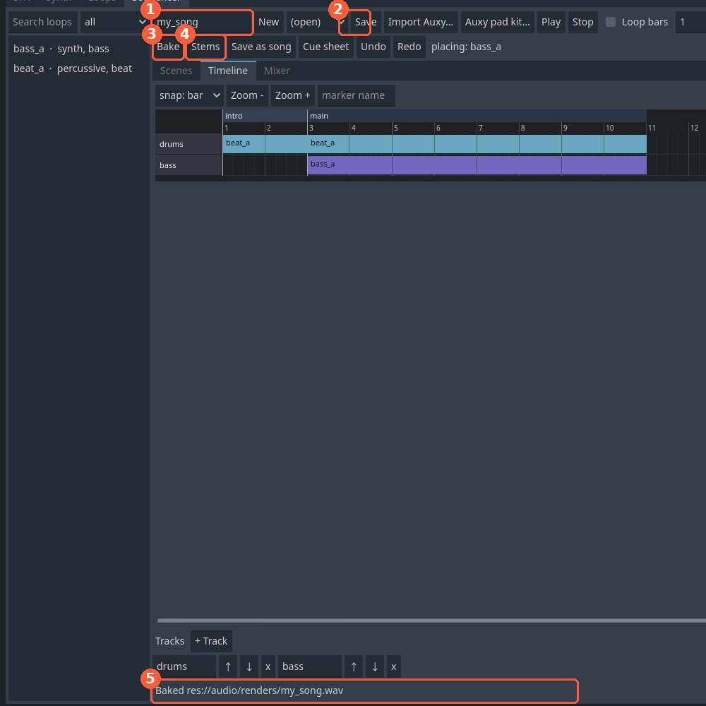

1. Check the name (1) and click **Save** (2). The arrangement is saved to `res://audio/arrangements/my_song.tres`; reopen it later from the menu beside **New**.
2. In the **Timeline** view, click **Bake** (3). The whole timeline is written as `res://audio/renders/my_song.wav` (5): a normal audio file you can play with an **AudioStreamPlayer**, even without the Audio Kit. In the **Scenes** view, **Bake** writes only the selected scene, handy for a loop of background music.
3. **Stems** (4) writes a WAV per track instead, for mixing in another program.

Double-click any clip or scene cell to open its loop in the Loops page, with the rest of the music playing around it, to fix a note in context.

### Step 6: play it in your game

For music that follows the game, play the scenes live with an **AKLivePlayer** node (this needs the native core in your game). Add one to your scene and drag `my_song.tres` onto its **Arrangement** property in the Inspector, then switch scenes from your script:

```gdscript
@onready var music: AKLivePlayer = $Music

func _ready() -> void:
    music.play_scene("intro")

func _on_level_started() -> void:
    music.play_scene("main", &"bar")    # switches on the next bar line
```

Set **Autoplay Scene** in the Inspector to start a scene without any code. For a fixed piece, such as a title screen, the baked WAV on an **AudioStreamPlayer** set to loop is simpler.

`demo/racing/race_demo.tscn` is a worked example: a small race whose countdown, laps and finish switch the music's scenes.

### Tips

- **Loop bars** in the transport plays just a range of bars round and round, for working on one part.
- Any loop can go on any track, since a loop carries its own instrument. Name tracks after their role (drums, bass, lead) to keep things clear.
- In the mixer, **Intensity** on a track fades it in as the game's music intensity rises (`AKLive.set_music_intensity`), for example drums that come in during a fight.

## 5. Recording: play along and record a take

Recording lets you play your MPK along with an arrangement and keep what you played as a **take**: an ordinary loop on the timeline that you can fix up on the Loops grid. In this tutorial you add a keys part to `my_song` (from the Sequencer tutorial), try a few passes round a section, and tidy the result, in about fifteen minutes.

Recording needs the native core and a MIDI keyboard (or the computer keyboard; see Step 6).

### The recording controls

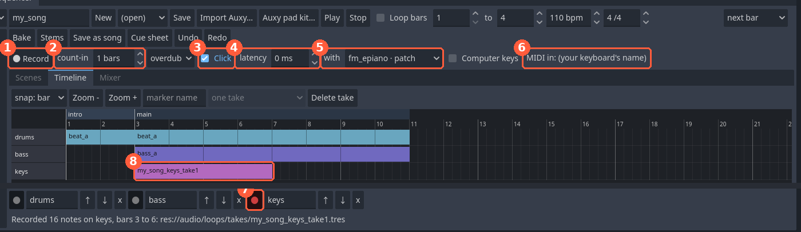

1. **● Record** starts recording; press it again (or **Stop**) to finish.
2. **count-in**: how many bars of clicks you get before the music starts (0 to 4).
3. **Click**: a metronome while you record.
4. **latency**: moves your notes earlier, in milliseconds, if takes come out consistently late.
5. **with**: what you play: the track's own instrument, or any drum kit or patch.
6. **MIDI in**: the keyboard Sound Lab is listening to.
7. The **●** beside a track arms it: that track is the one you play and record on (red when armed).
8. A take: a clip on the armed track, named `<song>_<track>_take<n>`.

### Step 1: set up a track to record on

1. Open `my_song` in the Sequencer (the menu beside **New**) and click **Timeline**.
2. Click **+ Track** and name the new track `keys` (type in its box and press Enter).
3. Click the **●** beside **keys** (7). It turns red: the track is armed, and your MPK now plays it. Play a few notes to hear it.
4. A new track has no loops yet, so it plays the pluck preset. Pick something else under **with** (5): try **fm_epiano · patch**.

Arming also turns on MIDI input. If **MIDI in** (6) says "no devices", plug the MPK in, then click the **●** twice (off and on) to look again.

### Step 2: record a take

1. Click bar **3** in the timeline's bar numbers to move the playhead to the start of **main**.
2. Leave **count-in** at **1 bar** and **Click** on.
3. Click **● Record** (1). You hear four clicks, then the song plays from bar 3 with the click going.
4. Play along: a simple riff over the bass is plenty. Play as long as you like.
5. Click **● Record** again, or **Stop**. The take appears on the keys track (8), from the bar of your first note to the end of the bar of your last.

Every note keeps its velocity, and the sustain pedal (if you have one plugged into the MPK) holds notes exactly as you heard them. **Ctrl+Z** removes the take if you didn't like it. To add more later in the song, move the playhead on and record again: earlier takes stay where they are.

### Step 3: loop a section and build it up

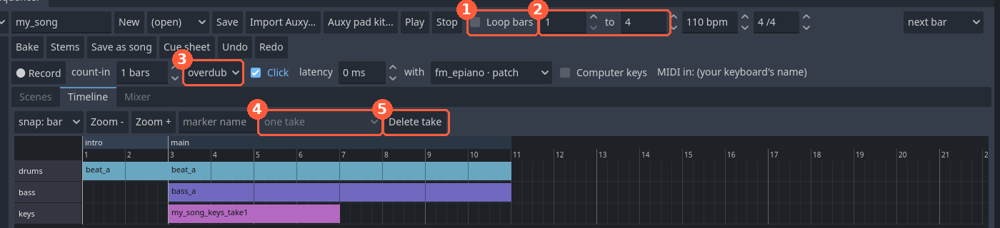

To work on one part, let recording go round it:

1. Tick **Loop bars** (1) and set the range to bars **3** to **4** (2).
2. Pick **overdub** or **replace** (3):
    - **overdub**: every pass is added to the take, and you hear what you played on the passes before. Play the chords one pass, a melody the next.
    - **replace**: each pass you play in replaces the passes before, so you can keep trying until one is right.
3. Click **● Record**, play as many passes as you like, then stop. The take covers exactly bars 3 to 4.

Record over exactly the same bars again and Sound Lab keeps both takes. Click the clip to select it, then use the **take** menu (4) to choose which one plays, or **Delete take** (5) to drop the one playing. The files themselves stay in `res://audio/loops/takes/`.

Untick **Loop bars** afterwards, or **Play** and **● Record** keep going round the range.

### Step 4: tidy the take on the Loops page

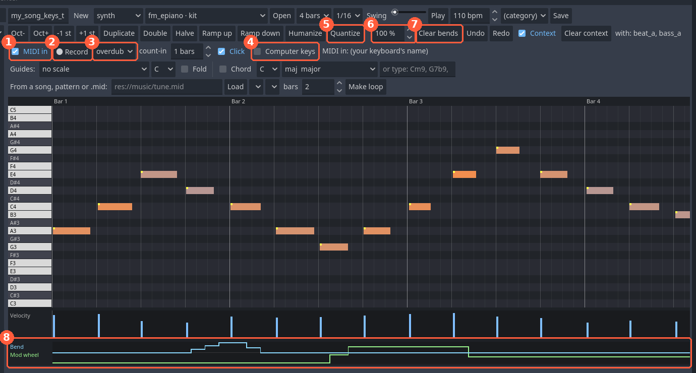

Double-click the take on the timeline: it opens on the Loops page with the rest of the song playing around it. Played notes sit slightly off the grid (a small yellow corner marks each one); that's the feel of your playing, not an error.

1. Select the notes to tidy (right-drag a box), or select none to tidy them all.
2. Set the strength (6): **100%** puts every note exactly on the grid; **50%** moves each one halfway, tightening the timing but keeping some feel.
3. Click **Quantize** (5). **Ctrl+Z** undoes it.
4. Fix any wrong notes by dragging them, as in the Loops tutorial, then **Save**.

On a synth take, the joystick's pitch bend and mod wheel are recorded too. They show in the strip under the velocities (8): **Bend** in blue, **Mod wheel** in green. They play back exactly as you moved them; **Clear bends** (7) removes them.

### Step 5: record straight into a loop

You can also record on the Loops page itself, to build a loop by playing:

1. Open or make a loop, and tick **MIDI in** (1). The keyboard plays the loop's instrument.
2. Pick **overdub** or **replace** (3) and click **● Record** (2). After the count-in, the loop goes round and round, and what you play is added to it (heard on the next pass).
3. Stop when you're happy. The whole recording is one undoable step.

For drums, open a percussive loop and play the pads: they hit the kit's drums by the General MIDI drum map (36 kick, 38 snare, 42 closed hat, 46 open hat, 49 crash), the same as in the Sequencer.

### Step 6: no MIDI keyboard to hand?

Tick **Computer keys** (4 on the Loops page, beside **with** in the Sequencer) and play on the computer keyboard, as on the Synth page: the bottom row `Z X C V B N M` plays the white keys from C3 and `S D G H J` the black keys, the row above plays the next octave, and `[` and `]` move an octave. Computer keys are ignored while you're typing in a box. In the Sequencer they play the armed track.

### Tips

- If every take comes out a little late, raise **latency** by 10 to 20 ms and try again. Godot reads MIDI once a frame, so notes can be up to about 8 ms out before you quantize.
- Turn the count-in up to 2 bars for a slower song, or to 0 to start straight away.
- Takes are ordinary loops, so you can reuse a good riff elsewhere: drag it to another bar, put it in a scene, or **Duplicate** it on the Loops page.

## 6. Pseudo-Speech: give a character a voice

The Pseudo-Speech page turns a line of dialogue into gibberish that follows the text: its rhythm, its stressed syllables and its melody, so a question rises and a shout lands. A word always sounds the same in a voice, so the gibberish reads like a language. In this tutorial you hear a line in a few voices, see why it sounds as it does, steer it with markup, and make a character speak it in a game with subtitles, in about ten minutes.

Every voice works without the native core, but slowly: a line can take 1 to 10 seconds to bake instead of a fraction of a second, and **Live** needs it.

### The page at a glance

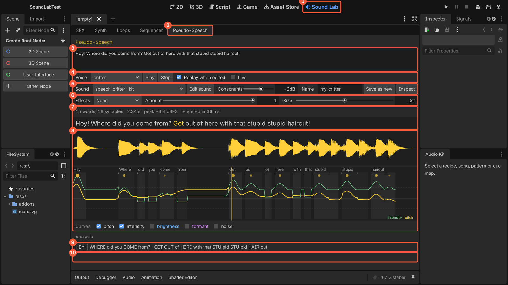

1. **Sound Lab** opens the lab.
2. **Pseudo-Speech** is the fifth page.
3. The line: type any dialogue here.
4. **Voice** picks who speaks; **Play** and **Stop**; **Replay when edited** plays the line again a moment after each change; **Live** plays it the way a game does (Step 4).
5. What the voice is made of: **Sound**, **Edit sound**, **Consonants**, **Name**, **Save** and **Inspect**. These are for making your own voice (next tutorial).
6. **Effects**, **Amount** and **Size**: a character for the voice, such as a demon or a robot (next tutorial).
7. The line's length and level, and the subtitle, which lights each word as it's spoken.
8. The waveform, and under it on the same time axis the curves: each word, its syllables and accents, and the pitch and loudness the voice follows. The checkboxes pick which curves are drawn.
9. **Analysis**: how the text was read.
10. Messages.

### Step 1: hear a line

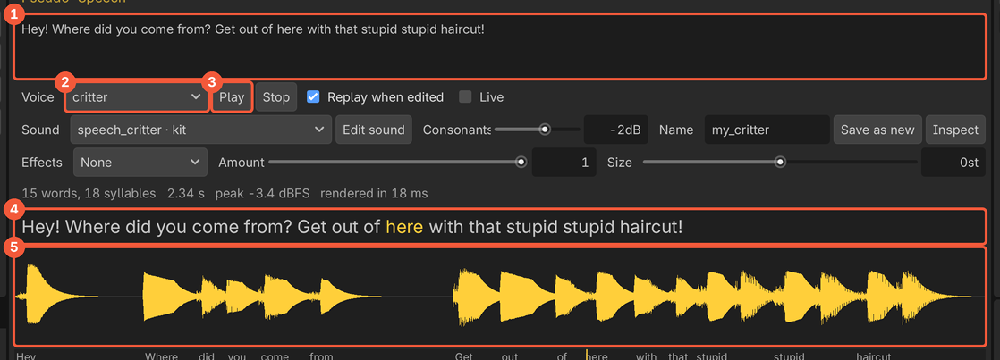

1. The page starts with a test line (1). Leave it for now, or type your own.
2. Set **Voice** (2) to **critter** and click **Play** (3). The subtitle (4) lights each word as you hear it, and the waveform (5) shows the line.
3. Try the other voices: **blip** (a retro text-box beep), **hollow** (a breathy whisper), **drone_priest** (a slow, low chant) and **scratch_king** (record scratches). Each takes the same words and makes them its own.
4. Change a word in the line. With **Replay when edited** ticked, it plays again a moment later.

Run the line through twice and it sounds exactly the same both times: the melody comes from the words, not from chance. Change one word and the others keep their own small melodies.

### Step 2: see why it sounds that way

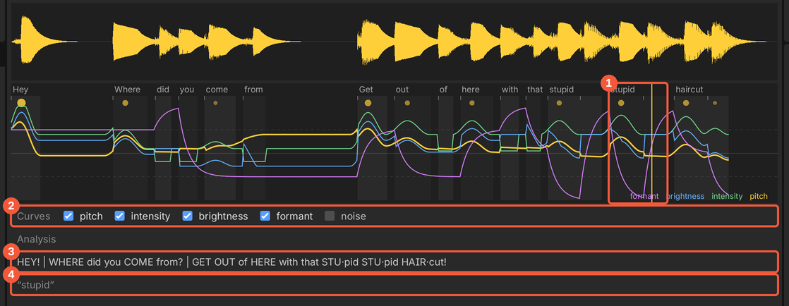

1. **Click a word** in the curves (1) to hear it alone, cut from the line so it keeps its place in the melody. The message line (4) shows which word you heard, and a yellow playhead follows it.
2. The bands are the words, each with its text. A small tick marks each syllable, and a dot marks an accented one: the bigger the dot, the stronger the accent. The second "stupid" gets a bigger dot than the first, because a word repeated in its clause lands harder each time.
3. Tick **brightness** and **formant** (2) to see more of what the voice follows. Pitch is yellow, around the voice's resting note, with its range dashed.
4. **Analysis** (3) shows how the text was read: syllables split with `·`, stressed ones in CAPITALS, each clause with its end mark (`!`, `?` or `.`), which sets its melody: a question rises at the end, an exclamation starts high and falls.

A word marked `(?)` in the analysis is one the kit's stress dictionary doesn't know (usually an invented name), so its stress was guessed. Tips below say how to fix it.

### Step 3: steer it with markup

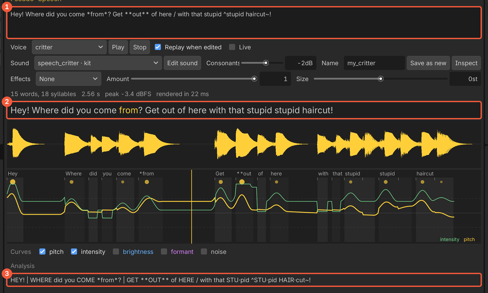

Marks in the text override what the words imply. Replace the line (1) with:

`Hey! Where did you come *from*? Get **out** of here / with that stupid ^stupid haircut~!`

The subtitle (2) shows the line without the marks, and the analysis (3) shows them in place. Each mark:

| Mark | Example | What you hear |
| --- | --- | --- |
| `*word*` | `come *from*` | An accent: higher, louder and brighter |
| `**word**` | `**out**` | The strongest accent, shouted and clipped |
| `/` | `here / with` | A short pause |
| `^word` | `^stupid` | A rise across the word; `_word` falls instead |
| `word~` | `haircut~` | The last syllable held longer; more tildes, longer |
| `{tag}` | `{whisper} come here` | Changes the voice until the next tag: `whisper`, `shout`, `excited`, `sad`, `fast`, `slow`, `high`, `low`; `{normal}` goes back |

A mark can cover several words (`**GET OUT**`). An unclosed mark or an unknown tag still plays; the message line says what's wrong.

### Step 4: play it live

Tick **Live** and click **Play**. The line now plays on the live synth, the way a game's speaker plays it: it starts at once, however long the line is, and the waveform and curves appear just after. Live and baked sound the same.

**Live** needs the native core and a voice made from a patch; **scratch_king** always bakes.

### Step 5: make a character speak in your game

An **AKSpeaker** node says lines in a voice and tells you when each word is heard, for subtitles and mouths. Add one to your character's scene and set its **Voice** to `critter.tres` (in `addons/audio_kit/speech/voices/`) in the Inspector, then:

```gdscript
@onready var speaker: AKSpeaker = $Speaker

func _ready() -> void:
    speaker.word_started.connect(func(index, word): $Subtitle.text = word)
    speaker.line_finished.connect(func(_line): $Subtitle.text = "")

func talk() -> void:
    speaker.say("Hey! Where did you come *from*?")

func _process(_delta: float) -> void:
    $Mouth.scale.y = 0.2 + speaker.mouth()   # open while a syllable sounds
```

The signals follow what you hear, not what was scheduled, so a subtitle or a mouth never runs ahead of the sound. A speaker plays live when the native core is in the game and bakes otherwise. To make it come from the character's place on screen, give its **Player** property an **AudioStreamPlayer2D** (or 3D).

`demo/speech/speech_demo.tscn` is a worked example: type a line, pick a voice, and a face mouths it under a subtitle.

### Tips

- For a word marked `(?)`, such as a character's name, add a line to the **Text** of `res://audio/speech/lexicon.tres`, an **AKSpeechLexicon** resource (make it with **New Resource** if your project has none): `zorblax 10` says ZOR·blax, one stress digit per syllable (1 stressed, 0 not).
- **drone_priest** without the native core takes about 10 seconds to bake the test line, so the page stops replaying it after each edit and says so; press **Play** when you're ready.
- In a cue map, a line is an ordinary recipe of the `speech` voice, with the text and the voice's path as its settings, so motion kit pieces can speak too.

## 7. Make your own voice: a goblin

Every character can have a voice of their own. On the Pseudo-Speech page you start from the kit voice closest to what you want and change what it's made of, how it speaks and its character, then save it as a new voice. In this tutorial you turn **critter** into a gruff, buzzy goblin and give it to a character in your game, in about ten minutes.

The page always edits a copy of the voice you pick, so you can't break the kit's voices: nothing is written until you click **Save**.

### Step 1: start from Critter and change its sound

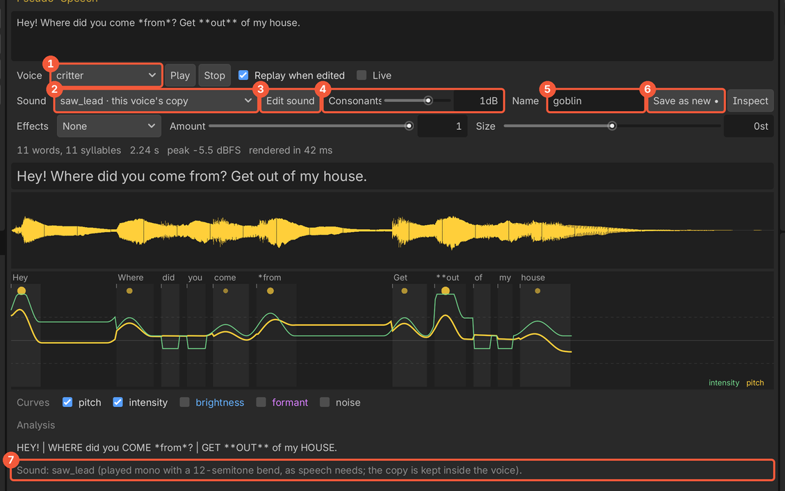

1. Type a short line to test with, such as `Hey! Where did you come *from*? Get **out** of my house.`
2. Set **Voice** to **critter** (1). It's quick and high, a good start for a small creature.
3. Set **Sound** (2) to **saw_lead · kit**. Sound is what the voice is made of, and changes it the most: Critter's own squeaky pulse becomes a buzzy saw. The list has the speech patches first, then every patch from the Synth page (the kit's, the General MIDI bank and yours), and at the end **scratch**, the record scratches Scratch King is made of.
4. The message (7) says the patch is played mono with a 12-semitone bend range, as speech needs. That copy is kept inside the voice, so the menu now says **saw_lead · this voice's copy**.
5. Drag **Consonants** (4) to **+1 dB**. That's the clicks of p, t and k and the hiss of s, f and h; a goblin spits its words a little more than Critter.
6. Type `goblin` in **Name** (5). The **Save as new** button (6) shows a dot while there are unsaved changes.

Any patch works as a sound, including your own from the Synth tutorial. **Edit sound** (3) opens it on the Synth page (Step 4).

### Step 2: give it a character

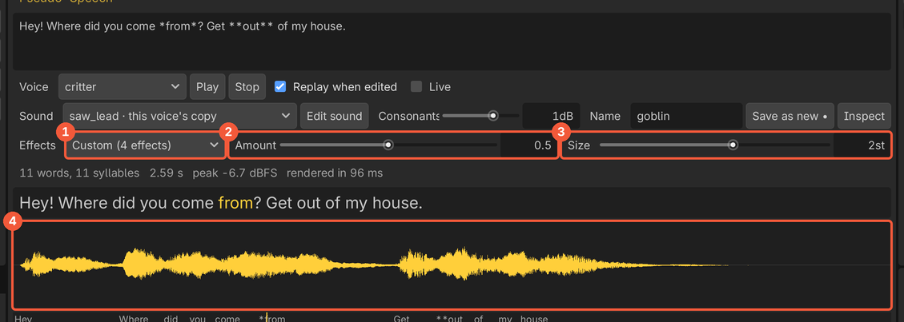

1. Set **Effects** (1) to **Beast**: a ragged growl, grit, a copy a fifth below and a small room.
2. Drag **Amount** (2) to **0.5**. Amount scales every effect at once: 0 is the dry voice, 1 the full character. Half a beast is plenty for a goblin.
3. Beast also sets **Size** (3) to +5, a big body. Drag it down to **+2 st**. Size changes how big the speaker sounds without changing the pitch: up is a bigger throat, down a smaller one. It's most of what makes a creature sound large or small.
4. Listen, and watch the waveform (4): the growl roughens it, and the line rings on a little after the last word.

The menu now says **Custom (4 effects)**, because the voice no longer matches Beast exactly. The effects are still Beast's, at your Amount and Size. Effects keep each voice at about the same loudness, so you can try them all freely:

| Character | Sounds like | Size |
| --- | --- | --- |
| Demon | An octave-down double, a growl, grit and a dark hall | +3 |
| Angel | A shimmering choir: chorus, a faint octave up, a bright hall | −1 |
| Alien | A swept ring modulator, a deep phaser, a short echo, lost bits | 0 |
| Beast | A ragged growl, grit and a fifth below | +5 |
| Sprite | A tiny body with a quick warble and a little echo | −5 |
| Ghost | Thin and far away: flanging, long echoes, a huge room | 0 |
| Robot | A low ring modulator, crushed samples, a tin can | 0 |
| Radio | A narrow, crunchy, squashed band, like a walkie-talkie | 0 |

### Step 3: change how it speaks

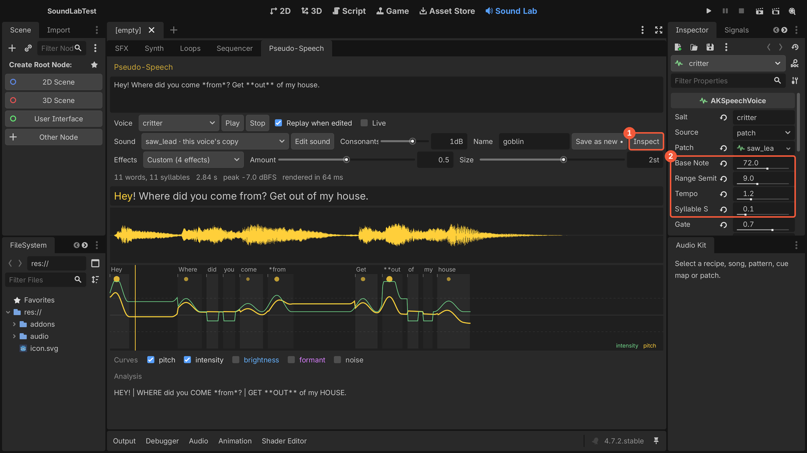

1. Click **Inspect** (1). Every setting of the voice opens in the Inspector, and changes there replay just like the page's own.
2. Set **Base Note** (2) to **72** (C5). Critter rests on 79 (G5); a goblin sits a little lower.
3. Set **Tempo** to **1.2**. Critter talks at 1.35; the goblin is a touch slower.

The other settings are worth a try too:

- **Range Semitones**: how far the melody moves. Wider sounds excitable, narrower sounds flat or sinister.
- **Syllable S** and **Gate**: how long a syllable lasts, and how much of it sounds. A low gate gives clipped, choppy speech.
- **Jitter**: looseness in the timing. 0 is a metronome.
- **Seed Pitch Semitones**: how much each word's own little melody moves it.
- **Effects**, further down: the effects one by one, with every setting, like the effects on a patch.

### Step 4 (optional): edit the sound on the Synth page

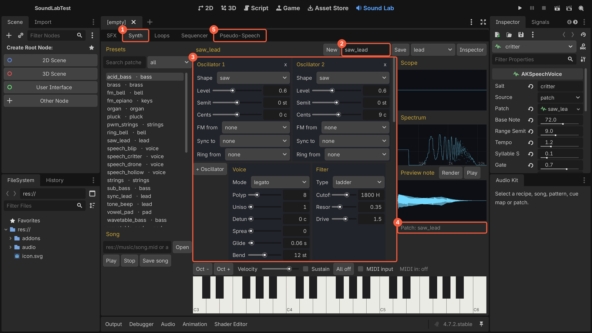

Click **Edit sound** on the Pseudo-Speech page. The lab switches to **Synth** (1) with the voice's copy of the patch open (2, 4), and every panel (3) works as in the Synth tutorial: a darker filter, a second detuned oscillator, a different wave.

Then click **Pseudo-Speech** (5) to go back and hear the voice with your changes. They're part of the voice and saved with it, so there's no need to save on the Synth page: that would write a separate patch file.

A speech patch hears the line through the usual inputs: a note per syllable, pitch bend for the melody, velocity for loudness, and the mod wheel for the vowel (dark u to bright i). A matrix row from **mod_wheel** to **cutoff** makes vowels sound different; Critter's own patch does this.

### Step 5: save it, and use it

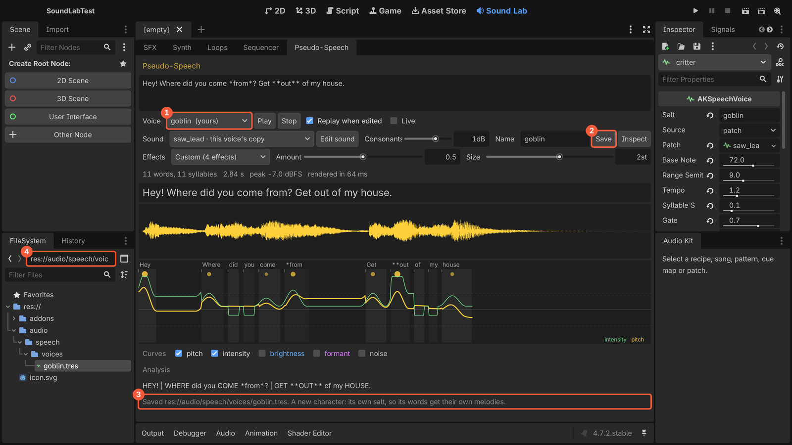

1. Click **Save as new**. The message (3) confirms it was saved to `res://audio/speech/voices/goblin.tres`, and it's in your project (4).
2. **Voice** (1) now shows **goblin (yours)**, and the button says **Save** (2): from now on it saves over your goblin.
3. A new voice gets its name as its *salt*, so its words get melodies of their own: "house" in Goblin is a different little tune from "house" in Critter.
4. To use it, set an **AKSpeaker**'s **Voice** to `goblin.tres`, as in the previous tutorial, or in code:

```gdscript
$Speaker.voice = load("res://audio/speech/voices/goblin.tres")
$Speaker.say("Get **out** of my house.")
```

A speaker that already holds the goblin picks up your changes the next time you save.

### Tips

- Saving a kit voice under a new name never changes the kit's own voice. To make a second goblin, pick **goblin (yours)**, change it, type a new name and save.
- In the Inspector, **States** gives a voice its own `{tag}` moods, or its own patch for one: a `shout` state with a rougher patch speaks every `**word**` through it.
- Voice files are ordinary resources: copy one into another project's `res://audio/speech/voices/` and it appears in **Voice** there.

## 8. Flavor: dial in a funky bass

The Flavor page makes an instrument from fourteen knobs and five switches named for what you hear: Lean ↔ Beefy, Silky ↔ Gritty, Polite ↔ Farty. Where the Synth page (tutorial 2) has every setting, Flavor has a few strong ones, and each knob moves many settings at once. In this tutorial you turn one neutral sound into a quacking, pumping bass, link a knob to your MPK Mini, and save it for your game, in about ten minutes.

What you make is an ordinary patch, the same kind the Synth page makes, so it plays, saves and works in Loops and the Sequencer like any other. Live playing needs the native core (see Before you start). Without it, the knobs and saving still work.

### The page at a glance

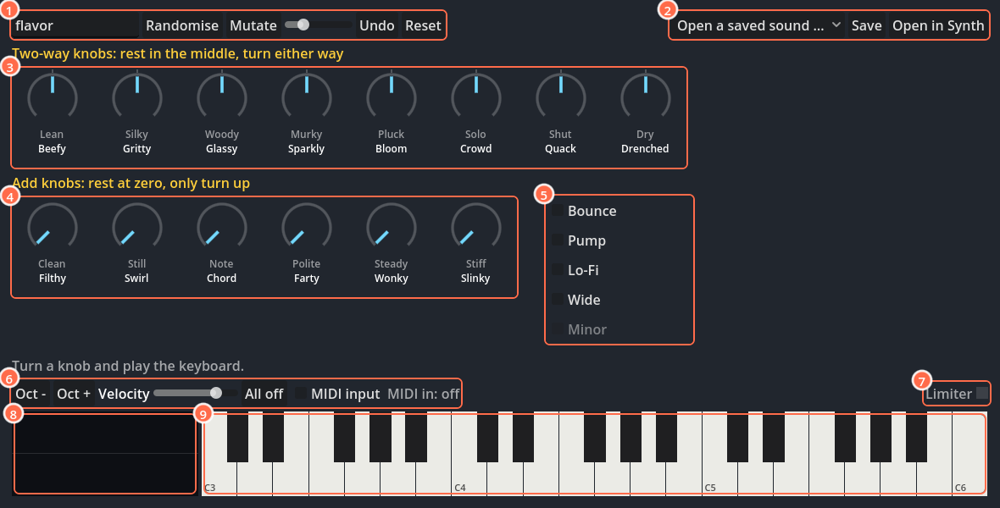

1. The sound's name, **Randomise**, **Mutate** with its amount slider, **Undo** and **Reset**.
2. The menu of sounds you've saved from this page, **Save**, and **Open in Synth**.
3. **Two-way knobs**. Each rests in the middle, which is the starting sound, and turns either way toward one of its two words.
4. **Add knobs**. Each rests at zero, fully left, and only turns up, toward its second word.
5. The switches. **Minor** is greyed out until Note ↔ Chord is turned up far enough for it to matter.
6. The keyboard's controls, as on the Synth page: **Oct -** and **Oct +**, **Velocity**, **All off** and **MIDI input**.
7. The **Limiter** light. It comes on when a sound is loud enough to reach the limiter that ends every Flavor sound.
8. The scope shows what you're playing.
9. The keyboard: click it, use your computer keys, or play a MIDI keyboard.

With every control at rest you hear the **base sound**: a plain, pleasant synth tone that works as a bass, a chord or a lead. Every knob sculpts that one sound.

To turn a knob, drag it **up or right** (down or left to go the other way). Hold **Shift** for fine steps, or roll the mouse wheel. While you drag, the knob shows its value: −1 to 1 for a two-way knob, 0 to 1 for an add knob. **Double-click** a knob to send it back to rest. Hover over one to read what it does.

### Step 1: hear the base, then turn one knob

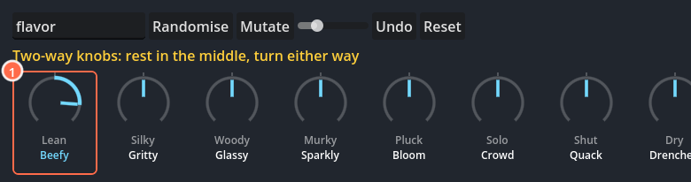

1. Play some low notes on the keyboard (the bottom row of your computer keys, `Z X C V B N M`). That's the base sound.
2. Drag **Lean ↔ Beefy** (1) up to about **0.70** and play again. The sound gets heavier: a sub an octave down, more low end, and some squash. The word **Beefy** lights up to show which way the knob has gone.
3. Now drag it down past the middle to about **−0.70**. The lows drop away and you're left with a thin, bright shell.
4. Double-click the knob to return it to rest.

Every knob works this way: the far ends are meant to be too much, so the useful sounds are usually somewhere along the way.

### Step 2: shape a funk bass

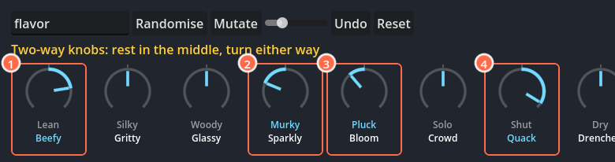

Set four knobs, playing low notes after each one:

1. **Lean ↔ Beefy** (1) to about **0.60**, for weight.
2. **Murky ↔ Sparkly** (2) down to about **−0.50**. The tone closes up and goes dark. This leaves room for the next two knobs to open it again.
3. **Pluck ↔ Bloom** (3) down to about **−0.30**, so each note starts with a snap and settles quickly.
4. **Shut ↔ Quack** (4) up to about **0.90**. This is a wah pedal rocked on every note: play a few and you'll hear each one go "wow". Play harder (click lower on a key, or raise **Velocity**) and it opens further.

Knobs add up. Murky closed the filter and Quack throws it open on each note, so together they give a bigger sweep than Quack alone. Try turning Murky ↔ Sparkly the other way, up toward Sparkly: the quack mostly disappears, because the filter is already open.

### Step 3: add dirt, glide and a pump

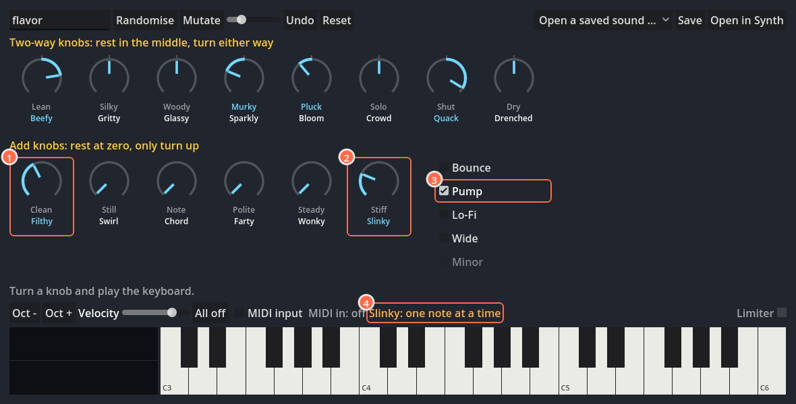

1. Turn **Clean ↔ Filthy** (1) up to about **0.40**. It adds dirt in stages: saturation first, then a growl, and near the top a digital crush that falls apart. At 0.40 you have the saturation and the start of the growl.
2. Turn **Stiff ↔ Slinky** (2) up to about **0.25**. The sound now plays **one note at a time** and slides from each note to the next. A reminder appears beside the keyboard controls (4), because chords stop working while this knob is up. Play a line with big jumps to hear the slides.
3. Tick **Pump** (3). The level ducks on every beat and swells back, like a bass ducking under a kick drum. Hold a note to hear it breathe.

That's the bass. If you want it wilder, try **Polite ↔ Farty**; if you want it bigger and wider, try **Solo ↔ Crowd** upward (turn Slinky back down first if you want chords).

### Step 4: Randomise, Mutate and Undo

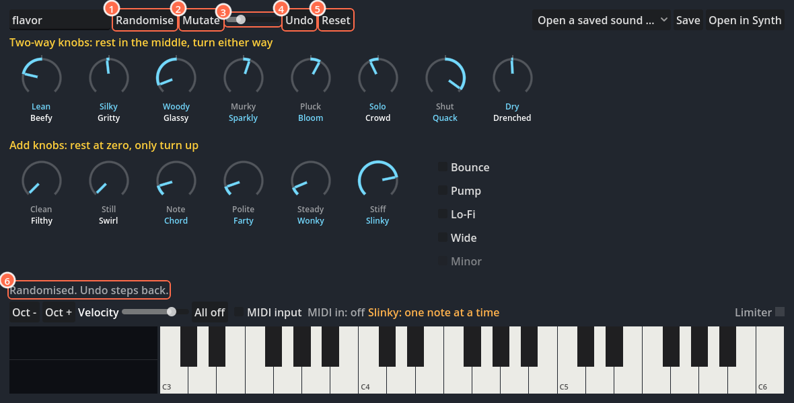

1. **Randomise** (1) makes a new sound from scratch. Most knobs land near rest and three or four are pushed far, so each result has a character. The message (6) confirms it.
2. **Mutate** (2) makes a near neighbour of the current sound: every knob moves a little.
3. The slider (3) sets how far Mutate moves them. Left is a nudge; right is a different sound.
4. **Undo** (4) steps back to the sound before the last change, so a good sound is never lost to the next press. Press it until your bass from Step 3 is back.
5. **Reset** (5) puts every control at rest: the base sound.

A good way to explore: press **Randomise** until something catches your ear, then **Mutate** a few times to circle around it.

### Step 5: save it

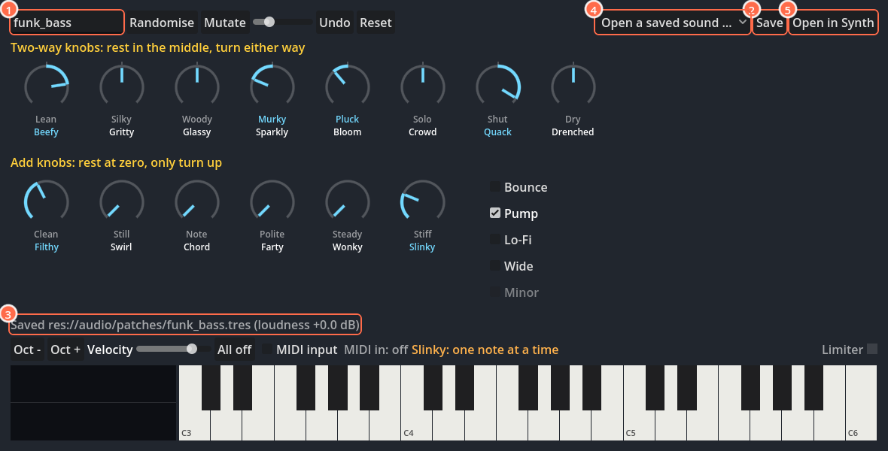

1. Type a name, such as `funk_bass`, in the name box (1).
2. Click **Save** (2). The message (3) confirms it was saved to `res://audio/patches/funk_bass.tres`.
3. The sound is now in the menu of saved sounds (4). Choose it there later and every knob and switch goes back to where you left it.

Saving also **evens out the loudness**. Some combinations are much louder than others, so Save measures the sound and gives it one fixed gain, to bring it within a few decibels of the base sound. The message shows the gain it chose (+0.0 dB here: this sound was already in range). It's a fixed number, not a compressor, so how hard you play still matters just as much.

The saved file also appears in the Synth page's **Library**, among your patches, and works as a track's instrument on the Loops page.

### Step 6: turn a knob from your MPK Mini

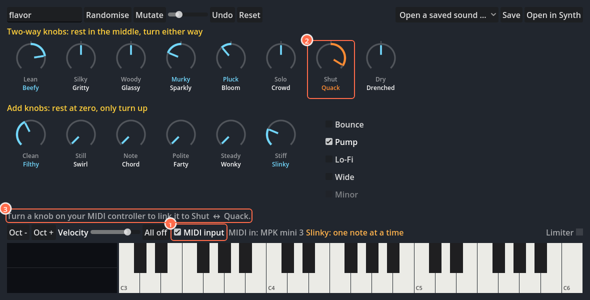

1. Plug in the MPK Mini before opening Godot, then tick **MIDI input** (1). Its name appears beside the box, and its keys now play the sound.
2. **Right-click** a knob, such as Shut ↔ Quack (2), and choose **Learn MIDI controller**. The knob turns orange and the message (3) asks you to turn a knob on your controller.
3. Turn one of the MPK's eight knobs. The link is made, and a small dot appears beside the on-screen knob.
4. Turn the MPK knob again. If the on-screen knob doesn't move at first, keep turning: it waits until the hardware knob reaches the position shown on screen, then follows. That stops the sound jumping when the two start out in different places.

On a two-way knob, the middle of the hardware knob's travel is rest. To remove a link, right-click the knob and choose **Forget MIDI controller**. Links are remembered by the editor between sessions; they aren't part of the saved sound.

Hold a note and sweep Shut ↔ Quack from the MPK: the held note follows as you turn.

### Step 7 (optional): fine-tune it on the Synth page

Click **Open in Synth**. A copy of the sound opens on the Synth page, where you can see and change every setting the knobs chose: its oscillators, filter, envelopes, modulation rows and effects. The last section of this tutorial explains what you'll find there.

This is one way. Once you change the copy on the Synth page and save it, the knob positions stored in it describe the sound as it was before those changes. It still opens on the Flavor page, with a notice:

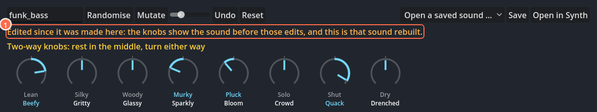

The knobs go to where they were, and you hear that earlier sound rebuilt from them; the Synth page edits are in your saved file, but not in what the Flavor page is playing. So finish on the Flavor page first, then move to the Synth page for detail work.

### Step 8: use it in your game

A Flavor sound is a patch, so it plays the same way as the bass from tutorial 2 (this needs the native core in the exported game):

```gdscript
var bass := AKSynthStream.new()
bass.patch = load("res://audio/patches/funk_bass.tres")
$Music.stream = bass
$Music.play()
bass.note_on(36, 0.9)        # C2, fairly hard
bass.note_off(36, 0.5)       # let go half a second later
```

You can also build one from code, with the same names the knobs have:

```gdscript
var patch := AKFlavor.build({lean_beefy = 0.6, shut_quack = 0.9, pump = true})
AKFlavor.level(patch)   # even out its loudness, as Save does
```

Knobs take −1 to 1 (two-way) or 0 to 1 (add); switches take `true` or `false`; anything left out is at rest. The knobs live in the editor only: a running game plays the finished patch.

### Tips

- Start with one or two knobs. Because they add up, five knobs at full is usually a mess; two or three at half is usually a sound.
- **Murky** with **Quack** is the funkiest pairing; **Beefy** with **Farty** is a tuba; **Lean** with **Farty** is a raspberry; **Glassy** with **Bloom** and **Drenched** is a shimmering pad.
- **Bounce** turns held chords into an arpeggio in time with the tempo. With **Slinky** up as well, it slides between the steps.
- If the **Limiter** light is on all the time, the combination is very loud or very resonant. It won't clip (the limiter holds it), but backing off Quack, Gritty or Farty will sound cleaner.
- **Pump**, **Bounce** and the echo from **Dry ↔ Drenched** follow the tempo, which is 120 BPM on this page.
- Solo ↔ Crowd, Still ↔ Swirl and **Wide** are mostly about stereo width, so judge them on headphones or stereo speakers.

### Behind the knobs: what each one changes

Every knob is a recipe. Turning it moves a handful of the patch's settings together, each by its own amount, and that's all it does: there is no hidden processing. This section lists each recipe, using the names you'll see if you click **Open in Synth**.

**How to read the tables.** Each row is one setting, with its value when the knob is fully down, at rest, and fully up. In between, a setting moves in a straight line from its rest value to its end value unless the notes say otherwise. "–" means the knob leaves that setting alone at that end, and "absent" means the oscillator, effect or modulation row doesn't exist there.

**The base sound.** With everything at rest, the patch is:

| Part | Settings |
| --- | --- |
| Oscillator 1 | Shape **morph** at position 0.55 (between triangle and saw), level 0.6 |
| Oscillator 2 (the sub) | Sine, one octave down, level 0.25 |
| Voice | Unison 2, detune 8 cents, spread 0.3, polyphonic, gain −6 dB |
| Filter | Ladder, cutoff 2500 Hz, resonance 0.2, drive 1.2 |
| Amp envelope | Attack 0.01 s, decay 0.5 s, sustain 0.6, release 0.25 s |
| Envelope 2 | Attack 0, decay 0.35 s, sustain 0.15, release 0.25 s |
| Modulation rows | env2 → cutoff 1.0; key → cutoff 0.4; velocity → cutoff 0.5 (all in octaves) |
| Effects | Saturate (drive 4 dB, mix 0.5), delay (dotted eighth notes, feedback 0.2, mix 0.08), reverb (room 0.45, mix 0.12), limiter (ceiling −1 dB) |

Several knobs add an **EQ** or a **compressor** at the front of the effects. They aren't in the base, so their rest value is "flat" or "off". Filter cutoff changes are given in octaves, because that's how knobs that share the cutoff add up.

#### Lean ↔ Beefy

Low-end weight. Beefy adds two subs and lifts the lows and low-mids; Lean removes the sub and cuts everything below about 700 Hz.

| Setting | Lean (−1) | Rest | Beefy (+1) |
| --- | --- | --- | --- |
| Oscillator 2 (sine sub) level | 0 | 0.25 | 0.60 |
| A square oscillator one octave down | absent | absent | level 0.60 |
| EQ low shelf | −24 dB at 700 Hz | flat (150 Hz) | +9 dB at 250 Hz |
| EQ mid peak | −8 dB at 400 Hz | flat (300 Hz) | +10 dB at 500 Hz |
| EQ high shelf at 5 kHz | +6 dB | flat | +4 dB |
| Compressor | off | off | 4:1, threshold −20 dB, attack 0.03 s, makeup +5 dB |
| Saturate drive / mix | – | 4 dB / 0.5 | 12 dB / 0.9 |
| Unison | 1 voice (from −0.75 down) | 2 | – |
| Gain | +8 dB | – | −8 dB |

The saturate's output is also trimmed on the way up (by 2.5 dB at full, on a curve), so Beefy sounds bigger without clipping.

#### Silky ↔ Gritty

Smooth or rough, at the source. Silky gets its smoothness by removing roughness while adding clean highs; Gritty roughens the oscillator itself.

| Setting | Silky (−1) | Rest | Gritty (+1) |
| --- | --- | --- | --- |
| Oscillator 1 position | 0.36 (triangle) | 0.55 | 0.72 (saw) |
| A sine one octave up / two octaves up | level 0.30 / 0.12 | absent | absent |
| Noise bending oscillator 1 (FM from a silent noise oscillator) | absent | absent | index 0.8 |
| A saw an octave and a fifth up, hard-synced to oscillator 1 | absent | absent | level 0.35 |
| Filter cutoff | +0.5 octave | 2500 Hz | +1 octave |
| Filter resonance | 0.05 | 0.20 | 0.45 |
| Filter drive | 0.6 | 1.2 | 3.0 |
| env2 → cutoff | 0.3 | 1.0 | 1.5 |
| Amp attack | 0.035 s | 0.01 s | – |
| Saturate mix | 0.1 | 0.5 | – |
| EQ high shelf at 5 kHz | +6 dB | flat | – |
| Gain | −1 dB | – | +2 dB |

#### Woody ↔ Glassy

The material. Woody is a hollow tone that is struck and damped; Glassy is a bell that rings on.

| Setting | Woody (−1) | Rest | Glassy (+1) |
| --- | --- | --- | --- |
| Oscillator 1 position | 0.90 (near square) | 0.55 | 0.15 (near sine) |
| Bell FM: a silent sine at 3.5 times the note, bending oscillator 1 | absent | absent | index 1.2 |
| env2 → oscillator 1's FM (brightest at the strike) | absent | absent | 2.5 |
| Filter cutoff | −1 octave | 2500 Hz | +1.5 octaves |
| Filter resonance | 0.35 | 0.20 | 0.10 |
| env2 → cutoff (the knock) | 2.5 | 1.0 | – |
| Envelope 2 decay / sustain | 0.08 s / 0 | 0.35 s / 0.15 | 0.75 s / – |
| Amp decay | 0.25 s | 0.5 s | 1.5 s |
| Amp sustain | 0.15 | 0.6 | 0.35 |
| Amp release | 0.12 s | 0.25 s | 1.5 s |
| EQ mid peak | +6 dB at 450 Hz | flat | – |
| EQ high shelf at 5 kHz | −4 dB | flat | +5 dB |
| Saturate mix | – | 0.5 | 0.2 |
| Gain | +1 dB | – | −1.5 dB |

#### Murky ↔ Sparkly

Dark and closed, or open with movement in the highs.

| Setting | Murky (−1) | Rest | Sparkly (+1) |
| --- | --- | --- | --- |
| Filter cutoff | −3 octaves (about 310 Hz) | 2500 Hz | +2.5 octaves (about 14 kHz) |
| env2 → cutoff | 0.3 | 1.0 | – |
| key → cutoff (how much high notes open the filter) | 0 | 0.4 | 1.0 |
| velocity → cutoff | 0.2 | 0.5 | 1.0 |
| Oscillator 1 position | – | 0.55 | 0.65 |
| A saw one octave up, doubled and detuned 18 cents | absent | absent | level 0.30 |
| A saw two octaves up | absent | absent | level 0.15 |
| The "ting": a sine three octaves up, shaped by Envelope 3 (decay 0.25 s, no sustain) | absent | absent | level 0.30 |
| Chorus (3 voices, 1.2 Hz) | absent | absent | mix 0.4 |
| Pitch effect, one octave up | absent | absent | mix 0.25 |
| EQ high shelf | −12 dB at 5 kHz | flat | +10 dB at 3 kHz |
| EQ mid peak | +4 dB at 250 Hz | flat | – |
| Reverb mix / damp | 0.22 / 0.9 | 0.12 / 0.5 | 0.20 / – |
| Gain | +2.5 dB | – | +1.5 dB |

#### Pluck ↔ Bloom

Only how a note moves over time; the resting tone stays the same.

| Setting | Pluck (−1) | Rest | Bloom (+1) |
| --- | --- | --- | --- |
| Amp attack | 0.001 s | 0.01 s | 1.21 s |
| Amp decay | 0.18 s | 0.5 s | – |
| Amp sustain | 0.05 | 0.6 | 1.0 |
| Amp release | 0.15 s | 0.25 s | 1.5 s |
| Envelope 2 attack | – | 0 | 1.0 s |
| Envelope 2 decay | 0.12 s | 0.35 s | – |
| Envelope 2 sustain | 0 | 0.15 | 1.0 |
| Envelope 2 release | – | 0.25 s | 1.25 s |
| env2 → cutoff | 3.0 | 1.0 | 1.5 |
| Filter cutoff | – | 2500 Hz | −1 octave (the envelope then opens it) |
| Gain | +3.5 dB | – | −0.5 dB |

The Bloom attack is curved so the swell arrives early: 0.44 s at half, 1.21 s at full. This knob **multiplies** the attack and release times (Pluck shortens the attack to a tenth; Bloom makes the release six times longer), which is why it is applied after the other knobs that add to those times.

#### Solo ↔ Crowd

One exposed player, or many not quite together.

| Setting | Solo (−1) | Rest | Crowd (+1) |
| --- | --- | --- | --- |
| Unison | 1 voice (from −0.5 down) | 2 | 7 (it steps: 5 at half) |
| Detune | 0 cents | 8 | 45 |
| Spread | 0 (centred) | 0.3 | 1.0 (full width) |
| Reverb width | 0 (mono) | 1.0 | – |
| Vibrato: LFO 1 at 5.5 Hz, fading in after 0.25 s, → pitch | 0.3 semitones | absent | absent |
| random → pitch (each note starts slightly off) | absent | absent | 0.12 semitones |
| Chorus (3 voices, 0.6 Hz) | absent | absent | mix 0.5, over the top half only |
| Gain | – | – | +5 dB, over the top half only |

Seven detuned voices partly cancel each other, which is what the gain makes up for.

#### Shut ↔ Quack

A wah pedal. Both ends park the filter two octaves lower; what differs is whether each note then throws it open.

| Setting | Shut (−1) | Rest | Quack (+1) |
| --- | --- | --- | --- |
| Filter cutoff | −2 octaves (625 Hz) | 2500 Hz | −2 octaves (625 Hz) |
| Filter resonance | 0.60 | 0.20 | 0.75 |
| env2 → cutoff | 0 | 1.0 | 5.0 |
| velocity → cutoff | 0 | 0.5 | 2.0 |
| Envelope 2 attack (the "w" of the wah) | – | 0 | 0.04 s |
| Envelope 2 decay / sustain | – | 0.35 s / 0.15 | 0.22 s / 0 |
| Gain | – | – | +1 dB |

#### Dry ↔ Drenched

No room at all, or echoes and a wash that barely fades. Drenched comes in stages: the delay over the first 60% of the travel, the reverb from 20% up, and a second reverb over the last 40%.

| Setting | Dry (−1) | Rest | Drenched (+1) |
| --- | --- | --- | --- |
| Delay mix | 0 | 0.08 | 0.70 |
| Delay feedback | – | 0.2 | 0.80 |
| Delay damping | – | 3500 Hz | 1800 Hz |
| Reverb mix | 0 | 0.12 | 1.0 |
| Reverb room | – | 0.45 | 0.98 |
| Reverb damp | – | 0.5 | 0.6 |
| A second reverb after the first (room 0.9) | absent | absent | mix 0.8 |
| Amp release | a quarter of its length | 0.25 s | – |
| Gain | – | – | −14 dB |

The gain falls on a curve (−4 dB at half) because delay and reverb add their sound on top of the notes, and they pile up fastest near the top.

#### Clean ↔ Filthy (add knob)

Dirt after the synth, in three overlapping stages.

| Setting | Rest (0) | Half (0.5) | Full (1) |
| --- | --- | --- | --- |
| Saturate drive | 4 dB | 24 dB | 24 dB |
| Saturate mix / asymmetry | 0.5 / 0 | 1.0 / 0.4 | 1.0 / 0.4 |
| Saturate output (level compensation) | 0 dB | −11 dB | −11 dB |
| EQ mid peak ahead of the saturation | flat | +8 dB at 800 Hz | +8 dB at 800 Hz |
| Growl effect at 45 Hz | absent | depth 0.5, mix 0.32 | depth 0.8, mix 0.8 |
| Crush effect | absent | absent | 3 bits, hold 14, fully wet |

Saturation ramps over 0 to 0.5, the growl over 0.3 to 0.8, and the crush over 0.65 to 1. The mid boost in front makes the distortion bite in the midrange, not only on the bass.

#### Still ↔ Swirl (add knob)

Movement. A phaser ramps in over the first half and a flanger from 0.4 up, while LFO 2 swings each note around.

| Setting | Rest (0) | Half (0.5) | Full (1) |
| --- | --- | --- | --- |
| Phaser | absent | mix 0.6, 8 stages, 0.65 Hz, feedback 0.6 | the same, at 1.0 Hz |
| Flanger | absent | mix 0.1 | mix 0.6, depth 4.5 ms, feedback 0.78 |
| LFO 2 (sine) rate | unused | 1.2 Hz | 3.5 Hz |
| lfo2 → pan | absent | 0.4 | 0.8 |
| lfo2 → oscillator position | absent | 0.1 | 0.2 |
| lfo2 → pitch | absent | 0.03 semitones | 0.2 semitones |
| Gain | – | +2 dB | +2 dB |

The gain rises to +4 dB around three-quarters, where the phaser and flanger partly cancel each other. The LFO's rate rises on a curve (slow for most of the travel, fast at the top). Each note restarts the LFO, so the notes of a chord spread across the stereo field instead of moving together.

#### Note ↔ Chord (add knob)

Three more oscillators, each a copy of oscillator 1 at a fixed distance above the note you play. They fade in one after another.

| Setting | Rest (0) | Half (0.5) | Full (1) |
| --- | --- | --- | --- |
| An oscillator one octave up | absent | level 0.60 | level 0.60 |
| An oscillator a fifth up | absent | level 0.375 | level 0.60 |
| An oscillator an octave and a major third up (a minor third with **Minor**) | absent | absent | level 0.55 |
| Gain | – | −2.25 dB | −4.5 dB |

The octave fades in over 0 to 0.35, the fifth over 0.25 to 0.65, and the third over 0.6 to 1. They take oscillator 1's shape, so they follow Silky, Gritty, Woody and Glassy. The distances are fixed, so the third is major on every note, or minor on every note.

#### Polite ↔ Farty (add knob)

Four things rising together: flap, rasp, squelch and sag.

| Part | Setting | Rest (0) | Full (1) |
| --- | --- | --- | --- |
| Flap | LFO 3 (saw) rate | unused | slows from 40 Hz to 22 Hz |
| Flap | lfo3 → amp / → cutoff | absent | −0.9 / 2.5 octaves |
| Flap | random → LFO 3's rate (each note flaps at its own speed) | absent | 0.4 |
| Rasp | Oscillator 1 position | 0.55 | 0.95 (near square) |
| Rasp | Growl effect at 28 Hz | absent | depth 0.7, mix 0.6 |
| Squelch | Filter cutoff | 2500 Hz | −1.2 octaves |
| Squelch | Filter resonance | 0.20 | 0.65 |
| Sag | Every oscillator's tuning | 0 | 150 cents flat |
| Sag | Envelope 4 (attack 0.04 s, full sustain, release 0.3 s) → pitch | absent | +1.5 semitones |
| Sag | random → pitch | absent | 0.3 semitones |
| Sag | Amp release | 0.25 s | 0.40 s |
| Level | Gain | – | +3 dB at half, −2 dB at full |

The sag is a trick: every oscillator is tuned flat, and Envelope 4 adds the same amount back while a key is held. So a note scoops up from flat as it starts, sits in tune, and droops flat again when you let go. This knob adds no bass of its own; pair it with Beefy for that.

#### Steady ↔ Wonky (add knob)

Slow, random pitch drift, like a worn tape.

| Setting | Rest (0) | Full (1) |
| --- | --- | --- |
| LFO 4 (smooth random) rate | unused | 0.5 Hz rising to 2.5 Hz |
| lfo4 → pitch | absent | 0.9 semitones |
| lfo4 → amp (small dips in level) | absent | −0.2 |
| random → pitch (each note starts off pitch) | absent | 0.4 semitones |
| random → cutoff (each note a little brighter or duller) | absent | 0.5 octaves |

#### Stiff ↔ Slinky (add knob)

| Setting | Rest (0) | Above zero | Full (1) |
| --- | --- | --- | --- |
| Voice mode | poly | mono | mono |
| Glide | 0 | 0.02 s at the bottom | 0.5 s |

The glide time rises on a curve (0.05 s at a quarter, 0.14 s at half), so the lower half gives short, playable slides and the top gives long swoops. The mode is **mono**, where every note re-strikes its envelopes, so Pluck, Quack and Farty are still heard on every note.

#### The switches

| Switch | What it sets |
| --- | --- |
| **Bounce** | The arpeggiator: up, two octaves, sixteenth notes, each step half its length |
| **Pump** | LFO 5, a ramp once per beat that runs with the song (not restarted by notes), → amp 0.8; gain −2 dB. The level dips about 14 dB at the start of each beat |
| **Lo-Fi** | EQ: lows −10 dB at 250 Hz, mids +5 dB at 1 kHz, highs −15 dB at 3.5 kHz; a crush effect (8 bits, hold 5); a noise oscillator at level 0.06 for hiss |
| **Wide** | Spread +0.7 (to full width), detune +6 cents, delay set to ping-pong with mix +0.17 and feedback +0.2 |
| **Minor** | Note ↔ Chord's third is 15 semitones up instead of 16 |

#### When knobs overlap

- **They add.** If two knobs move the same setting, both offsets apply. Murky lowers the filter cutoff and so do Quack and Farty; Gritty, Woody, Quack and Farty all raise the resonance.
- **Ceilings stop runaway sums.** Resonance stops at 0.8, env2 → cutoff at 5 octaves, the cutoff stays between 60 Hz and 18 kHz, delay feedback stops at 0.85, and mixes and levels stay between 0 and 1.
- **The order is fixed.** The result never depends on which knob you touched last. Pluck ↔ Bloom and Dry ↔ Drenched are applied last, because they multiply times that other knobs add to.
- **Crowd wins on voices.** Full Lean and half Solo each drop to one voice, but only when Crowd isn't up.
- **Each moving part has its own LFO.** LFO 1 is Solo's vibrato, LFO 2 Swirl, LFO 3 Farty's flap, LFO 4 Wonky's drift and LFO 5 Pump, so all five can run at once.
- **Matching rows merge.** Crowd, Farty and Wonky each add a random → pitch row; the patch gets one row with the three amounts added.
- **The effects run in a fixed order:** EQ, compressor, saturate, the knobs' own effects (growl, crush, phaser, flanger, chorus, pitch), delay, reverb, the second reverb, then the limiter.
- **The limiter is always last.** It holds every Flavor sound at −1 dB, so no combination can clip. When you save, one fixed gain is added just before it to even out the loudness.

With everything turned all the way up, one sound uses 13 oscillators, 16 modulation rows, 5 LFOs and 15 effects. It's a lot for the computer to play, especially with Crowd's seven voices, so if playing stutters, turn Crowd or Chord down first.

## 9. Match a recording: turn an Auxy sound into a patch

Found a sound you love in another app? The Synth page can listen to a recording of it and build a patch that sounds like it. You play a set of test notes through the sound in Auxy (on iPhone or iPad), export it, and the Sound Lab makes two patches from it: a **full** one that's as close as it can get, and a **lite** one that's lighter to play. In this tutorial you match an Auxy instrument and save both patches, in about fifteen minutes (most of it in Auxy).

Matching needs the native core (see Before you start). Without it the panel says so, and its buttons stay off. A plain WAV of held notes (a multisample from a sample pack, say) can be matched too, from code: see `docs/sample_matching.md`.

### The panel at a glance

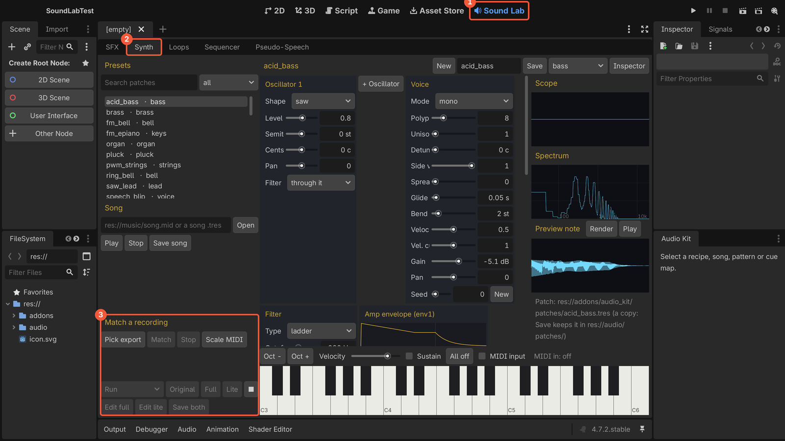

1. Click **Sound Lab** at the top of the editor.
2. Open the **Synth** page.
3. **Match a recording** is at the bottom of the left column, under the **Library** and **Song**. If you can't see it all, make the editor window taller.

The screenshots were taken when the **Library** was still a plain preset list; the match panel itself hasn't changed.

### Step 1: write the test notes

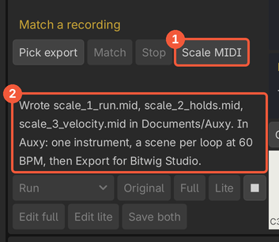

1. Click **Scale MIDI** (1) and choose a folder, such as one you share with your phone through iCloud Drive or AirDrop.
2. The message (2) lists the three MIDI files it wrote:
   - `scale_1_run.mid`: every note from F#7 down to G2, one after another.
   - `scale_2_holds.mid`: long notes from C7 down to C3, fast repeats and an arpeggio.
   - `scale_3_velocity.mid`: one note played softly and hard, short and long.

Between them they show the tool how the sound changes up the keyboard, how it rings on after you let go, and how it reacts to playing harder.

### Step 2: play them in Auxy and export

There's no screenshot for this step, because it happens in Auxy:

1. Start a new project at **60 BPM** with one instrument: the sound you want to match.
2. Import the three MIDI files as loops, **one per scene, in order** (run, holds, velocity). Make each scene **8 bars**.
3. Turn off the project's effects (reverb, delay) if you can. The match copies the instrument, not the room.
4. Export with **Export for Bitwig Studio**, and get the `.axbw` file to your computer.

The export holds the MIDI and the audio together, lined up to the millisecond, so the tool knows exactly where every note is. Any other export (a song, several instruments, a missing scene) is refused, with a message saying what's wrong.

### Step 3: match it

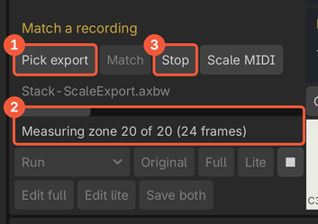

1. Click **Pick export** (1) and choose your `.axbw`. Its name appears under the buttons; then click **Match**.
2. The progress bar and message (2) show what it's doing: lining up the notes, finding the pitch, measuring the sound in zones up the keyboard, then fitting the lite patch.
3. It takes 20 to 60 seconds. The editor stays usable while it works, and **Stop** (3) cancels it.

### Step 4: listen and compare

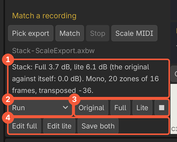

1. The message (1) gives the scores. Lower is closer: each one measures how far the copy's harmonics are from the recording's, note by note. Under 5 dB is very close; 5 to 9 dB is a good copy. The original against itself shows the best score possible (a sound with random movement can't reach 0).
2. It also says what it found: mono or stereo, how many zones the full patch has, and the transposition (how many semitones the sound sits from the notes played).
3. Pick a passage (2), **Run**, **Holds** or **Velocity**, then click **Original**, **Full** or **Lite** (3) to hear it. **■** stops playback. Listen to the Original and then each copy, passage by passage.

The **full** patch has a separate recorded tone for every few notes up the keyboard, so it follows the original closely everywhere. The **lite** patch has one tone, shaped by a filter, an EQ and a level for each part of the keyboard. It's smaller and easier to edit, and usually a little further from the original at the top and bottom of the keyboard. The match also finds and copies detuned layers, vibrato, chorus-like movement, a delay and a reverb when the recording has them.

### Step 5: open a patch in the editor

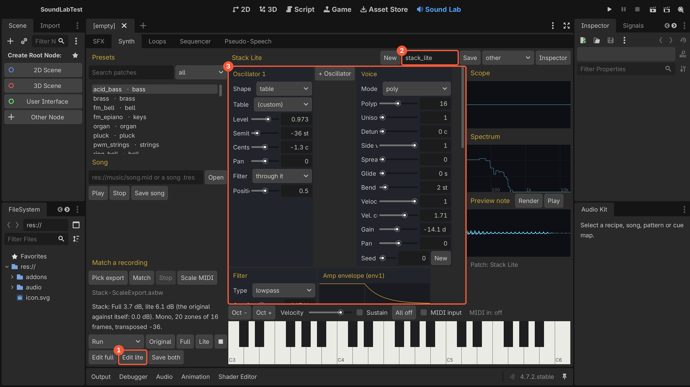

1. Click **Edit lite** (1), or **Edit full**. The patch opens in the Synth page's panels, named after the export (2), and you can play it from the keyboard straight away.
2. Every panel works as in the Synth tutorial (3). The oscillator's shape is **table**, holding the recorded tone. On the lite patch, try the **Filter** and **Amp envelope (env1)** panels first: they make the biggest difference.

### Step 6: save both

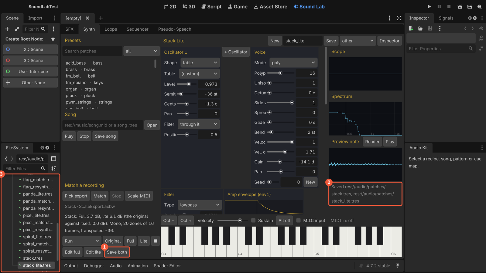

1. Click **Save both** (1). The message (2) confirms that both were saved to `res://audio/patches/`: `stack.tres` (full) and `stack_lite.tres` (lite), named after the sound.
2. They're in your project (3), and in the **Library** among your patches. Use them like any patch: in a loop, a song, or an `AKSynthStream` in your game.

If you edited the patch first, **Save** in the patch toolbar saves your edits over it; **Save both** saves the match as it came out, over any edits.

### Tips

- Match several sounds and compare their scores: plucks, keys and basses usually match closely; sounds that change by themselves while held (wobbles, noise, moving effects) score higher, because the copy can only follow what's the same each time.
- Pick the patch by ear, not by score: sometimes the lite patch sounds just as good where you'll play it.
- If the score is high only at the ends of the keyboard, you may never play those notes. Your game will sound the same.

## 10. The synth's toolbox: an evolving pad

Tutorial 2 built a bass from two oscillators, a filter and an envelope. The synth goes a long way past that, and this tutorial is a tour of the rest: unison and wavetables, a second filter, LFOs, the modulation matrix, macros, effects, and the arpeggiator. You build a slow, breathing pad that changes vowel as it's held, opens up when you push the mod wheel, and has one knob for "brightness", in about twenty minutes. It needs the native core to play live.

This tutorial has no screenshots yet; the panels are named as they are on the page.

### What the synth has

Every patch, whether you make it here, on the Flavor page or with a converter, is built from the same parts. The full reference is `docs/synth.md`.

| Part | What you get |
| --- | --- |
| **Oscillators** | Up to 16. Shapes: sine, triangle, saw, square, pulse (with width), noise (white, pink or red), **morph** (sine → triangle → saw → square), **table** (wavetables: six built in, your own, or key-zoned tables taken from a recording) and **pd** (Casio CZ phase distortion). Each has a level, a tuning in semitones and cents, a pan, and which filter it goes through. Between oscillators: **FM** (phase, pitch or linear; several modulators per oscillator, feedback, DX7-style operators with their own envelopes), **hard sync** and **ring modulation** |
| **Thickness** | **Unison** up to 16 copies of every oscillator, detuned and spread across the stereo field, with the side voices' level and an interval for every other copy (octaves, fifths). Per oscillator, a **stack** of up to 16 detuned copies of that one oscillator. Seeded random start phases, so a patch always sounds the same |
| **Filters** | Two, in series or parallel. State-variable low-pass, high-pass, band-pass and notch at 12 or 24 dB; a four-pole **ladder** with resonance up to self-oscillation, drive and 1–4 poles (or any pole mix); a diode mode; a `mix` type that morphs low-pass → notch → high-pass; low, high and bell shelves; **allpass**; **comb**. Also a feedback loop around the filter block, soft saturation after it, a gentle pre-filter, and a comb tuned to the note |
| **Envelopes** | Up to eight. Each can be an **ADSR** (with an exponential decay and a two-stage release), **stages** (up to 32, each with its own curve, a sustain stage, loops, times that follow the key or velocity), a **DX7** envelope or a **CZ** envelope, in those synths' own values |
| **LFOs** | Up to eight. Sine, triangle, saw, square (with width), random, smooth random, or a **custom** shape you draw (also usable as a one-shot drawn envelope). A fade-in delay, a start phase, free-running or restarting with each note, and **tempo sync** (`1/4`, `1/8.`, `1/16t` ...) |
| **Modulation matrix** | Up to 32 rows of source → destination × amount, each optionally multiplied by one or two more sources. Sources: the envelopes, the LFOs, velocity, key, mod wheel, aftertouch, pitch bend, a random value per note and four **macros**. Destinations: pitch, both filters' cutoff and resonance, amp, pan, filter feedback, every oscillator's pitch, level, FM depth, pulse width and wavetable position, the LFOs' rates, the comb, and envelope times |
| **Playing** | Poly (up to 32 voices), mono or legato with last, low or high note priority; glide; bend range; velocity sensitivity and curve; a level by key; an **arpeggiator** (up, down, up-down, random; 1–4 octaves; synced rate and gate); per-voice pan and analogue-style "slop" |
| **Effects** | In any order: chorus, flanger, phaser, three-band EQ, compressor, saturation, pitch shift, ring modulator, growl, bit crusher, delay (stereo, cross or ping-pong, tempo-synced), reverb (with predelay and filters), a filter and a limiter. The first six and the limiter also run on Godot buses, sounding the same |
| **Converters** | Patches from the DX7, Casio CZ, Synth1, TAL-NoiseMaker, Helm, OB-Xd/OB-Xf and Surge XT become patches like any other (`tools/patch_convert/README.md`), and the patch library holds 21,817 of them (tutorial 11) |

Whatever you build plays live and bakes to exactly the same samples, and every edit is heard while notes are held.

### Step 1: two oscillators, made wide

1. On the **Synth** page, click **New**. You get one saw.
2. Click **+ Oscillator**. In **Oscillator 2**, set **Shape** to **table**, pick the **vowel** wavetable, set **Semitones** to **12** (an octave up) and **Level** to **0.5**. **Position** chooses where in the table it reads: drag it from 0 to 1 while holding a note and the tone moves through a, e, i, o, u.
3. Put **Position** back to **0**. An LFO will move it in Step 4.
4. In **Voice**, set **Unison** to **4**, **Detune** to **18 c** and **Spread** to **0.8**. Every oscillator is now four slightly detuned copies spread left and right: the sound gets wide and shimmering. **Side voices** lower than 1 keeps a solid centre with a quieter shimmer around it.

### Step 2: two filters

1. In **Filter**, set **Type** to **lowpass**, **Cutoff** to **1500 Hz**, **Q** to **1.5** and **Slope** to **24**. The pad goes soft.
2. In **Filter 2**, set **Type** to **highpass** and **Cutoff** to **150 Hz**, with the routing on **series**. The low mud goes, which matters when a pad plays under other parts. In **parallel** the two filters would run side by side instead, and each oscillator's **Filter** menu could send it through one, the other, or both.

### Step 3: a slow envelope

In **Amp envelope (env1)**, set **Attack** to **0.8 s**, **Decay** to **1 s**, **Sustain** to **0.8** and **Release** to **1.5 s**. Notes now swell in and fade out slowly. For a shape an ADSR can't draw (a swell, a dip, then a second swell), switch **Mode** to **stages**: each stage has its own time, level and curve.

### Step 4: LFOs and the modulation matrix

An LFO is a slow wave that moves another setting. The matrix connects them: each row is "source → destination × amount".

1. In **LFO 1**, set **Shape** to **triangle** and **Rate** to **0.15 Hz** (one sweep every seven seconds).
2. In **LFO 2**, set **Shape** to **sine** and **Rate** to **0.3 Hz**.
3. In **Modulation matrix**, click **+ Row** twice and set:

   | Source | Destination | Amount | What you hear |
   | --- | --- | --- | --- |
   | lfo1 | osc2.position | 0.8 | Oscillator 2 slowly changes vowel |
   | lfo2 | cutoff | 0.6 | The filter breathes, 0.6 of an octave either way |

4. Hold a chord for ten seconds. The pad moves on its own, and because the two LFOs run at different rates, it never quite repeats.

### Step 5: vibrato on the mod wheel

1. Click **+ LFO**. In **LFO 3**, set **Shape** to **sine**, **Rate** to **5.5 Hz** and **Delay** to **0.4 s**, so the vibrato fades in after each note starts.
2. Add a matrix row: **lfo3 → pitch**, amount **0.3**, and set its **×** menu to **mod_wheel**. The row's amount is now multiplied by the wheel: no vibrato at rest, a gentle one with the wheel up.
3. Tick **MIDI input** and move your keyboard's mod wheel (or joystick) while holding a note.

The **×** menu works on any row: `velocity` makes a row follow how hard you play, `key` makes it stronger up the keyboard, and an envelope fades it in or out over the note.

### Step 6: one knob for brightness

**Macros** are four knobs (macro1 to macro4) that you route through the matrix like any other source, so one knob can move several settings at once.

1. Add two rows: **macro1 → cutoff**, amount **2**; and **macro1 → lfo2.rate**, amount **2**.
2. In **Macros**, turn knob 1 up while holding a chord. The filter opens by up to two octaves and its breathing speeds up, both from one move. A game can set a macro from code too (`patch.macros = [0.7, 0, 0, 0]` then `patch.emit_changed()`), and held notes carry on.

### Step 7: effects

1. Click **Add effect** and choose **chorus**. The defaults add a slow movement that thickens the pad further.
2. Add a **delay**: **Time** **375 ms**, **Feedback** **0.4**, **Mix** **0.2**.
3. Add a **reverb**: **Room** **0.85**, **Mix** **0.35**.
4. Use **↑** and **↓** to try them in another order. Reverb last is usual; a delay after the reverb gives echoes of a big room instead.

Try the others on the same pad: **phaser** and **flanger** for sweeps, **saturate** for warmth, **crush** for lo-fi grit, **pitch** (a copy an octave down blended in), **ring** for metal, **eq** and **compressor** to sit it in a mix, and **limiter** last to cap the peaks.

### Step 8: tempo sync and the arpeggiator

A few settings have no panel yet. Click **Inspector** to show the patch in Godot's inspector, or open the saved `.tres` in a text editor:

- **Tempo-synced LFO.** In `lfo2`, add a key `rate_sync` with the value `"1/2"`: the breathing now follows the tempo (`tempo_bpm`, or the song's), every half note, instead of 0.3 Hz.
- **Arpeggiator.** Set `arp` to `{"mode": "updown", "octaves": 2, "rate": "1/16", "gate": 0.6}`. Held chords now play as a rising and falling pattern in 16ths over two octaves. Set `"on": false` in it to turn it off again without losing the settings.
- **Thicker single oscillators.** Give an oscillator `stack = 5` and `stack_cents = 25` for five detuned copies of just that one.

`docs/synth.md` lists every setting the panels don't show yet.

### Step 9: save it

Type **evolving_pad** as the name, set the category menu to **pad**, and click **Save**. It goes to `res://audio/patches/evolving_pad.tres` and into the **Library** among your patches. Play it in a game as in tutorial 2, Step 8.

### Going further

Load these presets from the **Library** (filter **Source** to **kit**) and open their panels to see the other techniques at work:

| Preset | Shows |
| --- | --- |
| `fm_epiano`, `fm_bell` | FM: a sine modulating another sine |
| `sync_lead` | Hard sync swept by an envelope and the mod wheel |
| `ring_bell` | Ring modulation |
| `vowel_pad`, `pwm_strings` | Wavetables swept by an LFO |
| `acid_bass`, `wobble_bass` | A resonant, driven ladder; an LFO on the cutoff |
| `strings`, `wavetable_pad` | Unison spread with a chorus |

For DX7-style FM (six operators, algorithms, the DX7's envelopes) and Casio CZ phase distortion, pick a converted patch from the library with **Source** set to **dx7** or **cz** and press **Op** on its oscillators.

## 11. The libraries: find a patch and a drum kit

The kit has two big libraries that live outside your project: a **patch library** of converted synth patches (21,817 from Synth1, Surge XT, OB-Xd/OB-Xf, TAL-NoiseMaker, Helm, the DX7 and the Casio CZ) and a **drum library** of sampled drum machines (48,245 sounds and 2,431 kits from 470 machines). In this tutorial you point the Sound Lab at both, find a pad and a drum kit, rate them, and copy them into your project so a game can play them, in about ten minutes.

This tutorial has no screenshots yet.

The libraries are folders on your computer, built by the kit's tools from patch banks and sample collections you supply; they aren't in the repository. Without them, the Synth page's **Library** still lists the kit's presets, the General MIDI bank and your own patches, and the Loops page has the kit-made sound library and its five kits. How to build them: `tools/patch_library/README.md` and `tools/drum_prep/README.md` (and tutorial 12 for adding your own drums).

### Step 1: add the patch library

1. On the **Synth** page, click **Library folders…** in the Library, then **Add…**, and pick the folder that holds `gak_library.json`.
2. The first time, it reads the index (about two seconds); after that it uses a cached copy. The folder is kept in the editor settings, so every project on this computer sees it.

### Step 2: find a pad

1. Type `evolving` in **Search**. Search matches names, banks, creators and tags, and the tags describe what each patch does when played: `bright`, `dark`, `short`, `long`, `slow-attack`, `evolving`, `wide`, `metallic`, `sub-heavy` and more (`docs/library.md`).
2. Click **Filters** and set **Category** to **pad**. Each menu shows how many patches each choice leaves, given the others. Try **Source** (the synth it came from) or **Maker** (the hardware it emulates, such as Yamaha or Oberheim) too.
3. Set the sort menu to **Closest to source**: the conversions that sound most like the original synth come first.
4. Double-click a patch to hear it, or click it and play the keyboard. The detail under the list says where it came from, who made it, and how its category was found. A "?" after a category means it was a guess.
5. **Clear** resets the search and every filter.

### Step 3: rate it and keep it

1. Click a star to rate the patch, **♥** to make it a favourite, or **Hide** to get it out of your way. Type your own tags (comma separated, then Enter) and they work in Search. These live in your editor's data folder, not in the patch, so they follow you across projects.
2. Click **Use in project**. The patch is copied to `res://audio/patches/` with a note of where it came from. A game can only load patches inside the project, so do this for any library patch a game plays.
3. Edit it on the panels if you like: a library patch always opens as a copy, so the library never changes.

### Step 4: add the drum library

1. On the **Loops** page, open the **Drums** tab in the browser on the left (beside **Loops** and **Sounds**).
2. Click **Library folders…**, then **Add…**, and pick the folder that holds `gak_drums.json`. It reads the index in about three seconds.

### Step 5: find a kit

1. **Kits / Sounds** at the top switches between whole kits and single sounds. Leave it on **Kits**.
2. Search `909`, or open **Filters** and pick a **Machine**. **Kit type** says how a kit was made: *folder* (the machine's own kit), *assembled* (put together from its sounds), *percussion* or *all*.
3. Click a kit: it plays a two-bar beat at 100 bpm, so you can compare kits quickly. The details give its machine, piece count and whether it has velocity layers.
4. Switch to **Sounds** to look for one drum. The **Category** (kick, snare, clap, hat, cymbal, tom, perc ...), **Kind** (closed hat, ride bell, conga ...) and **Sounds** filters (`punchy`, `dark`, `roomy`, `lo-fi` ...) narrow it down, and **Sure category** hides sounds whose category is a guess.

### Step 6: use it in a beat

1. Open your drum loop from tutorial 3 (`beat_a`), or click **New** → **percussive**.
2. Double-click the kit in the **Drums** tab. It's copied into the project (each WAV to `res://audio/samples/drums/<machine>/` with an `AKSample` beside it, the kit to `res://audio/kits/`) and becomes the loop's instrument. Press **Play**: your beat, on that machine.
3. The kit's rows follow the kit's usual order (kick, snare, clap, hats, toms, cymbals, percussion) and the General MIDI drum names, so a `.mid` drum part or a pad controller plays the right pieces.
4. A single sound double-clicked in the **Sounds** view is copied in too, and becomes the instrument if a sample loop is open. To swap one piece of a kit for it, copy it in, select it in the **Sounds** tab (under **project**, where it appears straight away), and use **Use selected** on the kit's row (tutorial 12, Step 5).

Rate, favourite, hide and tag drums the same way as patches. Copying the same kit again reuses the copy.

### Tips

- **Shuffle** in either sort menu is a good way to discover things you'd never search for.
- Your categories override the library's: pick one in the category menu under a patch, and it's fixed for good.
- The drum collection has no stated licence, so keep it to personal projects. Converted patches carry their banks' own terms.
- After the library is rebuilt, **Library folders…** → **Rebuild indexes** (patches) or reopening the tab (drums) picks up the changes. Ratings and tags survive rebuilds.

## 12. Your own samples: WAV files into instruments and kits

Everything so far was synthesised or came from a library. This tutorial brings in sounds you recorded or downloaded: a WAV of a pitched sound becomes an instrument you play on the Loops grid, and a handful of drum hits become a kit. About fifteen minutes.

This tutorial has no screenshots yet.

### What the kit reads

| Format | Read |
| --- | --- |
| WAV | 8, 16, 24 or 32-bit PCM, 32 or 64-bit float, any sample rate, mono or stereo. A `smpl` chunk's root note and loop are read too |
| AIFF, AIFF-C | The same depths, big- or little-endian, with an `INST` chunk's root note and loop |
| OGG Vorbis | Through Godot's own decoder |

Compressed WAVs (ADPCM) and compressed AIFF-C are refused with a message; convert them to plain WAV first. The format is told from the file itself, so an AIFF file named `.wav` still reads. Stereo stays stereo; a file whose two channels are identical is kept as mono.

### Step 1: put the files in your project

1. Copy your files anywhere under `res://audio/`, for example `res://audio/samples/` (the Sound Lab only looks under `res://audio/`).
2. Godot imports them as usual, and they appear in the Sound Lab's sound list as soon as Godot has noticed them, even if the Sound Lab is already open.

For this tutorial, use one pitched sound (a piano or synth note, a sung "ah", a bass note) and three or four drum hits (a kick, a snare, a closed and an open hat).

### Step 2: make a sample instrument

1. On the **Loops** page, click **New** and choose **sample**. A new sample loop starts with the library's electric piano.
2. Open the **Sounds** tab in the browser on the left, and set its folder menu to **project** to see only your files. Click one to hear it; the waveform appears under the list.
3. Double-click your pitched sound. It becomes the loop's instrument, and an `AKSample` is saved beside it (`ah_c4.wav` → `ah_c4.sample.tres`).

That `.sample.tres` holds the decoded audio, so an exported game plays it without the WAV and without Godot's import compression. It's what you use from now on; picking the WAV again reuses it.

### Step 3: set its root note

The root note is the note the file was recorded at: playing it plays the file as it is, and every other note is the file sped up or slowed down.

1. In the sample panel under the grid, look at **Root**. If the file had a root note in its `smpl` or `INST` chunk, it's that; otherwise the kit measured the pitch when you picked it.
2. Play the root note's row on the grid and compare it with the file (click the file in **Sounds**). If it's off, click **Detect** to measure again, or type the note number yourself (60 is middle C). A strong overtone can fool the measurement, sometimes by an octave, so check by ear.
3. Draw a few notes (a chord, a melody) and press **Play**. Notes far from the root sound chipmunk-like or slow; a sample usually sounds natural within about an octave of its root.

### Step 4: shape how it plays

The sample panel's settings:

- **Mode**: **oneshot** plays the whole file whatever the note's length (good for hits and plucks); **gate** stops at the note's end with a short fade (**Release s**); **loop** repeats a section while the note is held, then releases (good for sustained sounds).
- **Start s** and **End s** trim the file, in seconds (end 0 is the file's end): cut a slow fade-in or silence at the start, so notes land on time.
- **Loop from** and **Loop to** set the repeating section in **loop** mode. Pick a stretch where the sound is steady; if you hear a click at the loop point, move the ends a few milliseconds.
- **Gain dB** sets its level; **Reverse** plays the trimmed sound backwards.

Set **Mode** to **loop**, find a steady stretch, and hold a long note: it sustains for as long as the note lasts. **Save** keeps the loop, with the sample as its instrument.

### Step 5: build a kit from your own hits

1. Click **New** and choose **percussive**. The loop starts with the **punch** kit, and the kit panel under the grid lists its pieces: a row each with its name, its sound, **Use selected**, **dB**, **Pan**, **Tune**, a choke group, **Gate** and **▶**.
2. In **Sounds**, click your kick (once, to select it). On the kit's **kick** row, click **Use selected**. Click **▶** on the row to hear it. The shipped kit isn't changed: your edits make a copy kept in the loop.
3. Do the same for the snare, closed hat and open hat rows.
4. For a sound the kit has no row for, select it in **Sounds** and click **+ Piece**. The new row is named after the file; type a better name in its name box and press Enter. Names from the General MIDI drum map (`kick`, `snare`, `closed_hat`, `open_hat`, `crash`, `ride`, `tom_low` ...) let a `.mid` drum part or a pad controller play the right pieces.
5. Set the hats' choke group to the same word (the punch kit already uses `hats`): a closed hat then cuts an open one off, as on a real hi-hat.
6. Tick **Gate** on a piece to stop it at the note's end instead of letting it ring out (a held open hat).
7. Balance the pieces with **dB** and **Pan**, and retune a hit with **Tune** (by resampling: down is deeper and longer).
8. Type a name and click **Save kit**. It's written to `res://audio/kits/` and appears in the drum loops' **Instrument** menu among yours.

Write a beat on the grid, as in tutorial 3, to hear the kit.

### Step 6 (optional): velocity layers and round-robin

A drum recorded at several strengths, or several times, plays more naturally when the kit picks the recording to match each hit. There's no panel for this yet; open the kit `.tres` in a text editor (or the **Inspector**) and give a piece `layers` instead of one `sound`:

```gdscript
{name = "snare", layers = [
	{sound = "res://audio/samples/snare_soft.sample.tres", up_to = 0.35},
	{sound = "res://audio/samples/snare_mid.sample.tres", up_to = 0.7},
	{sound = ["res://audio/samples/snare_hard_a.sample.tres", "res://audio/samples/snare_hard_b.sample.tres"], up_to = 1.0}]}
```

A hit plays the first layer whose `up_to` reaches its velocity. A list of sounds is a set of takes played in turn (round-robin), so fast repeated hits don't sound like a machine gun. Each WAV needs its `.sample.tres` first: double-click it once in **Sounds** on a sample loop, or make one in code (below). Kits from the drum library that have velocity layers come with them already set up.

### Step 7: in your game, and from code

Loops and kits made from your samples play in arrangements, songs and games like any other (tutorials 3 and 4); bake a loop or a song to a WAV to use it without the kit. In code:

```gdscript
var s := AKSample.new()
s.source = "res://audio/samples/ah_c4.wav"
s.import_source(true)          # decode it; true also reads the file's root note and loop
s.mode = "loop"
ResourceSaver.save(s, "res://audio/samples/ah_c4.sample.tres")

# a recipe that plays it at a pitch, anywhere a recipe goes:
var r := AKRecipe.make(&"sample", {sample = "res://audio/samples/ah_c4.sample.tres", freq_hz = 392.0, gate_s = 0.5})
$Player.stream = AKRecipeStream.of(r)
```

### Tips

- **A whole multisampled instrument** (a WAV of held notes up the keyboard) can become a synth patch instead, one that plays every note from the instrument's own tone: `AKSampleMatch.run_wav`, in `docs/sample_matching.md`.
- **Many sample packs at once.** For a big collection of drum samples, the drum library tools convert, tag, measure and sort them into kits, and the **Drums** tab browses the result (tutorial 11). See "Adding your own collection" in `docs/drums.md`.
- **Size.** The `.sample.tres` holds the audio as text, several times larger than the WAV. For long sounds (loops over a few seconds), trim them before importing, or bake the finished music to a WAV.
- Short, dry recordings make the most flexible instruments: add the room with the kit's reverb rather than baking it in.

## MIDI keyboards and MIDI files in Sound Lab

A MIDI keyboard plays live on three pages: the **Synth** page (tick **MIDI input** under its keyboard; Synth tutorial, Step 6), the **Sequencer** (arm a track with its **●**) and the **Loops** page (tick **MIDI in**); the last two also record what you play (Recording tutorial). The table below is for the Synth page; on the other two, the keys, pads, pitch bend, mod wheel and sustain pedal work the same way, and bend and mod wheel are recorded into synth takes.

### What each control does on the Synth page

The MPK Mini column assumes its factory settings.

| MIDI message | On an MPK Mini | What it does in Sound Lab |
| --- | --- | --- |
| Notes, with velocity | Keys | Play the patch; harder is louder, and brighter if the patch routes velocity to the filter |
| Notes from pads | Pads (notes 36–51) | Play low notes of the patch; they don't trigger drums on this page |
| Pitch bend | Joystick left and right | Bends held notes by the patch's **Bend range** (2 semitones unless you change it) |
| CC 1, mod wheel | Joystick up, or knob K1 | Whatever the patch's matrix routes from **mod_wheel** (nothing unless a row uses it) |
| CC 64, sustain | Sustain pedal jack | Holds notes after you let go |
| Channel pressure (aftertouch) | Not sent by the MPK Mini | The **aftertouch** matrix source, on keyboards that send it |
| CC 7, volume | Knob K7 | The volume of what you're playing |
| CC 120 or 123 | Not on the MPK Mini | Stops all notes, like **All off** |
| Program change | **PROG CHANGE** button | Switches to a General MIDI bank instrument; pick your patch in the **Library** again to get back |

The other knobs (K2 to K6 and K8) do nothing in Sound Lab yet. To make the joystick or K1 do something, add a matrix row with **mod_wheel** as its source (to **cutoff** for a filter sweep, **pitch** for vibrato depth with an LFO, or **amp** for a swell).

### MIDI files

- **Synth page → Song**: type a `.mid` path (or drop the file into your project first) and click **Open**, then **Play**. Each instrument in the file gets a starter General MIDI patch; pick another for any part from its menu, and **Save song** to keep it.
- **Loops page**: the import row turns one part of a `.mid` file (or all its drums) into a loop you can edit (Loops tutorial).
- Any `.mid` file you put in the project imports as a song you can play from game code.

### In your game

To play a patch from a MIDI keyboard while the game runs (for a music toy or a debug tool), add an `AKMidiRouter`:

```gdscript
var router := AKMidiRouter.new()
router.patch = load("res://audio/patches/pluck_bass.tres")
add_child(router)   # opens the MIDI inputs and plays the patch
```

It handles the same messages as the table above. Your `demo/midi/midi_demo.tscn` on `main` is another way to do this, with its own drum pads and instrument switching.

### If notes feel late

The delay between pressing a key and hearing it is set by Godot's audio buffer, about 15 to 30 ms by default. For playing in, lower **Project Settings → Audio → Driver → Output Latency** (turn on **Advanced Settings** to see it).
